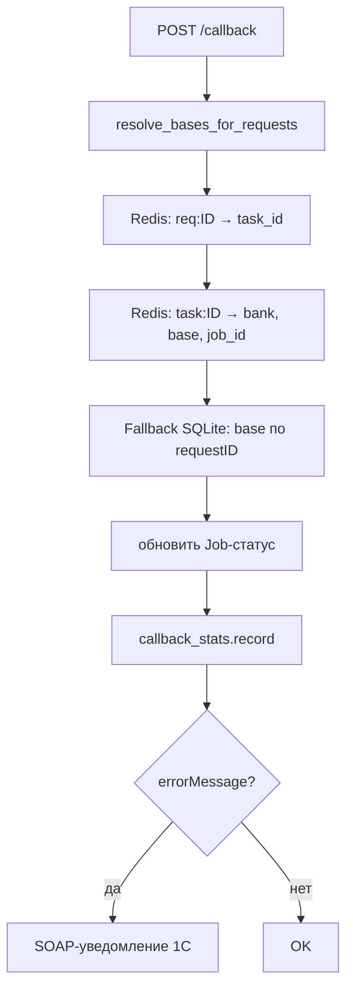

# API SBP MQ

## 🌐 Общее

| Параметр | DEV | PROD |
|----------|-----|------|
| **Базовый URL** | `http://localhost:8512` | `http://localhost:8511` |
| **Swagger UI** | `http://localhost:8512/docs` | `http://localhost:8511/docs` |
| **OpenAPI JSON** | `http://localhost:8512/openapi.json` | `http://localhost:8511/openapi.json` |
| **Документация проекта** | `http://localhost:8512/project-docs` | `http://localhost:8511/project-docs` |

**Формат ответа** — все эндпоинты (кроме отдающих HTML/файлы) возвращают
JSON, обёрнутый `create_response()`:

```json
{
  "status": "SUCCESS",
  "code": "SUCCESS",
  "message": "…",
  "data": { … }
}
```

Поле `status` может быть: `SUCCESS`, `API_ERROR`, `CONFIG_ERROR`,
`UNKNOWN_ERROR` (см. `config.STATUS`).

**Аутентификация** — отсутствует (внутренний сервис).

---

## 🏥 Служебные

### `GET /`

Hello World. Простейший health-check.

```bash
curl http://localhost:8512/
```

**Ответ:**
```json
{"message": "Hello World"}
```

---

### `GET /health`

Быстрый health — «сервер жив».

```bash
curl http://localhost:8512/health
```

**Ответ:**
```json
{"status": "ok", "timestamp": "2026-09-20T17:46:51.255265"}
```

---

### `GET /health/detailed`

Полный healthcheck — 7 компонентов + uptime.

```bash
curl http://localhost:8512/health/detailed
```

**Ответ:**
```json
{
  "status": "ok",
  "version": "1.0.0",
  "timestamp": "2026-09-20T17:46:51.255265",
  "uptime_seconds": 12345,
  "uptime_human": "3h 25m",
  "components": {
    "api":            {"status": "ok"},
    "rabbitmq":       {"status": "ok", "queue": "sbp_mq_dev_queue", "queue_size": 0, "consumers": 3},
    "redis":          {"status": "ok", "host": "localhost:6379", "db": 1,
                        "keys": {"req": 12, "task": 8, "progress": 2, "lock": 0, "processed": 45}},
    "workers":        {"status": "ok", "pattern": "sbp_mq-dev-worker",
                        "active": 3, "total": 3, "services": ["sbp_mq-dev-worker@1.service", …]},
    "callback_stats": {"status": "ok", "connected": true},
    "monitor_ws":     {"status": "ok", "clients": 1},
    "bank_api":       {"status": "ok", "last_check": "2026-09-20T17:45:00", "banks": {"ci": "ok", "sb": "skip", "vtb": "skip"}}
  }
}
```

**HTTP-код:** `200` при `status=ok`, `503` при `status=error`.

---

## 📦 Payload — создание QR

### `GET /create_payload/{base}`

Синхронная отправка файлов на обработку (без MQ).

| Параметр | Тип | Описание |
|----------|-----|----------|
| `base` | string (path) | Имя базы, напр. `zkh_ursv` |

```bash
curl "http://localhost:8512/create_payload/zkh_ursv"
```

---

### `GET /create_payload_mq/{bank}/{base}/{job_id}`

**Главный эндпоинт** — создаёт задачу для банка через RabbitMQ (асинхронно).

| Параметр | Тип | Описание |
|----------|-----|----------|
| `bank` | string (path) | Имя банка: `ci`, `sb`, `vtb` |
| `base` | string (path) | Имя базы |
| `job_id` | integer (path) | ID Job в 1С (уникальный в пределах базы) |

```bash
curl "http://localhost:8512/create_payload_mq/ci/zkh_ursv/123"
```

**Ответ:**
```json
{
  "status": "SUCCESS",
  "code": "SUCCESS",
  "data": {
    "task_id": "job_20260906120000_abc123",
    "bank": "ci",
    "base": "zkh_ursv",
    "job_id": 123,
    "files_count": 1,
    "total_requests": 4,
    "status_url": "/create_payload_mq/ci/zkh_ursv/123/status",
    "result_url": "/queue/result/job_20260906120000_abc123"
  }
}
```

**Ошибки:**
- `CONFIG_ERROR` — неизвестный банк
- `CONFIG_ERROR` — неизвестная база

---

### `GET /create_payload_mq/{bank}/{base}/{job_id}/status`

Проверка статуса Job.

**Ответ (один из 4 вариантов):**

```json
{
  "status": "SUCCESS",
  "data": {
    "bank": "ci", "base": "zkh_ursv", "job_id": 123,
    "status": "pending",     // pending | success | error | not_found
    "file_path": "/sbp/mq_dev/jobs/ci/zkh_ursv/123.json",
    "message": "Job ожидает обработки"
  }
}
```

---

### `GET /create_payload_mq/jobs/pending`

Список ожидающих Job-файлов.

| Параметр | Тип | Обязателен | Описание |
|----------|-----|------------|----------|
| `bank` | string (query) | нет | Фильтр по банку |
| `base` | string (query) | нет | Фильтр по базе |

```bash
curl "http://localhost:8512/create_payload_mq/jobs/pending?bank=ci"
```

---

### `DELETE /create_payload_mq/jobs/clean`

Очистка старых Job-файлов.

| Параметр | Тип | Обязателен | По умолчанию | Описание |
|----------|-----|------------|--------------|----------|
| `days` | integer (query) | нет | 7 | Удалить старше N дней |

```bash
curl -X DELETE "http://localhost:8512/create_payload_mq/jobs/clean?days=30"
```

---

### `GET /stop_payload/{base}`

Блокировка QR-кодов для базы.

| Параметр | Тип | Описание |
|----------|-----|----------|
| `base` | string (path) | Имя базы |

```bash
curl "http://localhost:8512/stop_payload/zkh_ursv"
```

---

### `GET /get_payload/{base}`

⚠️ **Отключён** в `register_routes` (`routes/__init__.py`).
Оставлен для совместимости, но не зарегистрирован.

---

## 🔔 Callback от банка

### `POST /callback`

Принимает массив результатов от банка. Обновляет Job-статусы, ведёт статистику,
при ошибке Job отправляет SOAP-уведомление в 1С.

**Тело запроса:**
```json
[
  {
    "requestId": "req-123456",
    "qrPayload": "QR:abc...",
    "errorMessage": null
  },
  {
    "requestId": "req-123457",
    "qrPayload": null,
    "errorMessage": "payment rejected"
  }
]
```

**Ограничения:** массив ≤ 10 000 элементов.

**Логика обработки:**



```bash
curl -X POST http://localhost:8512/callback \
  -H "Content-Type: application/json" \
  -d '[{"requestId":"req-123","qrPayload":"QR:abc","errorMessage":null}]'
```

---

## 📈 Статистика

### `GET /stats`

JSON-статистика за период.

| Параметр | Тип | Описание |
|----------|-----|----------|
| `hours` | int (query) | Последние N часов |
| `start` | string (query) | Начало периода (ISO) |
| `end` | string (query) | Конец периода (ISO) |
| `base` | string (query) | Фильтр по базе |

```bash
curl "http://localhost:8512/stats?hours=24"
curl "http://localhost:8512/stats?start=2026-09-19T00:00&end=2026-09-20T00:00&base=zkh_ursv"
```

**Ответ:**
```json
{
  "status": "SUCCESS",
  "message": "Статистика за 24 часов",
  "data": {
    "period": {"hours": 24, "start": "…", "end": "…"},
    "total": {"requests": 152, "success": 148, "errors": 4, "files": 12, "soap_calls": 4},
    "bases": {
      "zkh_ursv": {"requests": 100, "success": 98, "errors": 2, "files": 8, "files_processed": 8, "soap_calls": 2, "db_deletes": 0}
    }
  }
}
```

---

### `GET /stats/html`

То же самое, но HTML-страница с карточками баз и файлов. Открывать в браузере:

`http://localhost:8512/stats/html?hours=24`

---

### `GET /clear_db/{minRequestID}`

Удаление из SQLite записей с `requestID < minRequestID`.

```bash
curl "http://localhost:8512/clear_db/1000"
```

---

### `GET /clear_one_db/{RequestID}`

Удаление одной записи по `requestID`.

```bash
curl "http://localhost:8512/clear_one_db/req-123456"
```

---

### `GET /vacuum`

`VACUUM` на SQLite (сжатие БД).

```bash
curl "http://localhost:8512/vacuum"
```

---

## 📡 Мониторинг

### `GET /monitor`

HTML-дашборд мониторинга. Открывать в браузере:

`http://localhost:8512/monitor`

Дашборд подключается к WebSocket `/ws/monitor` и получает realtime-обновления.

---

### `GET /monitor/data`

JSON со снимком мониторинга.

```bash
curl http://localhost:8512/monitor/data | jq .
```

**Ответ:**
```json
{
  "timestamp": "2026-09-20T17:46:51",
  "processing_count": 2,
  "completed_count": 45,
  "processing": [ … ],
  "completed": [ … ],
  "banks": { … },
  "bases": { … },
  "bank_api": { "ci": "ok", "sb": "skip", "vtb": "skip" }
}
```

**Используется деплоем** для проверки: `processing_count == 0` перед рестартом PROD.

---

### `GET /monitor/cards`

HTML-фрагмент с карточками Job (для AJAX-обновления в дашборде).

---

### `WS /ws/monitor`

WebSocket realtime-обновления мониторинга.

**Логика:**

1. Клиент открывает `ws://localhost:8512/ws/monitor`
2. Сервер **сразу** отправляет initial-состояние (JSON):

```json
{
  "timestamp": "2026-09-20T17:46:51",
  "processing_count": 2,
  "completed_count": 45,
  "banks": { … },
  "bases": { … },
  "cards_html": "<div class='job-card'>…</div>",
  "bank_api": { "ci": "ok" }
}
```

3. Далее сервер **broadcast'ит** обновления через `modules/monitor/ws.py` (`ConnectionManager`)
   при событиях:
   - изменение в Job-статусах (от poller'а)
   - изменение `bank_api` (каждые 60 сек, TCP-проверка банков)

**Пример клиента:**

```javascript
const ws = new WebSocket(`ws://${location.host}/ws/monitor`);
ws.onmessage = (e) => {
  const data = JSON.parse(e.data);
  document.querySelector('#cards').innerHTML = data.cards_html;
  document.querySelector('#count').textContent = data.processing_count;
};
```

`ConnectionManager` в `/health/detailed` показывает `clients: N` (число активных).

---

## 🧪 Mock API (TEST_MODE=true)

Включается только при `TEST_MODE=true` (DEV по умолчанию).
Позволяет тестировать MQ-пайплайн **без реального банка**.

### `POST /mockapi/qr-code`

Принимает массив запросов, отвечает `202 Accepted` + массив `PayloadItem`.

**Тело:**
```json
[
  {
    "requestId": "req-1",
    "amount": 15000,
    "qrTtl": 129600,
    "persAcctIvc": "12345",
    "period": "092026",
    "paymentPurpose": "Оплата ЖКХ",
    "serviceCode": "ZKH"
  }
]
```

**Поля `QRCodeRequestItem`:**

| Поле | Тип | Обяз. | Описание |
|------|-----|-------|----------|
| `requestId` | str | ✅ | ID запроса |
| `retailer` | str | — | Точка продаж |
| `amount` | int | — | Сумма (в копейках). Если < 0 → 400 |
| `qrTtl` | int | — | Время жизни QR (мин), по умолч. 129600 |
| `persAcctIvc` | str | — | Л/с в ИВЦ |
| `persAcctGis` | str | — | Л/с в ГИС |
| `period` | str | — | Период в формате `ММГГГГ` |
| `paymentPurpose` | str | — | Назначение платежа |
| `payerAddress` | str | — | Адрес плательщика |
| `serviceCode` | str | — | Код услуги |
| `redirectUrl` | str | — | URL редиректа |

**Ответ `202`:**
```json
[
  {"requestId": "req-1", "qrPayload": "QR:abc…", "errorMessage": "accepted"}
]
```

```bash
curl -X POST http://localhost:8512/mockapi/qr-code \
  -H "Content-Type: application/json" \
  -d '[{"requestId":"req-1","amount":15000}]'
```

---

### `GET /mockapi/qr-code`

Аналог POST, но через GET. Также возвращает `PayloadItem[]`.

**Особенность:** если `requestId` начинается с `err` — вернёт `qrPayload: null` и `errorMessage`.

---

### `PATCH /mockapi/qr-code/block`

Мок блокировки QR. Принимает тот же массив, отвечает `202`.

---

## 📖 Документация

### `GET /project-docs`

HTML-индекс всей документации (`docs/*.md`).

### `GET /project-docs/{name}`

Рендер конкретного `.md` в HTML. Mermaid-диаграммы рендерятся на клиенте.

Примеры:
- `/project-docs/architecture`
- `/project-docs/deployment`
- `/project-docs/modules/monitor`

Защита от path traversal: `..` игнорируется, выход за `docs/` → 404.

---

## 📐 Модели (Pydantic)

### `PayloadItem`

```python
class PayloadItem(BaseModel):
    model_config = ConfigDict(extra='ignore')
    requestId: str
    qrPayload: Optional[str] = None
    errorMessage: Optional[str] = None
```

Используется в `/callback` (тело) и `/mockapi/qr-code` (ответ).

### `QRCodeRequestItem` / `QRCodeRequest`

Только в `routes/mockapi.py` (см. выше).

---

## 🗂 Сводная таблица

| Метод | Путь | Группа |
|-------|------|--------|
| GET | `/` | служебные |
| GET | `/health` | служебные |
| GET | `/health/detailed` | служебные |
| GET | `/create_payload/{base}` | payload |
| GET | `/create_payload_mq/{bank}/{base}/{job_id}` | payload |
| GET | `/create_payload_mq/{bank}/{base}/{job_id}/status` | payload |
| GET | `/create_payload_mq/jobs/pending` | payload |
| DELETE | `/create_payload_mq/jobs/clean` | payload |
| GET | `/stop_payload/{base}` | payload |
| POST | `/callback` | callback |
| GET | `/stats` | статистика |
| GET | `/stats/html` | статистика |
| GET | `/clear_db/{minRequestID}` | статистика |
| GET | `/clear_one_db/{RequestID}` | статистика |
| GET | `/vacuum` | статистика |
| GET | `/monitor` | мониторинг |
| GET | `/monitor/data` | мониторинг |
| GET | `/monitor/cards` | мониторинг |
| WS | `/ws/monitor` | мониторинг |
| POST | `/mockapi/qr-code` | mock |
| GET | `/mockapi/qr-code` | mock |
| PATCH | `/mockapi/qr-code/block` | mock |
| GET | `/project-docs` | docs |
| GET | `/project-docs/{name}` | docs |

**Отключённые:** `GET /get_payload/{base}`, `routes/test.py` (`/test_all`, `/debug_routes`, `/test_app_routes`).

---

## 🔗 Связанные документы

- [architecture.md](architecture.md) — слои, модули, потоки
- [monitoring.md](monitoring.md) — детально про `/monitor` и `/ws/monitor`
- [soap_integration.md](soap_integration.md) — SOAP при ошибках Job
- [workflows/create_job.md](workflows/create_job.md) — пошаговый сценарий
- [workflows/callback_flow.md](workflows/callback_flow.md) — callback от банка