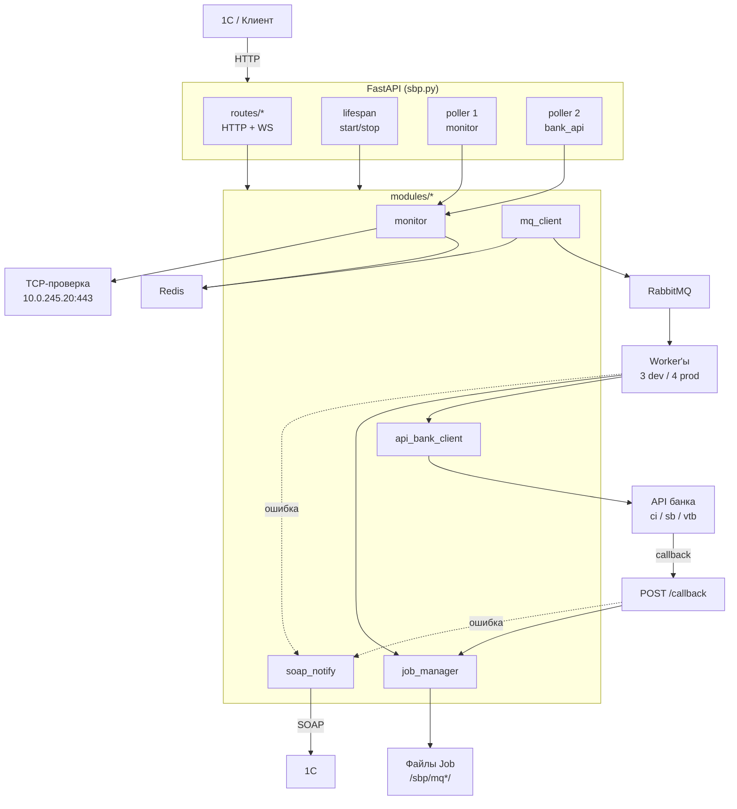
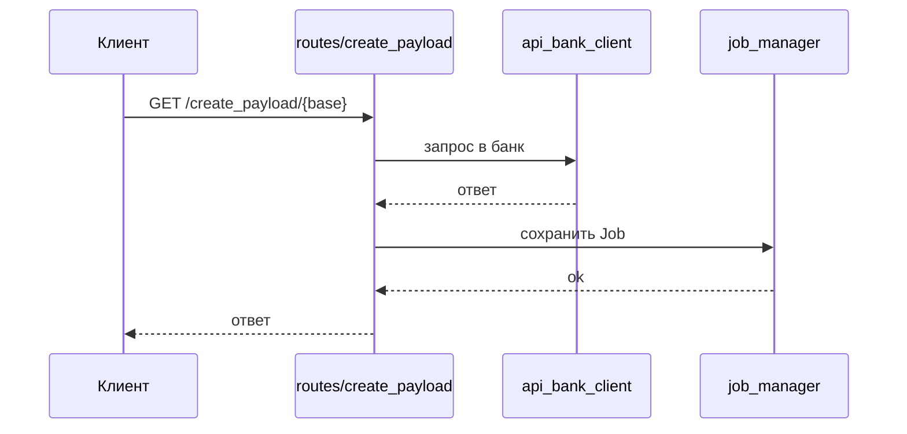
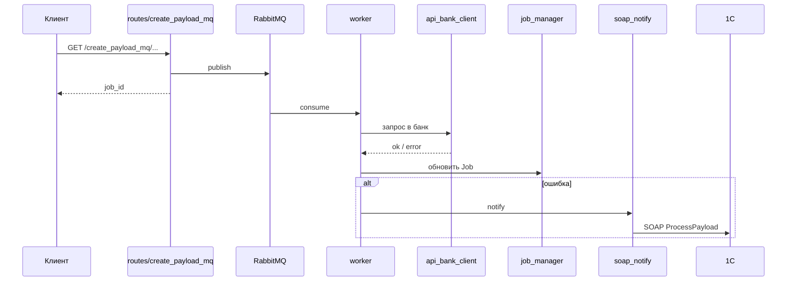
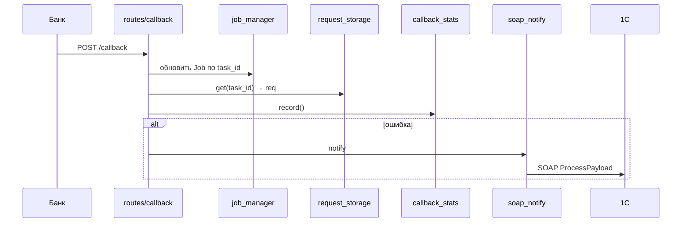
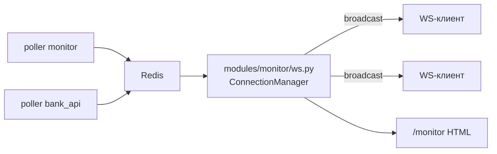
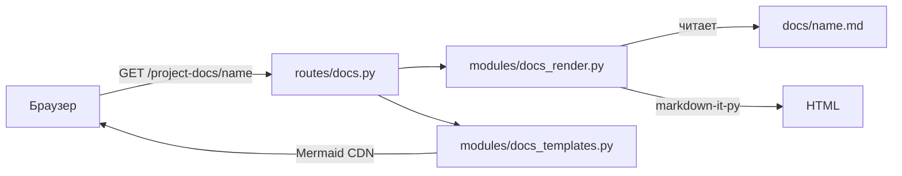

# Архитектура SBP MQ

## 🎯 Назначение

Сервис принимает запросы на создание **QR-кодов СБП**, отправляет их в банк,
обрабатывает асинхронные **callback'и** от банка через RabbitMQ, ведёт Job-файлы
и отдаёт статистику/мониторинг через HTTP + WebSocket. При ошибке Job
отправляет **SOAP-уведомление в 1С**.

## 🏗 Общая схема



<details>
<summary>ASCII-версия схемы (для терминала)</summary>

```
1С/Клиент ──HTTP──▶ FastAPI (sbp.py)
                       │
       ┌───────────────┼───────────────┐
       ▼               ▼               ▼
   routes/*       lifespan        poller ×2
       │               │               │
       └───────┬───────┴───────┬───────┘
               ▼               ▼
          modules/*       modules/monitor
       ┌───────┼───────┐       │
       ▼       ▼       ▼       ▼
   job_mgr  mq_cli  bank_cl  Redis
       │       │       │
       ▼       ▼       ▼
    Файлы   Rabbit  API банка
    Job       MQ       │
               │       │ callback
               ▼       ▼
            Worker ──▶ POST /callback
               │            │
               └── ошибка ──┴──▶ soap_notify ──SOAP──▶ 1С
```

</details>

## 🧱 Слои

### 1. HTTP / WebSocket слой (`routes/`)

- FastAPI-роутеры, по одному файлу на группу эндпоинтов
- Тонкие — бизнес-логика в `modules/`
- Регистрация — единая точка: `routes/__init__.py` → `register_routes(app)`
- **Файлы:** `main`, `health`, `create_payload`, `create_payload_mq`, `callback`,
  `monitor`, `stats`, `stop_payload`, `clear_db`, `get_payload`, `mockapi`,
  `test`, `docs`

### 2. Бизнес-логика (`modules/`)

| Модуль | Ответственность |
|--------|-----------------|
| `job_manager/` | Создание / чтение / обновление Job-файлов |
| `api_bank_client/` | HTTP-клиенты банков (ci, sb, vtb) + factory + legacy |
| `mq_client/` | RabbitMQ (publish/consume) + Redis (req→task_id, TTL) |
| `worker/` | Обработка задач из очереди |
| `monitor/` | Дашборд, WS, TCP-проверка банков |
| `soap_notify.py` | SOAP-уведомление 1С при ошибке Job |
| `common_soap.py` | Общий SOAP-клиент (zeep) |
| `callback_stats.py` | Статистика callback'ов |
| `request_storage.py` | `req:*` → `task_id` в Redis |
| `sbp_root.py` | Умные пути банков |
| `db.py` | SQLite (история) |
| `stats.py` | Агрегация статистики |
| `docs_render.py` | Рендер `docs/*.md` в HTML |
| `docs_templates.py` | HTML-шаблоны для `/project-docs` |

### 3. Данные

- **Redis** — оперативное состояние (`req:*`, счётчики, каналы WS)
- **RabbitMQ** — очередь задач (`sbp_mq_queue` / `sbp_mq_dev_queue`)
- **Файлы Job** — `/sbp/mq/jobs/` (prod), `/sbp/mq_dev/jobs/` (dev)
- **SQLite** — история callback'ов (`requests.db`)

## 🔄 Потоки данных

### 1. Создание задачи (синхронно)



### 2. Создание задачи (через MQ)



### 3. Callback от банка



### 4. Мониторинг (realtime)



### 5. Просмотр документации



## 🧬 Два окружения (worktree)

```
/var/www/html/sbp_mq       [main]   PROD  8511  Redis 0  sbp_mq_queue
/var/www/html/sbp_mq_dev   [dev]    DEV   8512  Redis 1  sbp_mq_dev_queue
```

**Один `.git`** — два рабочих дерева (`git worktree`).
Различия — **только через `.env`**. `config.py` читает переменные и
выставляет `IS_DEV` / `IS_PROD`, `WORKER_PATTERN`, `SERVICE_PREFIX` и т.д.

Подробнее — [deployment.md](deployment.md) и [git_workflow.md](git_workflow.md).

## 📦 Ключевые зависимости

- **Web:** FastAPI + uvicorn + starlette
- **WS:** `websockets==17.1`
- **MQ:** `aio-pika`
- **Redis:** `redis` (async)
- **SOAP:** `zeep` + `lxml`
- **HTTP:** `httpx` + `requests`
- **Docs:** `markdown-it-py` + `mdit-py-plugins`
- **Debug:** `debugpy` (5679 prod / 5680 dev)

## 🗂 Структура проекта (DEV)

```
sbp_mq_dev/
├── config.py                ← ЕДИНЫЙ ИСТОЧНИК конфигурации
├── sbp.py                   ← FastAPI + lifespan + 2 poller'а
├── run_worker.py            ← запуск воркера
├── run_debug.sh             ← параметризован (по имени папки)
├── deploy.sh                ← обёртка для sh_prod/deploy_to_prod.sh
├── requirements.txt
├── job_example.json         ← пример Job-файла
├── settings.json
├── .env                     ← (не в git)
├── models/
│   └── schemas.py
├── modules/
│   ├── api_bank_client/     ← клиенты банков (ci, sb, vtb) + factory + legacy
│   ├── job_manager/         ← управление Job-файлами (5 файлов)
│   ├── monitor/             ← дашборд, WS, bank_api (6 файлов)
│   ├── mq_client/           ← RabbitMQ + Redis (6 файлов)
│   ├── worker/              ← воркеры (6 файлов)
│   ├── docs_render.py       ← рендер docs/*.md → HTML
│   ├── docs_templates.py    ← HTML-шаблоны /project-docs
│   ├── soap_notify.py       ← SOAP при ошибке Job
│   └── ... (см. таблицу выше)
├── routes/
│   ├── docs.py              ← /project-docs
│   ├── health.py            ← /health, /health/detailed
│   ├── monitor.py           ← /monitor, /ws/monitor
│   ├── create_payload_mq.py ← MQ-задачи
│   └── ... (см. api.md)
├── sh_common/               ← общие скрипты
├── sh_dev/                  ← dev-скрипты
├── sh_prod/                 ← prod-скрипты
├── docs/                    ← эта документация
│   └── *.md
├── logs/                    ← не в git
├── data/                    ← не в git
└── .venv/                   ← не в git
```

## 🔗 Связанные документы

- [api.md](api.md) — все эндпоинты HTTP + WebSocket
- [configuration.md](configuration.md) — `config.py` + `.env`
- [deployment.md](deployment.md) — деплой dev → prod
- [monitoring.md](monitoring.md) — как устроен мониторинг
- [soap_integration.md](soap_integration.md) — SOAP в 1С
- [git_workflow.md](git_workflow.md) — worktree, ветки
- [modules/](modules/) — детали по модулям