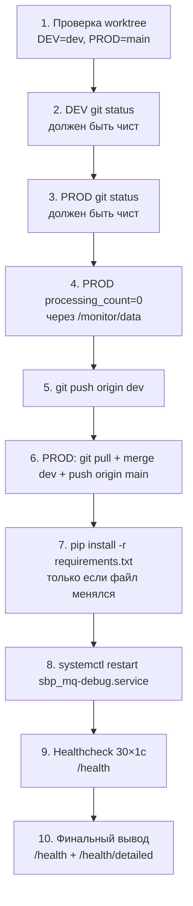

# Деплой SBP MQ

## 🎯 Общая модель

Проект использует **git worktree** — один `.git`, две рабочие директории,
привязанные к двум ветками:

```
/var/www/html/sbp_mq       [main]   ← PROD
/var/www/html/sbp_mq_dev   [dev]    ← DEV
```

Проверить:

```bash
git worktree list
```

```
/var/www/html/sbp_mq      2b2f5aa [main]
/var/www/html/sbp_mq_dev  85e16e1 [dev]
```

### Таблица различий

| Параметр | DEV | PROD |
|----------|-----|------|
| **Путь** | `/var/www/html/sbp_mq_dev` | `/var/www/html/sbp_mq` |
| **Ветка** | `dev` | `main` |
| **HTTP порт** | 8512 | 8510 |
| **debugpy порт** | 5680 | 5679 |
| **Redis DB** | 1 | 0 |
| **RabbitMQ queue** | `sbp_mq_dev_queue` | `sbp_mq_queue` |
| **Папка Job** | `/sbp/mq_dev/jobs/` | `/sbp/mq/jobs/` |
| **Сервис HTTP** | `sbp_mq-dev.service` | `sbp_mq-debug.service` |
| **Воркеры** | `sbp_mq-dev-worker*` (3) | `sbp_mq-worker*` (4) |
| **TEST_MODE** | `true` (мок банка) | `false` (реальный банк) |
| **LOG_NAME** | `sbp-dev` | `sbp` |

**Все различия — только через `.env`.** `config.py` читает переменные и
выставляет `IS_DEV` / `IS_PROD`, `WORKER_PATTERN`, `SERVICE_PREFIX` автоматически.

Подробнее — [configuration.md](configuration.md).

---

## 🚀 Обычный деплой dev → prod

### Команда

```bash
cd /var/www/html/sbp_mq_dev
./deploy.sh
```

`deploy.sh` — тонкая обёртка над `sh_prod/deploy_to_prod.sh`, просто передаёт
аргументы и вызывает из правильной директории.

### Что делает `deploy_to_prod.sh`



### Шаги детально

**1. Проверка worktree**

Убеждается, что `$DEV_DIR` на ветке `dev`, а `$PROD_DIR` на `main`. Если нет —
останавливается.

**2. DEV git status**

В `$DEV_DIR` не должно быть незакоммиченных изменений. Иначе:

```
❌ В dev есть незакоммиченные изменения:
 M some_file.py
```

→ сделать `git add`, `git commit` и повторить деплой.

**3. PROD git status**

В `$PROD_DIR` тоже должно быть чисто. Если что-то осталось от прошлого
незавершённого деплоя:

```bash
cd /var/www/html/sbp_mq
git checkout -- .
```

**4. PROD не обрабатывает задачи**

Проверяет `processing_count` через `/monitor/data` на PROD. Если > 0 — ждём
завершения. Иначе:

```
❌ Prod обрабатывает 3 заданий!
```

Проверить вручную:

```bash
curl -s http://localhost:8510/monitor/data | jq .
```

**5. Push dev → GitHub**

```bash
cd $DEV_DIR
git push origin dev
```

**6. Merge dev → main в PROD**

```bash
cd $PROD_DIR
git pull origin main
git merge dev
git push origin main
```

⚠️ **PROD привязан к ветке `main` через worktree** — `checkout` не нужен.
Merge происходит прямо в рабочей директории PROD.

**7. Установка зависимостей (опционально)**

Скрипт проверяет, менялся ли `requirements.txt` между `HEAD@{1}` и `HEAD`.
Если **не менялся** — pip install **пропускается** (быстро).

Если менялся — `pip install -r requirements.txt` с **timeout 120 сек**.
По таймауту — предупреждение, деплой продолжается.

**8. Перезапуск PROD**

```bash
sudo systemctl restart sbp_mq-debug.service
```

**9. Healthcheck 30×1с**

Ждёт `HTTP 200` на `http://localhost:8510/health` — до 30 попыток по 1 сек.
Каждые 5 попыток печатает текущий код.

**10. Финальный вывод**

```
🎉 ДЕПЛОЙ ЗАВЕРШЁН

PROD (8510) /health:            {"status":"ok",...}
PROD (8510) /health/detailed:   {"status":"ok","queue":"sbp_mq_queue",...}
```

При провале healthcheck — печатает последние 30 строк
`journalctl -u sbp_mq-debug.service` и выходит с кодом 1.

### Пример успешного вывода

```
════════════════════════════════════════
🚀 ДЕПЛОЙ DEV → PROD
════════════════════════════════════════
   DEV_DIR:   /var/www/html/sbp_mq_dev
   PROD_DIR:  /var/www/html/sbp_mq
   DEV_PORT:  8512
   PROD_PORT: 8510

✅ Worktree: DEV=dev, PROD=main
✅ Dev чист
✅ Prod чист
✅ Prod свободен

📤 Push dev → origin/dev
✅ Dev запушен

🔀 Merge dev → main в PROD
✅ Merge выполнен

✅ requirements.txt не менялся — pip install пропущен

🔄 Перезапуск sbp_mq-debug.service

⏳ Ожидание HTTP на порту 8510...
   [1/30] HTTP: 000
   [5/30] HTTP: 000
   [8/30] ✅ HTTP 200

════════════════════════════════════════
🎉 ДЕПЛОЙ ЗАВЕРШЁН
════════════════════════════════════════

PROD (8510) /health:            {"status":"ok",...}
PROD (8510) /health/detailed:   {"status":"ok","queue":"sbp_mq_queue",...}
```

### Откат

Если после деплоя выяснилось, что что-то не так:

```bash
cd /var/www/html/sbp_mq

# посмотреть, что изменилось
git log --oneline -5

# откатить на предыдущий коммит
git reset --hard HEAD~1

# перезапустить prod
sudo systemctl restart sbp_mq-debug.service
```

⚠️ **Внимание:** откат main'а **не откатит** `dev`. Если проблема в коде —
сначала фикс в `dev`, потом заново `./deploy.sh`.

---

## ⚠️ Предусловия для деплоя

| Условие | Как проверить |
|---------|---------------|
| Запуск **из DEV** (`sbp_mq_dev`) | `pwd` → `/var/www/html/sbp_mq_dev` |
| DEV на ветке `dev` | `git -C $DEV_DIR branch --show-current` |
| PROD на ветке `main` | `git -C $PROD_DIR branch --show-current` |
| DEV git status чист | `git -C $DEV_DIR status --short` |
| PROD git status чист | `git -C $PROD_DIR status --short` |
| PROD не обрабатывает задачи | `curl -s http://localhost:8510/monitor/data \| jq .processing_count` |

---

## 🧩 Systemd

### Юниты

| Юнит | Файл | Назначение |
|------|------|------------|
| `sbp_mq-dev.service` | `/etc/systemd/system/sbp_mq-dev.service` | **DEV HTTP** (8512) |
| `sbp_mq-dev-worker.service` | `.../sbp_mq-dev-worker.service` | **DEV Worker default** |
| `sbp_mq-dev-worker@.service` | `.../sbp_mq-dev-worker@.service` | **DEV Worker шаблон** (`%i` = N) |
| `sbp_mq-debug.service` | `.../sbp_mq-debug.service` | **PROD HTTP** (8510) |
| `sbp_mq-worker.service` | `.../sbp_mq-worker.service` | **PROD Worker default** |
| `sbp_mq-worker@.service` | `.../sbp_mq-worker@.service` | **PROD Worker шаблон** |

**Старые (планируются к удалению):** `sbp-debug.service` (8510),
`sbp-worker.service` + `sbp-worker@.service`.

### Структура юнита (пример `sbp_mq-dev.service`)

```ini
[Unit]
Description=SBP MQ DEV FastAPI Application with Debug
After=network.target rabbitmq-server.service redis-server.service
Wants=rabbitmq-server.service redis-server.service

[Service]
Type=simple
User=user
Group=user
WorkingDirectory=/var/www/html/sbp_mq_dev

EnvironmentFile=/var/www/html/sbp_mq_dev/.env
Environment="LOG_NAME=sbp-dev"
Environment="PATH=/var/www/html/sbp_mq_dev/.venv/bin:/usr/local/bin:/usr/bin:/bin"

ExecStart=/bin/bash /var/www/html/sbp_mq_dev/run_debug.sh
Restart=always
RestartSec=5
StandardOutput=journal
StandardError=journal

[Install]
WantedBy=multi-user.target
```

Ключевое:
- `EnvironmentFile=.env` — все переменные из `.env` доступны процессу
- `Environment=PATH=...` — venv впереди системного PATH
- `Restart=always` — сервис перезапустится при падении
- `RestartSec=5` — пауза перед перезапуском

### Шаблоны воркеров `@.service`

```ini
# sbp_mq-dev-worker@.service
[Service]
...
Environment="LOG_NAME=dev-worker-%i"
Environment="WORKER_ID=dev-worker-%i"
ExecStart=/var/www/html/sbp_mq_dev/.venv/bin/python -B /var/www/html/sbp_mq_dev/run_worker.py
```

Запуск воркера с конкретным ID:

```bash
sudo systemctl start sbp_mq-dev-worker@1.service
sudo systemctl start sbp_mq-dev-worker@2.service
```

`%i` подставится в `WORKER_ID`, воркер «представится» этим ID при подключении
к RabbitMQ.

### Полезные команды

```bash
# Статус
sudo systemctl status sbp_mq-dev.service
sudo systemctl status sbp_mq-debug.service
sudo systemctl status 'sbp_mq-dev-worker*'
sudo systemctl status 'sbp_mq-worker*'

# Запуск / стоп / рестарт
sudo systemctl restart sbp_mq-dev.service
sudo systemctl stop sbp_mq-dev-worker@1.service

# Логи (в реальном времени)
sudo journalctl -u sbp_mq-dev.service -f
sudo journalctl -u sbp_mq-debug.service -f
sudo journalctl -u 'sbp_mq-dev-worker*' -f

# Логи за период
sudo journalctl -u sbp_mq-dev.service --since "1 hour ago"
sudo journalctl -u sbp_mq-dev.service -n 100 --no-pager

# Автозапуск
sudo systemctl enable sbp_mq-dev.service
sudo systemctl disable sbp_mq-dev.service

# Перечитать юнит-файлы после правки
sudo systemctl daemon-reload
```

---

## 📜 Скрипты

### `sh_common/` — общие

| Скрипт | Назначение |
|--------|------------|
| `load_env.sh` | Загрузка `.env` в shell-переменные (контракт: `SBP_MQ_PORT`, `DEV_DIR`, `PROD_DIR`, `REDIS_DB`, `RABBITMQ_QUEUE`, `TEST_MODE`) |
| `sbp_mq_service_start.sh` | Запуск/перезапуск `sbp_mq-debug.service` с ожиданием старта + healthcheck |
| `log_show.sh` | Просмотр логов |
| `install-tinyrdm.sh` | Установка tinyrdm (Redis GUI) |
| `README.md` | См. `sh_common/README.md` |

### `sh_dev/` — DEV

| Скрипт | Назначение |
|--------|------------|
| `restart_dev.sh` | Restart `sbp_mq-dev.service` + healthcheck (30×1с) |
| `restart_dev_workers.sh` | Restart `sbp_mq-dev-worker*` |
| `status_dev.sh` | Статус dev-сервисов |
| `health_dev.sh` | Healthcheck (короткий + detailed) |
| `logs_dev.sh` | Логи `sbp_mq-dev.service` (tail) |
| `logs_dev_all.sh` | Логи всех dev-сервисов |
| `reset_dev.sh` | Сброс состояния (Redis DB 1, БД, Job-файлы) |
| `quick_test.sh` | Быстрый smoke-тест |
| `test_create_payload_mq.sh` | Тест `create_payload_mq` |
| `test_monitor_v2.sh` | Тест мониторинга |
| `README.md` | См. `sh_dev/README.md` |

### `sh_prod/` — PROD

| Скрипт | Назначение |
|--------|------------|
| `deploy_to_prod.sh` | **Главный деплой** (см. выше) |
| `restart_prod.sh` | Restart `sbp_mq-debug.service` |
| `restart_prod_workers.sh` | Restart `sbp_mq-worker*` |
| `status_prod.sh` | Статус prod-сервисов |
| `health_prod.sh` | Healthcheck PROD |
| `logs_prod.sh` | Логи `sbp_mq-debug.service` |
| `backup_sbp_mq.sh` | Бэкап `/var/www/html/sbp_mq` → `/var/www/html/backups/` (без остановки сервисов) |
| `restore_sbp_mq.sh` | Восстановление из бэкапа |
| `restore_sbp_mq_with_venv.sh` | Восстановление + пересоздание `.venv` |
| `README.md` | См. `sh_prod/README.md` |

---

## 🔁 Типовые сценарии

### 1. Обычный деплой

```bash
cd /var/www/html/sbp_mq_dev
./deploy.sh
```

### 2. Проверка статуса

```bash
# DEV
./sh_dev/status_dev.sh
./sh_dev/health_dev.sh

# PROD
./sh_prod/status_prod.sh
./sh_prod/health_prod.sh
```

### 3. Просмотр логов

```bash
# DEV
./sh_dev/logs_dev.sh              # tail -f
./sh_dev/logs_dev_all.sh          # все сервисы

# PROD
./sh_prod/logs_prod.sh
sudo journalctl -u sbp_mq-debug.service -f
```

### 4. Рестарт без деплоя

```bash
# HTTP
./sh_dev/restart_dev.sh
./sh_prod/restart_prod.sh

# Workers
./sh_dev/restart_dev_workers.sh
./sh_prod/restart_prod_workers.sh
```

### 5. Бэкап / восстановление PROD

```bash
./sh_prod/backup_sbp_mq.sh
# → /var/www/html/backups/sbp_mq_backup_YYYYMMDD_HHMMSS.tar.gz

./sh_prod/restore_sbp_mq.sh /path/to/backup.tar.gz
```

### 6. Экстренный откат

```bash
cd /var/www/html/sbp_mq
git reset --hard HEAD~1
sudo systemctl restart sbp_mq-debug.service
```

---

## 🆘 Troubleshooting

### ❌ «В dev есть незакоммиченные изменения»

```bash
cd /var/www/html/sbp_mq_dev
git status --short
git add <файлы>
git commit -m "..."
./deploy.sh
```

### ❌ «В prod есть незакоммиченные изменения»

Обычно след от прошлого неудачного деплоя или ручной правки:

```bash
cd /var/www/html/sbp_mq
git status --short
git checkout -- .        # откатить все локальные правки
```

### ❌ «Prod обрабатывает N заданий»

Дождись завершения или проверь:

```bash
curl -s http://localhost:8510/monitor/data | jq .
curl -s http://localhost:8510/health/detailed | jq '.components.workers'
```

### ❌ «pip install timeout (120s)»

Скорее всего проблема с сетью. Ручной запуск:

```bash
cd /var/www/html/sbp_mq
source .venv/bin/activate
pip install -r requirements.txt
```

### ❌ «PROD не поднялся за 30 сек»

Смотрим логи:

```bash
sudo journalctl -u sbp_mq-debug.service -n 100 --no-pager
```

Частые причины:
- синтаксическая ошибка в коде (только что смерженном)
- `.env` не читается
- порт 8510 занят (`sudo lsof -i :8510`)

### ❌ Воркеры не видны в `/health/detailed`

```bash
sudo systemctl status 'sbp_mq-dev-worker*' --no-pager
sudo systemctl status 'sbp_mq-worker*' --no-pager
```

Если «inactive» — запустить:

```bash
./sh_dev/restart_dev_workers.sh
# или
./sh_prod/restart_prod_workers.sh
```

---

## 🔗 Связанные документы

- [architecture.md](architecture.md) — слои, модули, потоки данных
- [configuration.md](configuration.md) — `config.py` + `.env`
- [git_workflow.md](git_workflow.md) — worktree, ветки, push
- [monitoring.md](monitoring.md) — `/health/detailed`, WS, bank_api
- [scripts/sh_common.md](scripts/sh_common.md)
- [scripts/sh_dev.md](scripts/sh_dev.md)
- [scripts/sh_prod.md](scripts/sh_prod.md)