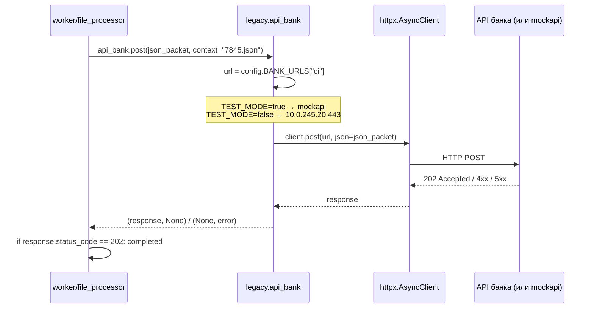

# Модуль `modules/api_bank_client/`

Клиенты для работы с API банков. Плюс `legacy` — старый клиент для
**обратной совместимости**, который **сейчас и используется** в пайплайне.

> 📖 **Общая картина** — [architecture.md](../architecture.md),
> [modules/worker.md](worker.md).

---

## 📁 Структура

```
modules/api_bank_client/
├── __init__.py     36 строк  ← публичный API
├── base.py        107 строк  ← BaseBankClient (ABC)
├── bank_ci.py      85 строк  ← BankCI (рабочий)
├── bank_sb.py     101 строка ← BankSB (заглушка)
├── bank_vtb.py     93 строки ← BankVTB (заглушка)
├── factory.py      42 строки ← create_bank_client
└── legacy.py       96 строк  ← APIBankClient + api_bank (используется!)
```

**Итого:** 560 строк, 7 файлов.

---

## ⚠️ Два поколения клиентов

В модуле **два параллельных API**, и это **важно** понимать:

| | **Новый** | **Legacy** |
|---|-----------|-----------|
| **Класс** | `BaseBankClient` + наследники (`BankCI`, `BankSB`, `BankVTB`) | `APIBankClient` |
| **Создание** | `create_bank_client(bank)` | `api_bank` (singleton) |
| **Метод** | `await client.send_request(data)` | `await api_bank.post(data, context=...)` |
| **URL** | `config.BANK_CONFIG[bank]["url"]` | `config.BANK_URLS["ci"]` (только ci!) |
| **Банки** | `ci` / `sb` / `vtb` | только `ci` |
| **Мультибанк** | ✅ | ❌ |
| **Используется в пайплайне** | ❌ **нигде** | ✅ `worker/file_processor`, `routes/create_payload` |

**Вывод:** практически весь код работает через **legacy** `api_bank`.
Новый `create_bank_client` — **на будущее** (мультибанковость).

План миграции — **TODO** в конце файла.

---

## 🗂 `__init__.py` — публичный API

```python
from .base import BaseBankClient
from .bank_ci import BankCI
from .bank_sb import BankSB
from .bank_vtb import BankVTB
from .factory import create_bank_client, get_bank_names
from .legacy import APIBankClient, api_bank
```

**Что импортируется снаружи:**

| Что | Где используется |
|-----|------------------|
| `api_bank` (legacy) | `worker/file_processor.py`, `routes/create_payload.py` |
| `create_bank_client` | пока **нигде** — только в примерах / тестах |
| `BaseBankClient`, `BankCI`, `BankSB`, `BankVTB` | для типизации |

---

## 🏭 `factory.py` — `create_bank_client`

```python
def create_bank_client(bank: str) -> BaseBankClient:
    bank = bank.lower()
    if bank == "ci":   return BankCI()
    elif bank == "sb": return BankSB()
    elif bank == "vtb":return BankVTB()
    else: raise ValueError(f"Неизвестный банк: {bank}. Доступные: ci, sb, vtb")
```

- **Простой switch** по имени банка
- **Не кэширует** — каждый вызов создаёт новый экземпляр
- **Не читает** `config.BANK_CONFIG[bank]["api_class"]`
  (хотя в конфиге это поле есть — **не используется**)
- `get_bank_names()` → `["ci", "sb", "vtb"]` — **хардкод**, не из конфига

**Использование:**

```python
from modules.api_bank_client import create_bank_client

client = create_bank_client("ci")
response, error = await client.send_request(data)
await client.close()
```

⚠️ **Текущая реализация `BankCI`** при ошибке возвращает `error_response`
со статусом `API_SOAP_ERROR` — это **неправильно**, должно быть `API_ERROR`.
Копипаста между банками (см. Known issues).

---

## 🏦 `base.py` — `BaseBankClient`

Абстрактный класс (ABC). Определяет контракт для всех банков.

### Конструктор

```python
self.bank_name = bank_name
self.base_url = config.BANK_CONFIG.get(bank_name, {}).get('url')
self.timeout = config.REQUEST_TIMEOUT
self.verify_ssl = config.BANK_CONFIG.get(bank_name, {}).get('verify_ssl', False)
self.headers = config.DEFAULT_HEADERS.copy()
self._client: Optional[httpx.AsyncClient] = None
self._is_closed = False
```

- **`base_url`** — из `BANK_CONFIG[bank]["url"]`, который, в свою очередь,
  берётся из `BANK_URLS[bank]` (с подстановкой mockapi в TEST_MODE для ci)
- **`verify_ssl`** — из `BANK_CONFIG[bank]["verify_ssl"]`
- **`headers`** — копия `config.DEFAULT_HEADERS`

### Абстрактные методы

| Метод | Что должен делать наследник |
|-------|----------------------------|
| `async send_request(data)` | POST в API банка, вернуть `(response, None)` / `(None, error_response)` |
| `parse_response(response)` | Разобрать ответ банка в стандартный dict |
| `get_callback_url()` | Вернуть URL callback для этого банка |

### Публичные методы

| Метод | Что |
|-------|-----|
| `async _get_client()` | Ленивая инициализация `httpx.AsyncClient` |
| `async close()` | `await client.aclose()` |
| `async __aenter__ / __aexit__` | Контекстный менеджер |
| `is_success(response)` | `status_code == 202` |
| `_build_url(endpoint="")` | `base_url + endpoint` с нормализацией `/` |

### Важное: **`is_success` = 202**

```python
def is_success(self, response): return response.status_code == 202
```

API банка СБП возвращает **202 Accepted** (асинхронная обработка). Не 200.
Это согласовано во **всех** клиентах — везде проверка `202`.

---

## 🇨🇮 `bank_ci.py` — `BankCI`

**Рабочий клиент.** URL — `https://10.0.245.20:443/ivolga-api/qr-code`
(в TEST_MODE — `http://localhost:8512/mockapi/qr-code`).

### `send_request(data)`

```python
response = await client.post(url, json=data, headers=self.headers, timeout=self.timeout)
return response, None
```

**Обработка ошибок:**

| Исключение | Status | `error_type` |
|------------|--------|--------------|
| `httpx.TimeoutException` | `API_TIMEOUT` | timeout |
| `httpx.ConnectError` | `API_CONNECTION_ERROR` | connection |
| любое другое | `API_SOAP_ERROR` ⚠️ | (должно быть `API_ERROR`) |

⚠️ **`API_SOAP_ERROR` в `except Exception`** — это **ошибка копипасты**.
SOAP не имеет отношения к HTTP-запросу в банк. Должно быть `API_ERROR` или
`UNKNOWN_ERROR`.

### `parse_response(response)`

- Если ответ — **список** (`[...]`): `{"status": "success", "data": [...], "count": N}`
- Если **dict/что-то ещё**: `{"status": "success" if 202 else "error", "data": ..., "status_code": ...}`
- Если JSON не парсится — `{"status": "error", "error": ..., "status_code": ...}`

⚠️ **`parse_response` не используется** в текущем пайплайне.
`file_processor` читает `response.status_code` и `response.text` **напрямую**.

### `get_callback_url()`

→ `config.CALLBACK_URLS["ci"]` = `"/callback"`

---

## 🇸🇦 `bank_sb.py` — `BankSB` (заглушка)

⚠️ **В РАЗРАБОТКЕ.** Требует уточнения API Сбербанка.

**Отличия от `BankCI`:**
- Свои заголовки: `Accept: application/json`, `User-Agent: SBP-Service/1.0`
- Свой `callback_url` = `"/callback_sb"` (в `config.CALLBACK_URLS`)
- `parse_response` ожидает **dict** с полем `"data"` (`{"data": ..., "meta": ...}`)
- Проверка успеха — `status_code == 200` (не 202!)

⚠️ **`/callback_sb` эндпоинт не реализован** — см. `routes/callback.py`
(есть только `/callback`). Заглушка в клиенте, но callback не примется.

⚠️ **`BANK_URLS["sb"] = "https://sb.api.sberbank.ru/..."`** — с `"..."`,
что **пропускается** TCP-проверкой (`bank_api.check_all_banks`).

---

## 🇻🇹 `bank_vtb.py` — `BankVTB` (заглушка)

Аналогично `BankSB`:
- Свои заголовки
- `callback_url = "/callback_vtb"` (не реализован)
- Проверка успеха — `200`

**Идентичен `BankSB`** кроме URL и callback — **копипаста**.

⚠️ `BANK_URLS["vtb"] = "https://api.vtb.ru/..."` — заглушка.

---

## 🧬 `legacy.py` — `APIBankClient` + `api_bank`

**Работает только с `ci`.** Использует `config.BANK_URLS["ci"]` и
`config.VERIFY_SSL`.

### `post(data, endpoint="", context=None)`

```python
url = f"{self.base_url}{endpoint}" if endpoint else self.base_url
response = await client.post(url, json=data, headers=self.default_headers, timeout=self.timeout)
return response, None
```

**Обработка ошибок:** та же копипаста — `API_TIMEOUT`, `API_CONNECTION_ERROR`,
`API_SOAP_ERROR` (последнее — снова неправильно).

**`context`** — строка для логов (обычно `filename` при вызове из worker'а).

### `is_success(response)` — `202`

### Глобальный экземпляр

```python
api_bank = APIBankClient()
```

Импортируется в `worker/file_processor.py`:

```python
from modules.api_bank_client import api_bank
...
response, error = await api_bank.post(data=json_packet, context=processing_file.name)
```

**Это основной путь HTTP-запроса в банк в текущем пайплайне.**

---

## 🔄 Поток вызова (фактический)



**Где `BANK_URLS["ci"]` устанавливается:**

```python
# config.py
BANK_URLS = {
    "ci": "https://10.0.245.20:443/ivolga-api/qr-code" if not TEST_MODE
          else f"http://localhost:{SBP_MQ_PORT}/mockapi/qr-code",
    ...
}
```

В **DEV** (`TEST_MODE=true`) — запросы уходят **в себя** на `/mockapi/qr-code`.
В **PROD** — в реальный банк на `10.0.245.20:443`.

---

## 🧪 Mock API (TEST_MODE)

Когда `TEST_MODE=true`, `BANK_URLS["ci"]` указывает на локальный эндпоинт:

```
POST http://localhost:8512/mockapi/qr-code
```

Обработчик — `routes/mockapi.py`:

- `POST /mockapi/qr-code` — принимает массив, отвечает `202` + `PayloadItem[]`
- `GET /mockapi/qr-code` — то же, но если `requestId` начинается с `"err"` → `errorMessage`
- `PATCH /mockapi/qr-code/block` — мок блокировки

Подробнее — [api.md](../api.md#-mock-api-test_modetrue).

**Это позволяет** полностью прогонять пайплайн (worker → API → callback) **без
реального банка**.

---

## 🧪 Отладка

### Проверить URL банка

```python
import config
print(config.BANK_URLS["ci"])       # с учётом TEST_MODE
print(config.BANK_CONFIG["ci"])     # весь конфиг
print(config.VERIFY_SSL)
```

### Проверить банк вручную (TCP)

```bash
# банк ci
curl -sv --insecure "https://10.0.245.20:443/ivolga-api/qr-code" 2>&1 | head -20
```

### Проверить mockapi

```bash
curl -X POST http://localhost:8512/mockapi/qr-code \
  -H "Content-Type: application/json" \
  -d '[{"requestId":"test-1","amount":15000}]'
```

### Логи вызовов банка

```bash
sudo journalctl -u sbp_mq-dev.service | grep "API банка"
sudo journalctl -u 'sbp_mq-dev-worker*' | grep "API банка"
```

Что искать:
- `API банка POST http://localhost:8512/mockapi/qr-code выполнен за 0.05 сек (7845.json)`
- `API банка POST https://10.0.245.20:443/... выполнен за 1.2 сек (7846.json)`

### Тест нового клиента (не используется в пайплайне)

```python
import asyncio
from modules.api_bank_client import create_bank_client

async def main():
    client = create_bank_client("ci")
    response, error = await client.send_request([{"requestId": "test"}])
    print("status_code:", response.status_code if response else None)
    print("error:", error)
    if response:
        print("parsed:", client.parse_response(response))
    await client.close()

asyncio.run(main())
```

---

## 🛠 Как добавлять банк

### 1. Добавить запись в `config.BANK_CONFIG`

```python
BANK_CONFIG["new_bank"] = {
    "name": "Новый банк",
    "url": "https://api.new.ru/qr-code",
    "sbp_root": SBP_ROOT["new_bank"],
    "callback_url": "/callback_new",
    "verify_ssl": True,
    "api_class": "BankNew",
}
```

### 2. Создать `bank_new.py`

```python
from .base import BaseBankClient

class BankNew(BaseBankClient):
    def __init__(self):
        super().__init__("new_bank")
        self.callback_url = config.CALLBACK_URLS.get("new_bank", "/callback_new")

    async def send_request(self, data): ...
    def parse_response(self, response): ...
    def get_callback_url(self): return self.callback_url
```

### 3. Добавить в `factory.py`

```python
elif bank == "new_bank":
    return BankNew()
```

### 4. Добавить в `__init__.py`

```python
from .bank_new import BankNew
__all__ += ['BankNew']
```

### 5. Добавить в `config.SBP_ROOT` и `CALLBACK_URLS`

См. [modules/sbp_root.md](sbp_root.md) (TODO) и [configuration.md](../configuration.md).

### 6. Реализовать callback

`routes/callback.py` — эндпоинт `/callback_new` (сейчас есть только `/callback`).

### 7. Использовать в worker'е

⚠️ **Сейчас worker всегда вызывает `api_bank.post()` (legacy → только ci)**.
Для мультибанка нужно **мигрировать** `worker/file_processor.py` на
`create_bank_client(bank).send_request(...)`.

---

## 📋 Known issues (TODO)

| # | Файл | Проблема | Приоритет |
|---|------|----------|-----------|
| 1 | `bank_ci.py` | `API_SOAP_ERROR` в `except Exception` — должно быть `API_ERROR` | средний |
| 2 | `bank_sb.py`, `bank_vtb.py` | `API_SOAP_ERROR` в `except Exception` (копипаста) | средний |
| 3 | `legacy.py` | `API_SOAP_ERROR` в `except Exception` | средний |
| 4 | `bank_sb.py` | Проверка `status_code == 200`, а не `202` (у CI — 202) | средний |
| 5 | `bank_vtb.py` | То же | средний |
| 6 | `worker/file_processor.py` | Использует legacy `api_bank` вместо factory — **только ci** | **высокий** |
| 7 | `factory.py` | `get_bank_names()` хардкодит `["ci", "sb", "vtb"]` — не из `BANK_CONFIG` | низкий |
| 8 | `factory.py` | Не использует `config.BANK_CONFIG[bank]["api_class"]` | низкий |
| 9 | `bank_sb.py`, `bank_vtb.py` | Идентичны, кроме URL / callback — можно сделать общий `SimpleBankClient` | низкий |
| 11 | `config.BANK_URLS` | `sb` и `vtb` — заглушки (`"..."`), TCP-проверка пропускает | ожидаемо |
| 12 | весь модуль | `parse_response` **не используется** — `worker` читает `response.status_code` напрямую | дизайн |

**Критичные для мультибанковости:** #6 (исправлено — `file_processor` использует factory).

---

## 🔗 Связанные документы

- [architecture.md](../architecture.md) — место модуля в схеме
- [configuration.md](../configuration.md) — `BANK_CONFIG`, `BANK_URLS`, `CALLBACK_URLS`, `VERIFY_SSL`
- [modules/worker.md](worker.md) — `file_processor` вызывает `api_bank.post`
- [api.md](../api.md) — `/callback`, `/mockapi/qr-code`
- [monitoring.md](../monitoring.md) — TCP-проверка банков (bank_api)
- [workflows/callback_flow.md](../workflows/callback_flow.md) — что происходит после `202` (TODO)
- [workflows/error_handling.md](../workflows/error_handling.md) — цепочка ошибок (TODO)
