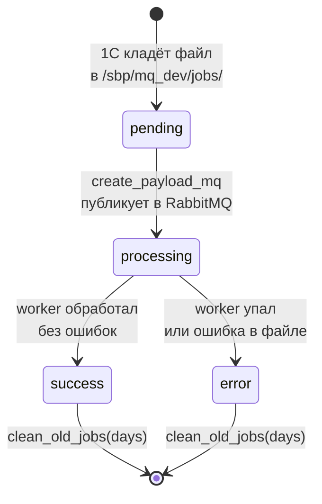
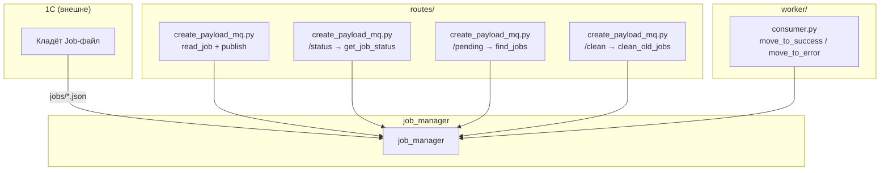

# Модуль `modules/job_manager/`

Управление Job-файлами. Job — это JSON-файл, который **создаёт 1С** и кладёт
в `/sbp/{mq|mq_dev}/jobs/` для последующей обработки воркером.

> 📖 **Общая картина** — [architecture.md](../architecture.md),
> [modules/worker.md](worker.md).

---

## 📁 Структура

```
modules/job_manager/
├── __init__.py           23 строки  ← публичный API + глобальный экземпляр
├── manager.py           167 строк   ← JobManager (фасад)
├── file_operations.py   193 строки  ← FileOperations (чтение/запись/перемещение)
├── search.py             63 строки  ← JobSearch (поиск/фильтрация)
├── stats.py              81 строка  ← JobStats (статистика)
└── cleanup.py            97 строк   ← JobCleanup (удаление старых)
```

**Итого:** 624 строки, 6 файлов.

**Ключевой принцип:** `JobManager` — **тонкий фасад**. Вся логика — в
подмодулях, доступных через свойства:

```python
job_manager.files.get_job_file_path(...)
job_manager.search.find_jobs(...)
job_manager.stats.get_stats()
job_manager.cleanup.clean_old_jobs(days=30)
```

Прокси-методы на самом `JobManager` — для обратной совместимости (старый код
вызывает `job_manager.get_job_status(...)`).

---

## 📂 Где лежат Job-файлы

```
/sbp/mq_dev/jobs/                  ← pending (SBP_ROOT4JOBS)
├── ci@zkh_ursv@123.json           ← ожидает обработки
├── ci@zkh_ursv@124.json
├── ci@zkh_ursv@125.json
├── success/                       ← успешно обработанные
│   ├── ci@zkh_ursv@120.json
│   └── ci@zkh_ursv@121.json
└── error/                         ← завершённые с ошибкой
    └── ci@zkh_ursv@122.json
```

**Плоская структура.** Все файлы — в одной папке, различаются по имени
`{bank}@{base}@{job_id}.json`. Никаких подпапок под банк/базу — банк и база
уже в имени.

⚠️ **`FileOperations.get_bank_base_path(bank, base)`** — возвращает путь
**не** к Job-файлу, а к папке банка/базы в `SBP_ROOT` (там лежат JSON-файлы
с запросами — `7845.json`, `7846.json`). Это **другая** папка, не `jobs/`:

```
/sbp/mq_dev/ci/zkh_ursv/           ← здесь лежат файлы запросов (7845.json и т.д.)
                                     (SBP_ROOT.pathlib(bank, base))
/sbp/mq_dev/jobs/                  ← здесь лежат Job-файлы (SBP_ROOT4JOBS)
/sbp/mq_dev/jobs/success/
/sbp/mq_dev/jobs/error/
```

---

## 📄 Формат Job-файла

Файл: `{bank}@{base}@{job_id}.json`. Пример — `job_example.json`:

```json
{
  "bank": "ci",
  "base": "zkh_ursv",
  "job_id": 123,
  "job_name": "Печать квитанций за сентябрь 2026",
  "created_at": "2026-09-05T10:00:00",
  "files": [
    {
      "filename": "7845.json",
      "count": 4,
      "request_ids": ["754316", "754318", "754319", "754317"]
    },
    {
      "filename": "7846.json",
      "count": 3,
      "request_ids": ["754320", "754321", "754322"]
    }
  ],
  "total_requests": 20,
  "status": "pending"
}
```

### Обязательные поля

| Поле | Тип | Описание |
|------|-----|----------|
| `bank` | str | Имя банка (`ci` / `sb` / `vtb`) |
| `base` | str | Имя базы (`zkh_ursv`) |
| `job_id` | int | ID Job в 1С (уникален в пределах базы) |
| `job_name` | str | Человекочитаемое имя |
| `created_at` | str (ISO) | Время создания в 1С |
| `files` | list | Список файлов с запросами |
| `total_requests` | int | Суммарное кол-во запросов |
| `status` | str | `pending` (в jobs/) |

### Формат `files[]`

| Поле | Тип | Описание |
|------|-----|----------|
| `filename` | str | Имя файла в папке банка/базы (`7845.json`) |
| `count` | int | Сколько запросов |
| `request_ids` | list[str] | ID запросов (`req:*` → `task_id` в Redis) |

### Кто создаёт

**1С** — кладёт готовый Job-файл в `/sbp/mq_dev/jobs/` (или PROD — `/sbp/mq/jobs/`).

**Никакого API для создания Job-файла нет** — это внешняя операция.

### Кто читает

- `routes/create_payload_mq.py` — при `GET /create_payload_mq/{bank}/{base}/{job_id}`:
  - **проверяет**, что Job-файл существует (`job_exists`)
  - читает (`read_job`)
  - публикует в RabbitMQ (`mq_client.publisher.publish_job`)
- `modules/worker/consumer.py` — после обработки: `move_to_success` / `move_to_error`

---

## 🎯 `JobManager` — фасад

### Инициализация

```python
self.jobs_dir = Path(config.SBP_ROOT4JOBS)      # /sbp/mq_dev/jobs
self.success_dir = self.jobs_dir / "success"
self.error_dir = self.jobs_dir / "error"

# Создаются автоматически при старте
for d in (self.jobs_dir, self.success_dir, self.error_dir):
    d.mkdir(parents=True, exist_ok=True)
```

### Свойства

| Свойство | Тип |
|----------|-----|
| `files` | `FileOperations` |
| `search` | `JobSearch` |
| `stats` | `JobStats` |
| `cleanup` | `JobCleanup` |
| `jobs_dir` | `Path` |
| `success_dir` | `Path` |
| `error_dir` | `Path` |

### Глобальный экземпляр

```python
job_manager = JobManager()
```

Создаётся **при импорте** `modules/job_manager` — до `mq_client.connect()`.
**Каталоги создаются сразу** (`mkdir(exist_ok=True)`).

Импортируется как:
```python
from modules.job_manager import job_manager
```

---

## 📄 `file_operations.py` — `FileOperations`

### Пути

| Метод | Что возвращает |
|-------|----------------|
| `get_job_file_path(bank, base, job_id)` | `jobs/{bank}@{base}@{job_id}.json` |
| `get_success_path(bank, base, job_id)` | `jobs/success/{bank}@{base}@{job_id}.json` |
| `get_error_path(bank, base, job_id)` | `jobs/error/{bank}@{base}@{job_id}.json` |
| `get_bank_base_path(bank, base)` | `SBP_ROOT.bank_pathlib(bank, base)` ← **не Job-папка** |

### Проверки

| Метод | Что |
|-------|-----|
| `job_exists(bank, base, job_id)` | `get_job_file_path().exists()` |
| `job_in_success(...)` | `get_success_path().exists()` |
| `job_in_error(...)` | `get_error_path().exists()` |
| `get_job_status(...)` | `pending` / `success` / `error` / `not_found` |

### `get_job_status()` — приоритет

```
1. job_exists       → "pending"
2. job_in_success   → "success"
3. job_in_error     → "error"
4. иначе            → "not_found"
```

Возвращается в `GET /create_payload_mq/{bank}/{base}/{job_id}/status`.

### Чтение

| Метод | Что |
|-------|-----|
| `read_job(bank, base, job_id)` | `json.load()` из `jobs/{...}.json` |
| `read_job_by_path(file_path)` | `json.load()` из произвольного пути |

При ошибке (`JSONDecodeError`, `FileNotFoundError`) — **логирует и возвращает `None`**.
Исключение не бросает.

### Запись

```python
write_job(job_data) -> bool
```

- Проверяет наличие `bank`, `base`, `job_id` в `job_data`
- `json.dump(job_data, f, ensure_ascii=False, indent=2)`
- **Всегда пишет в `jobs/`** (не в `success/` / `error/`)
- Возвращает `True` / `False`

⚠️ **Перезаписывает** существующий файл молча. Нет защиты от перезаписи.

⚠️ **`if not bank or not base or not job_id:`** — считает `job_id=0` **пустым**.
Но `job_id=0` — валидный ID (если 1С начнёт с 0, Job не запишется).
**Это известный баг**: правильнее `if bank is None or base is None or job_id is None:`.

### Перемещение

```python
move_to_success(bank, base, job_id) -> bool    # jobs/ → jobs/success/
move_to_error(bank, base, job_id) -> bool      # jobs/ → jobs/error/
```

**Поведение при коллизии:** если файл уже есть в `success/` / `error/` —
**удаляет существующий и перемещает новый**.

**Логика:**
1. Проверка `src.exists()` (иначе — `logger.error` + `False`)
2. Если `dst.exists()` → `dst.unlink()`
3. `dst.parent.mkdir(parents=True, exist_ok=True)`
4. `shutil.move(src, dst)` — переносит **файл** (не copy)

### `move_to_success` и `move_to_error` — где вызываются

Только в **`modules/worker/consumer.py`** после успешной/неуспешной обработки:

```python
# success
job_manager.move_to_success(bank, base, job_id)

# error
job_manager.move_to_error(bank, base, job_id)
```

Подробнее — [modules/worker.md](worker.md#-consumerpy--messageconsumer).

---

## 🔎 `search.py` — `JobSearch`

### `find_jobs(bank=None, base=None) -> List[Path]`

Ищет Job-файлы в `jobs/` (только pending, **не** в `success/` / `error/`).

| Параметры | Паттерн `glob` |
|-----------|----------------|
| оба | `{bank}@{base}@*.json` |
| только `bank` | `{bank}@*@*.json` |
| без фильтров | `*.json` |

⚠️ **Только `bank`, без `base`** — паттерн `{bank}@*@*.json`.
**Только `base`, без `bank`** — вернёт **все** (`*.json`), т.к. в `find_jobs`
`base` без `bank` игнорируется. **Это тоже баг** — фильтр `base` работает
только вместе с `bank`.

### `get_job_info(file_path) -> Optional[Dict]`

Парсит имя файла: `{bank}@{base}@{job_id}.json` → `{bank, base, job_id}`.

Если имя не подходит — `None`.

### Удобные обёртки

```python
find_by_bank(bank)   # → find_jobs(bank=bank)
find_by_base(base)   # → find_jobs(base=base)   ← работает некорректно, см. выше
```

⚠️ **`find_by_base(base)` не фильтрует по base** — вернёт все Job-файлы.

---

## 📊 `stats.py` — `JobStats`

Считает файлы в трёх папках:

| Метод | Что |
|-------|-----|
| `get_stats()` | `{pending, success, error, total}` |
| `get_stats_by_bank(bank)` | `{bank, pending, success, error, total}` |
| `get_stats_by_base(bank, base)` | `{bank, base, pending, success, error, total}` |

**Пример:**

```python
job_manager.stats.get_stats()
# {'pending': 3, 'success': 120, 'error': 5, 'total': 128}
```

⚠️ **Не фильтрует по времени.** `success/` и `error/` со временем растут
(до вызова `clean_old_jobs`).

---

## 🗑 `cleanup.py` — `JobCleanup`

Удаляет старые файлы из `success/` и `error/` (в `jobs/` **не трогает**).

### `clean_old_jobs(days=30) -> (deleted_success, deleted_error)`

Удаляет по `mtime` (`os.stat().st_mtime`) — **не по `created_at` в JSON**.
То есть ориентируется на время модификации файла на диске.

### `clean_by_bank(bank, days=30)`

То же, но только для одного банка (`{bank}@*.json`).

**Кто вызывает:** `DELETE /create_payload_mq/jobs/clean?days=N`
(см. [api.md](../api.md#delete-create_payload_mqjobsclean)).

---

## 🔄 Жизненный цикл Job



**Кто и когда:**

| Шаг | Кто | Файл |
|-----|-----|------|
| **1** | 1С (внешне) | `jobs/ci@zkh_ursv@123.json` |
| **2** | `routes/create_payload_mq.py` | читает + публикует в MQ |
| **3** | `worker/consumer.py` | `move_to_success` → `jobs/success/` |
| **3'** | `worker/consumer.py` | `move_to_error` → `jobs/error/` |
| **4** | `cleanup.clean_old_jobs(30)` | удаляет старые |

⚠️ **Важно:** после **шага 2** файл **остаётся** в `jobs/`. То есть
`/create_payload_mq/.../status` покажет `pending`, пока worker не завершит.

Если Job публикуется **повторно** (второй вызов API с тем же `job_id`),
**файл в `jobs/` уже есть** — публикуется снова, воркеры возьмут **дважды**.
**Идемпотентности нет** — это ответственность 1С.

---

## 🔗 Интеграция с другими модулями



**Кто что вызывает:**

| Модуль | Метод `job_manager` |
|--------|---------------------|
| `routes/create_payload_mq.py` | `job_exists`, `read_job`, `get_job_status`, `find_jobs`, `get_job_info`, `clean_old_jobs` |
| `modules/worker/consumer.py` | `move_to_success`, `move_to_error` |
| `routes/monitor.py` | не использует (читает из Redis) |
| `routes/health.py` | не использует (проверяет Redis/RabbitMQ) |

---

## 🧪 Отладка

### Посмотреть файлы

```bash
# pending
ls -la /sbp/mq_dev/jobs/*.json

# success
ls -la /sbp/mq_dev/jobs/success/*.json | tail -10

# error
ls -la /sbp/mq_dev/jobs/error/*.json | tail -10
```

### Прочитать Job

```bash
cat /sbp/mq_dev/jobs/ci@zkh_ursv@123.json | jq .
```

### Найти Jobs вручную

```bash
# все pending для ci
ls /sbp/mq_dev/jobs/ci@*.json

# все pending для ci@zkh_ursv
ls /sbp/mq_dev/jobs/ci@zkh_ursv@*.json
```

### Python — из интерактивной сессии

```python
from modules.job_manager import job_manager

# статус
job_manager.get_job_status("ci", "zkh_ursv", 123)
# 'pending' | 'success' | 'error' | 'not_found'

# прочитать
job = job_manager.read_job("ci", "zkh_ursv", 123)
print(job['job_name'], len(job['files']))

# найти все pending
jobs = job_manager.find_jobs(bank="ci", base="zkh_ursv")
for p in jobs:
    print(job_manager.get_job_info(p))

# статистика
print(job_manager.get_stats())
```

### Логи

```bash
sudo journalctl -u sbp_mq-dev.service | grep "\[JobManager\]"
sudo journalctl -u 'sbp_mq-dev-worker*' | grep "\[JobManager\]"
```

Что искать:
- `[JobManager] Инициализирован: jobs_dir=/sbp/mq_dev/jobs`
- `Job 123 (ci@zkh_ursv) перемещён в success`
- `Удалено старых Job-файлов: success=5, error=2`

---

## 🛠 Как расширять

### Добавить новый метод

1. **`file_operations.py`** — реализация (или другой подмодуль)
2. **`manager.py`** — прокси-метод (для консистентности)
3. **`__init__.py`** — не трогать (класс уже экспортируется)

### Изменить структуру папок

**Все пути — в `manager.py::__init__`** и в `file_operations.py::get_*_path`.
Изменить в одном месте:

```python
self.success_dir = self.jobs_dir / "success"   # ← правка
```

### Изменить политику удаления

**`cleanup.py`** использует `st_mtime`. Если нужно по `created_at` из JSON —
нужно **читать файл** (медленнее):

```python
job = json.loads(file_path.read_text())
created = datetime.fromisoformat(job['created_at'])
```

### Добавить идемпотентность

Сейчас `write_job` **перезаписывает** существующий файл. Чтобы запретить:

```python
def write_job(self, job_data, overwrite=True):
    if not overwrite and self.get_job_file_path(...).exists():
        return False
    ...
```

Но это **изменит контракт** — согласовать с 1С.

---

## 📋 Known issues (TODO)

| # | Файл | Проблема | Приоритет |
|---|------|----------|-----------|
| 1 | `file_operations.py` | `if not job_id:` — считает `job_id=0` пустым. Должно быть `is None` | **средний** |
| 2 | `search.py` | `find_jobs(base="...")` **без** `bank` — возвращает **все** файлы (base игнорируется) | **средний** |
| 3 | `search.py` | `find_by_base(base)` — по факту вызывает `find_jobs(base=base)` → см. #2 | **средний** |
| 4 | `file_operations.py` | `write_job` перезаписывает файл молча — нет защиты | низкий |
| 5 | `cleanup.py` | По `mtime`, а не по `created_at` из JSON | низкий |
| 6 | `manager.py` | Прокси-методы — рудимент, можно вызывать через `job_manager.files.*` | низкий |
| 7 | — | Нет идемпотентности при повторной публикации Job с тем же `job_id` | дизайн |

**Рекомендация:** исправить #1 и #2 — они **могут приводить к реальным багам**
при `job_id=0` или при поиске по одной базе.

---

## 🔗 Связанные документы

- [architecture.md](../architecture.md) — место Job-модуля в общей схеме
- [api.md](../api.md) — `/create_payload_mq/*` эндпоинты
- [modules/worker.md](worker.md) — `consumer.py`, `move_to_success`, `move_to_error`
- [configuration.md](../configuration.md) — `SBP_ROOT4MQ`, `SBP_ROOT4JOBS`
- [modules/monitor.md](monitor.md) — почему мониторинг **не** использует `job_manager` (читает Redis)
- [workflows/create_job.md](../workflows/create_job.md) — пошаговый сценарий (TODO)
- [workflows/callback_flow.md](../workflows/callback_flow.md) — как callback связан с Job (TODO)
