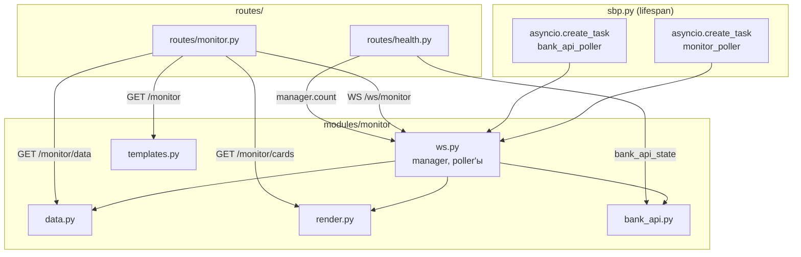

# Модуль `modules/monitor/`

Мониторинг активных и завершённых задач, доступности банков, realtime-обновления
через WebSocket. Также — HTML-дашборд `/monitor` и TCP-проверка банков.

> 📖 **Как это работает в целом** — см. [monitoring.md](../monitoring.md).
> Этот файл — **справочник по файлам модуля** + **правила расширения**.

---

## 📁 Структура

```
modules/monitor/
├── __init__.py      38 строк   ← публичный API модуля
├── bank_api.py     240 строк   ← TCP-проверка банков + backoff
├── data.py         126 строк   ← сбор данных из Redis
├── render.py       219 строк   ← HTML-рендер карточек
├── templates.py    677 строк   ← HTML+CSS+JS дашборда /monitor
└── ws.py           170 строк   ← ConnectionManager + 2 poller'а
```

**Итого:** 1470 строк, 6 файлов.

---

## 🗂 `__init__.py` — публичный API

```python
from .data import get_monitor_data
from .render import (
    render_status_badge,
    render_callback_html,
    render_progress_card,
    render_completed_card,
    render_cards_html,
    COMPLETED_TTL_MINUTES,
)
from .templates import render_monitor_html
from .ws import (
    ConnectionManager,
    monitor_poller,
    bank_api_poller,
    manager,
    bank_api_state,
    get_bank_api_last,
)
```

`__all__` — полный список экспортируемых имён.

**Снаружи модуля используются:**

| Имя | Где |
|-----|-----|
| `get_monitor_data` | `routes/monitor.py` (`/monitor/data`) |
| `render_cards_html` | `routes/monitor.py` (`WS initial`, `/monitor/cards`) |
| `render_monitor_html` | `routes/monitor.py` (`/monitor`) |
| `manager` | `routes/monitor.py` (`WS connect/disconnect`), `routes/health.py` (`_check_monitor_ws`) |
| `monitor_poller` | `sbp.py` (lifespan) |
| `bank_api_poller` | `sbp.py` (lifespan) |
| `bank_api_state` | `routes/health.py` (`_check_bank_api`) |
| `get_bank_api_last` | `routes/monitor.py` (initial WS) |

Остальное (`render_status_badge`, `render_progress_card`, …) — вспомогательное,
экспортируется «на всякий случай».

---

## 📊 `data.py`

**Что делает:** собирает снимок мониторинга из Redis.

**Главная функция** `get_monitor_data()` возвращает:

```python
{
    "timestamp": str,             # ISO
    "processing": list[dict],     # активные (из progress:*)
    "completed": list[dict],      # завершённые за 5 мин (из task:*)
    "banks": list[str],           # уникальные банки
    "bases": list[str],           # уникальные базы
}
```

**Внутренние функции:**

| Функция | Назначение |
|---------|------------|
| `_load_processing(redis, banks, bases)` | читает `progress:*` |
| `_load_completed(redis, cutoff, banks, bases)` | читает `task:*`, фильтрует по `finished_at < cutoff` |
| `_enrich_with_callbacks(jobs)` | добавляет `callback_count` и `callback_last_error` |
| `_empty_response()` | пустой ответ, если Redis недоступен |

**Константа:** `COMPLETED_TTL_MINUTES = 5` — окно показа завершённых.

**Настройка окна:** изменить константу в `data.py` → применится ко всему
модулю (включая `render.py`, где она импортируется для подписи).

Подробнее — [monitoring.md → Сбор данных](../monitoring.md#-сбор-данных-datapy).

---

## 🎨 `render.py`

**Что делает:** превращает `dict` из `data.py` в HTML-карточки.

**Публичные функции:**

| Функция | Что возвращает |
|---------|----------------|
| `render_status_badge(status)` | `<span class="badge">…</span>` |
| `render_callback_html(count, last_error)` | блок `📞 N` + `❌ ошибка` (опц.) |
| `render_progress_card(job)` | карточка активной задачи |
| `render_completed_card(job)` | карточка завершённой задачи |
| `render_cards_html(data)` | два блока: «🔥 В обработке» + «✅ Завершённые» |
| `COMPLETED_TTL_MINUTES` | реэкспорт из `data.py` |

**Вспомогательное:** `_collect_job_error(job)` — собирает текст ошибки
(приоритет: `job["error"]` → `files[].error` → пусто).

**Что рендерится в карточке:**

- **Активная:** прогресс-бар, `📁 N/M`, `✅ K`, `❌ L`, «📄 Сейчас: file.json», callback-блок
- **Завершённая:** summary (`📁 N/M`, `✅ K`, `❌ L`), callback-блок, **текст ошибки** (если есть)

`data-bank`, `data-base`, `data-status` — атрибуты для клиентской фильтрации в JS.

Подробнее — [monitoring.md → Рендер карточек](../monitoring.md#-рендер-карточек-renderpy).

---

## 🌐 `templates.py`

**Что делает:** возвращает **полный HTML дашборда** `/monitor` — одна
функция `render_monitor_html()` → `str`.

**Особенности:**

- **Один файл** — весь HTML + CSS + JS внутри `return '''…'''`
- **Никаких шаблонизаторов** — чистый Python-строковый литерал
- HTML **независим** от `data.py` — данные подгружаются **клиентом** через
  `fetch('/monitor/data')` + `WS /ws/monitor`
- Тёмно-синяя тема (`#1a1a2e`), карточки на белом, `box-shadow`

### Структура HTML (верхний уровень)

```html
<div class="container">
  <div class="header">
    <h1>📊 Мониторинг SBP</h1>
    <div class="time">…</div>
    <div class="header-status">
      <span class="status-dot"></span>  ← индикатор WS (пульсирует)
      <span id="ws-status">connected</span>
    </div>
  </div>

  <div class="summary">
    <div class="summary-card">🔥 Активных: <span id="processing-count">0</span></div>
    <div class="summary-card">✅ Завершено: <span id="completed-count">0</span></div>
    <div class="summary-card">🏦 Банки: <span id="banks">—</span></div>
    <div class="summary-card">📁 Базы: <span id="bases">—</span></div>
  </div>

  <div class="filters">
    <!-- фильтры по bank / base / status -->
  </div>

  <div id="cards">
    <!-- ← сюда JS вставляет cards_html из WS -->
  </div>
</div>
```

### JavaScript — что делает

1. При загрузке — `fetch('/monitor/data')` → первичный рендер
2. Открывает `WS /ws/monitor`
3. На `onmessage`:
   - `cards_html` → `#cards.innerHTML` (замена всего блока)
   - `processing_count`, `completed_count` → в summary-карточки
   - `banks`, `bases` → в summary-карточки
   - `bank_api` → отдельный блок статуса банков
4. Фильтры — **клиентские**: скрывают карточки по `data-bank`/`data-base`/`data-status`
5. При disconnect WS — попытка реконнекта через 3 сек (с `location.reload()`)

⚠️ **`location.reload()` при disconnect** — грубо, но надёжно. Перезагрузка
восстанавливает и `fetch`, и WS. В будущем можно заменить на мягкий реконнект.

### Что **не** делает

- **Не рендерит карточки на сервере** — это делает `render.py` + `cards_html`
- **Не хранит состояние** — всё приходит по WS
- **Не имеет API** — только HTML-строку

---

## 📡 `ws.py`

**Что делает:** `ConnectionManager` + два фоновых poller'а.

**Публичные объекты:**

| Имя | Тип | Назначение |
|-----|-----|------------|
| `manager` | `ConnectionManager` | глобальный экземпляр, активные WS |
| `bank_api_state` | `BankApiHealthState` | backoff-состояние TCP-проверки |
| `bank_api_last` | `dict` | последний результат `check_all_banks()` |
| `get_bank_api_last()` | function | вернуть `bank_api_last` |

**Класс `ConnectionManager`:**

| Метод | Что делает |
|-------|------------|
| `connect(ws)` | `ws.accept()` + добавить в `_active` |
| `disconnect(ws)` | убрать из `_active` |
| `broadcast(data)` | JSON всем активным, чистит «мёртвых» |
| `count` (property) | число активных |

**Poller'ы:**

| Функция | Интервал | Что делает |
|---------|----------|------------|
| `monitor_poller(stop_event)` | 2 сек | `get_monitor_data()` → broadcast при изменениях |
| `bank_api_poller(stop_event)` | 60 сек + jitter | `check_all_banks()` → broadcast при изменениях |

`stop_event` — общий `asyncio.Event` из `sbp.py` lifespan. По `set()` — оба
poller'а завершаются.

Подробнее — [monitoring.md → WebSocket](../monitoring.md#-websocket-wsmonitor).

---

## 🏦 `bank_api.py`

**Что делает:** TCP-проверка доступности банков + backoff.

**Публичные объекты:**

| Имя | Назначение |
|-----|------------|
| `BankApiStatus` | dataclass со статусом одного банка |
| `BankApiHealthState` | backoff-состояние (consecutive_errors, interval) |
| `check_bank_tcp(bank, host, port, timeout)` | одна проверка |
| `check_all_banks()` | параллельная проверка всех банков |

**Константы (настройки):**

```python
HEALTHCHECK_INTERVAL = 60      # базовый интервал
HEALTHCHECK_JITTER   = 15      # ±15 сек
HEALTHCHECK_TIMEOUT  = 5.0     # TCP timeout
BACKOFF_MAP = {0: 60, 3: 600, 5: 1800}
```

**Логика:**

- **DNS** (если hostname) → `gaierror` → `error_type="dns"`
- **TCP connect** через `asyncio.open_connection` → timeout/refused/other
- **`latency_ms`** — сколько занял connect
- **Пропуск заглушек** — банки с `"..."` в URL не проверяются

**Backoff:**

- `consecutive_errors` растёт, если **хоть один** банк недоступен
- Сбрасывается в 0, если **все** доступны
- `interval = base ± jitter`, минимум 30 сек

Подробнее — [monitoring.md → bank_api](../monitoring.md#-bank_apipy--tcp-проверка-банков).

---

## 🔌 Как модуль встроен в приложение



---

## 🛠 Как расширять

### Добавить банк

**Не нужно трогать `modules/monitor`** — банк берётся из `config.BANK_CONFIG`.
Достаточно добавить запись:

```python
# config.py
BANK_CONFIG["new_bank"] = {
    "name": "Новый банк",
    "url": "https://api.new.ru/qr-code",
    "sbp_root": SBP_ROOT["new_bank"],
    "callback_url": "/callback_new",
    "verify_ssl": True,
    "api_class": "BankNew",
}
```

TCP-проверка подхватит автоматически. Мониторинг покажет в `/monitor/data`.

### Изменить окно завершённых

`modules/monitor/data.py`:

```python
COMPLETED_TTL_MINUTES = 5    # ← изменить на нужное
```

Автоматически применится к `/monitor/data` и к подписи в `render.py`
(там `COMPLETED_TTL_MINUTES` импортируется).

### Изменить частоту monitor_poller

`modules/monitor/ws.py`:

```python
await asyncio.wait_for(stop_event.wait(), timeout=2.0)   # ← изменить
```

⚠️ Быстрее 1 сек — не рекомендуется, лишняя нагрузка на Redis.

### Изменить интервал TCP-проверки

`modules/monitor/bank_api.py`:

```python
HEALTHCHECK_INTERVAL = 60     # базовый
HEALTHCHECK_JITTER   = 15     # разброс
```

### Добавить поле в карточку

1. **Источник** — `progress:*` или `task:*` в Redis (заполняет worker)
2. **`data.py`** — подхватит автоматически (читает всё содержимое JSON)
3. **`render.py`** — добавить в `f'''…'''` шаблон (`render_progress_card`
   или `render_completed_card`)
4. **CSS** — при необходимости добавить класс в `templates.py`

### Кастомный банк-статус в дашборде

1. **`bank_api.py`** — расширить `BankApiStatus` новыми полями
2. **`render.py`** — рендер статуса банков (сейчас в JS `templates.py`)
3. **`templates.py`** — обновить `updateBankStatus()` в JS

---

## 🧪 Отладка

### Запустить только модуль (без FastAPI)

```python
# python -i
import asyncio
from modules.monitor import get_monitor_data

data = asyncio.run(get_monitor_data())
print(f"processing: {len(data['processing'])}")
print(f"completed:  {len(data['completed'])}")
print(f"banks:      {data['banks']}")
```

### Проверить HTML дашборда

```python
from modules.monitor import render_monitor_html
html = render_monitor_html()
print(len(html))         # длина HTML
print(html[:500])        # начало
```

### Проверить TCP одного банка

```python
import asyncio
from modules.monitor.bank_api import check_bank_tcp

status = asyncio.run(check_bank_tcp("ci", "10.0.245.20", 443))
print(status.to_dict())
# {'bank': 'ci', 'host': '10.0.245.20', 'port': 443, 'available': True, 'latency_ms': 12.4, ...}
```

### Логи модуля

```bash
# все сообщения модуля
sudo journalctl -u sbp_mq-dev.service | grep -E "\[WS\]|\[BankAPI\]"
```

---

## 🔗 Связанные документы

- [monitoring.md](../monitoring.md) — **как работает мониторинг** (главный документ)
- [api.md](../api.md) — эндпоинты `/monitor`, `/monitor/data`, `/monitor/cards`, `/ws/monitor`
- [architecture.md](../architecture.md) — где модуль в общей схеме
- [configuration.md](../configuration.md) — `BANK_CONFIG`, `WORKER_PATTERN`
- [modules/worker.md](worker.md) — как worker пишет `progress:*` и `task:*` (TODO)
