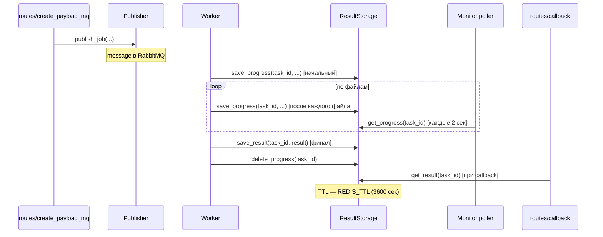
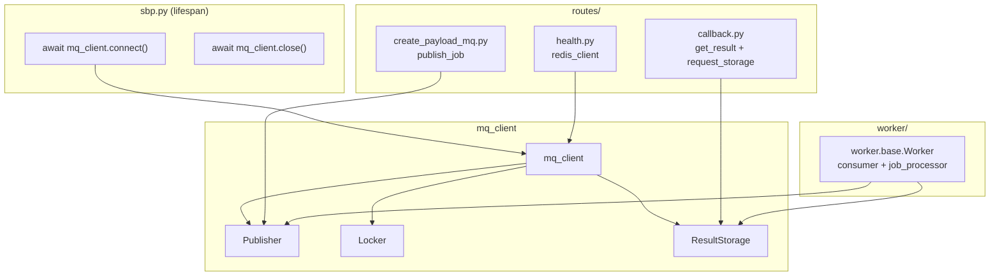

# Модуль `modules/mq_client/`

Клиент для работы с **RabbitMQ** и **Redis**. Один глобальный экземпляр
`mq_client` используется **всеми** компонентами: `sbp.py`, worker'ами,
`routes/create_payload_mq.py`, `routes/callback.py`, мониторингом.

> 📖 Связанные документы: [architecture.md](../architecture.md),
> [modules/worker.md](worker.md), [monitoring.md](../monitoring.md).

---

## 📁 Структура

```
modules/mq_client/
├── __init__.py         23 строки  ← публичный API + глобальный экземпляр
├── base.py            213 строк   ← MQClient (главный класс)
├── publisher.py        80 строк   ← публикация Job в RabbitMQ
├── locker.py           91 строка  ← блокировка файлов через Redis
└── result_storage.py  258 строк   ← результаты и прогресс в Redis
```

**Итого:** 665 строк, 5 файлов.

---

## 🗂 `__init__.py` — публичный API

```python
from .base import MQClient
from .publisher import Publisher
from .locker import Locker
from .result_storage import ResultStorage

__all__ = ['MQClient', 'Publisher', 'Locker', 'ResultStorage']

from .base import mq_client    # ← глобальный экземпляр
```

**Что используется снаружи:**

| Импорт | Где |
|--------|-----|
| `from modules.mq_client import mq_client` | `sbp.py`, worker'ы, `routes/*` |
| `MQClient`, `Publisher`, `Locker`, `ResultStorage` | только для типизации / тестов |

Практически весь код работает через **`mq_client`** (singleton).

---

## 🔌 `base.py` — `MQClient`

### Ответственность

- Подключение к RabbitMQ + Redis
- Инициализация подмодулей (`publisher`, `locker`, `result_storage`)
- Прокси-методы для обратной совместимости

### Свойства

| Свойство | Тип | Что |
|----------|-----|-----|
| `is_connected` | `bool` | флаг соединения |
| `publisher` | `Publisher` | публикация |
| `locker` | `Locker` | блокировки |
| `result_storage` | `ResultStorage` | результаты |
| `channel` | `AbstractChannel` | канал RabbitMQ |
| `redis_client` | `redis.Redis` | клиент Redis |

### Методы

| Метод | Что делает |
|-------|------------|
| `connect()` | `aio_pika.connect_robust` → `channel` → `declare_queue(durable=True)` → `redis.Redis` → `ping()` → создаёт подмодули |
| `close()` | Закрывает RabbitMQ + Redis |
| `ensure_connected()` | Если не подключено — `connect()` |

**Подключение (упрощённо):**

```python
self._connection = await aio_pika.connect_robust(...)     # RabbitMQ
self._channel = await self._connection.channel()
await self._channel.declare_queue(config.RABBITMQ_QUEUE, durable=True)

self._redis = redis.Redis(...)
await self._redis.ping()

self._publisher = Publisher(self)
self._locker = Locker(self)
self._result_storage = ResultStorage(self)
```

### Прокси-методы

`base.py` **дублирует** интерфейс подмодулей — «на всякий случай»,
для обратной совместимости (старый код мог вызывать `mq_client.publish_job(...)`
напрямую).

| Прокси | Делегирует в |
|--------|--------------|
| `publish_job` | `Publisher` |
| `lock_file`, `unlock_file`, `is_file_locked`, `is_file_processed`, `mark_processed` | `Locker` |
| `save_result`, `get_result`, `delete_result` | `ResultStorage` |
| `save_progress`, `get_progress`, `delete_progress` | `ResultStorage` |
| `get_task_status` | `ResultStorage` |

⚠️ **Прокси — рудимент.** В новом коде лучше вызывать `mq_client.publisher.publish_job(...)`
или `mq_client.result_storage.save_result(...)` — явно. Но **не удаляем** — может использоваться
в существующих вызовах.

### Глобальный экземпляр

```python
mq_client = MQClient()
```

Один на процесс. **Инициализируется в `sbp.py` lifespan** (для сервера) и **в
`run_worker.py`** (для воркера) через `await mq_client.connect()`.

---

## 📤 `publisher.py` — `Publisher`

Три метода публикации. Все — `DeliveryMode.PERSISTENT` (не теряются при рестарте
RabbitMQ), `content_type="application/json"`, `ensure_ascii=False`.

### 🔥 `publish_job(job_data) → task_id`

**Главный метод.** Публикует Job целиком.

**Валидация:** обязательные поля — `bank`, `base`, `job_id`.

**Message:**

```json
{
  "task_id": "job_20260920193000_abc123",
  "bank": "ci",
  "base": "zkh_ursv",
  "job_id": 123,
  "job_name": "Печать квитанций",
  "created_at": "2026-09-20T19:25:00",
  "files": [
    {"filename": "7845.json", "count": 4, "request_ids": ["req-1", "req-2", "req-3", "req-4"]}
  ],
  "total_requests": 4,
  "published_at": "2026-09-20T19:30:00"
}
```

**Кто вызывает:**
- `routes/create_payload_mq.py` — основной эндпоинт создания Job

**Что происходит дальше:**
- Воркер читает сообщение в `consumer.py` → `job_processor.process_job(...)`

### `_publish_message(message_data)` (приватный)

```python
message = Message(
    body=json.dumps(message_data, ensure_ascii=False).encode('utf-8'),
    delivery_mode=DeliveryMode.PERSISTENT,
    content_type="application/json"
)
await channel.default_exchange.publish(message, routing_key=config.RABBITMQ_QUEUE)
```

`default_exchange` → **прямая очередь** без exchange-логики.

---

## 🔒 `locker.py` — `Locker`

Защита от **двойной обработки** файлов. Работает через Redis-ключи.

### Ключи

| Ключ | TTL | Что |
|------|-----|-----|
| `lock:{file_path}` | `ttl` (по умолчанию 3600) | блокировка «в работе» |
| `processed:{file_path}` | `config.REDIS_TTL` | «уже обработан» + результат |

### Методы

| Метод | Что |
|-------|-----|
| `lock_file(path, ttl=3600)` | `SET NX EX` — **атомарно**. `True` если заблокировал, `False` если уже занят |
| `unlock_file(path)` | `DEL lock:{path}` |
| `is_file_locked(path)` | `EXISTS lock:{path}` |
| `is_file_processed(path)` | `EXISTS processed:{path}` |
| `mark_processed(path, result)` | `SETEX processed:{path} REDIS_TTL {result}` (JSON) |

### Где используется

- **`ResultStorage.save_result()`** — при сохранении полного результата:
  ```python
  if file_path and self.parent.locker:
      await self.parent.locker.mark_processed(file_path, result)
      await self.parent.locker.unlock_file(file_path)
  ```
- **`lock_file`** — вызывается из `routes/create_payload_mq.py` перед публикацией Job
  для защиты от дублирования (двойного запуска одного Job)

⚠️ **В текущем пайплайне `locker` почти не используется** — Job-модель
гарантирует, что один Job уходит одному воркеру через `prefetch=1`.
`Locker` остался от task-модели.

---

## 💾 `result_storage.py` — `ResultStorage`

Два независимых ключа в Redis. **Ключевой момент архитектуры:**

| Ключ | Когда пишется | Размер | TTL |
|------|---------------|--------|-----|
| `progress:{task_id}` | **После каждого файла** (в `job_processor._save_progress`) | ~300 байт | `REDIS_TTL` |
| `task:{task_id}` | **Один раз в конце** (`consumer.py` → `mq_client.save_result`) | полный JSON | `REDIS_TTL` |

### Почему два ключа

- **`progress:*`** — для **мониторинга** (карточка активной задачи). Лёгкий,
  обновляется часто, читается **каждые 2 сек** poller'ом (`modules/monitor/data.py`).
- **`task:*`** — для **финального результата**. Тяжёлый, читается редко
  (по запросу `/create_payload_mq/.../status`).

Если бы был один ключ — poller каждые 2 сек тянул бы полный результат,
что дорого.

### Методы

| Метод | Ключ | Что |
|-------|------|-----|
| `save_result(task_id, result, file_path=None, ttl=REDIS_TTL)` | `task:*` | `SETEX`, полный JSON. Если `file_path` — вызывает `locker.mark_processed` + `unlock_file` |
| `get_result(task_id)` | `task:*` | `GET` + `json.loads` |
| `delete_result(task_id)` | `task:*` | `DEL` |
| `save_progress(task_id, progress, ttl=REDIS_TTL)` | `progress:*` | `SETEX`, добавляет `updated_at` |
| `get_progress(task_id)` | `progress:*` | `GET` + `json.loads` |
| `delete_progress(task_id)` | `progress:*` | `DEL` |
| `get_task_status(task_id)` | оба | Комбинированный |

### `get_task_status(task_id)` — приоритет

```
1. task:*       → {"status": <result.status>, "result": ...}         ← полный результат
2. progress:*   → {"status": "processing", "progress": ...}          ← в работе
3. ничего       → {"status": "pending", "message": "..."}            ← ещё не взято
```

Возвращается в `/create_payload_mq/{bank}/{base}/{job_id}/status`
(см. [api.md](../api.md#get-create_payload_mqbankbasejob_idstatus)).

### Полный жизненный цикл в Redis



---

## 🔌 Как встроено в систему



**Кто что пишет/читает:**

| Компонент | Пишет | Читает |
|-----------|-------|--------|
| `create_payload_mq.py` | `publish_job` | — |
| `worker/consumer.py` | `save_result` (task:*), `delete_progress` | — |
| `worker/job_processor.py` | `save_progress` (progress:*), `delete_progress` | — |
| `worker/file_processor.py` | `request_storage.save_requests` (req:*) | — |
| `routes/callback.py` | — | `get_result`, `request_storage.get_task_ids_for_requests` |
| `modules/monitor/data.py` | — | `progress:*`, `task:*` (напрямую через `redis_client`) |
| `routes/health.py` | — | `redis_client.ping()`, ключи `req:*`, `task:*`, `progress:*`, `lock:*`, `processed:*` |

---

## 🧪 Отладка

### Посмотреть Redis напрямую

```bash
# DEV (DB 1)
redis-cli -n 1 keys 'progress:*' | head
redis-cli -n 1 get 'progress:job_20260920_abc'
redis-cli -n 1 keys 'task:*' | head
redis-cli -n 1 get 'task:job_20260920_abc'
redis-cli -n 1 keys 'req:*' | head
redis-cli -n 1 keys 'lock:*' | head
redis-cli -n 1 keys 'processed:*' | head

# TTL ключа
redis-cli -n 1 ttl 'task:job_20260920_abc'
```

### Публикация вручную

```python
# python -i
import asyncio
from modules.mq_client import mq_client

async def main():
    await mq_client.connect()
    task_id = await mq_client.publisher.publish_job({
        "bank": "ci",
        "base": "zkh_ursv",
        "job_id": 999,
        "job_name": "Test",
        "files": [],
        "total_requests": 0,
    })
    print("task_id:", task_id)
    await mq_client.close()

asyncio.run(main())
```

### Проверить очередь

```bash
sudo rabbitmqctl list_queues name messages consumers
# sbp_mq_dev_queue   3   3    ← 3 сообщения, 3 воркера
```

### Логи mq_client

```bash
sudo journalctl -u sbp_mq-dev.service | grep "\[MQClient\]"
sudo journalctl -u 'sbp_mq-dev-worker*' | grep "\[MQClient\]"
sudo journalctl -u sbp_mq-dev.service | grep "\[Redis\]"
```

Что искать:
- `[MQClient] Подключение к RabbitMQ и Redis установлено`
- `[MQClient] Задача ... опубликована`
- `[Redis] Результат ... сохранён`
- `📊 [Redis] Прогресс ...: 3/5 файлов (60%)`

---

## 🛠 Как расширять

### Добавить новый тип публикации

1. **`publisher.py`** — новый метод, например `publish_high_priority(job_data)`
2. **`base.py`** — прокси-метод (для консистентности)

### Добавить новый тип ключа

1. **`result_storage.py`** — метод (`save_*`, `get_*`, `delete_*`)
2. **`base.py`** — прокси-метод
3. **`routes/health.py`** — добавить префикс в `_check_redis()`
   (сейчас перебирает `["req", "task", "progress", "lock", "processed"]`)

### Изменить формат message

- **`publisher.py::publish_job`** — добавить поля в `message_data`
- **`worker/consumer.py::process_message`** — подхватить новые поля
- **`worker/job_processor.py::process_job`** — использовать

### Чистка кода (сделано)

В ходе рефакторинга **удалено**:

- ✅ `Publisher.publish_task`, `Publisher.publish_batch` — не использовались (Job-модель)
- ✅ `utils.py` (весь файл) — не использовался
- ✅ Прокси `publish_task`, `publish_batch` из `MQClient`

**Оставлено** (используется):
- `Locker` — **защита от дублирования** Job, используется в `routes/create_payload_mq.py`
- `publish_job` — основной метод публикации

## 📋 Known issues (TODO)

| # | Файл | Проблема | Приоритет |
|---|------|----------|-----------|
| 1 | `locker.py` | Ключи `lock:*` и `processed:*` содержат **полный путь** файла | низкий |
| 2 | `base.py` | Прокси-методы — рудимент | низкий |
| 3 | `result_storage.py` | `save_result` неявно зависит от `locker` | низкий |

---

## 🔗 Связанные документы

- [architecture.md](../architecture.md) — где `mq_client` в общей схеме
- [modules/worker.md](worker.md) — как воркер использует `save_progress` / `save_result`
- [modules/monitor.md](monitor.md) — как читаются `progress:*` и `task:*`
- [monitoring.md](../monitoring.md) — WS, poller'ы
- [api.md](../api.md) — `POST /callback`, `/create_payload_mq/...`
- [configuration.md](../configuration.md) — `RABBITMQ_*`, `REDIS_*`, `REDIS_TTL`
- [modules/job_manager.md](job_manager.md) — как Job-файлы попадают в publish (TODO)
- [modules/api_bank_client.md](api_bank_client.md) — что `file_processor` вызывает (TODO)
