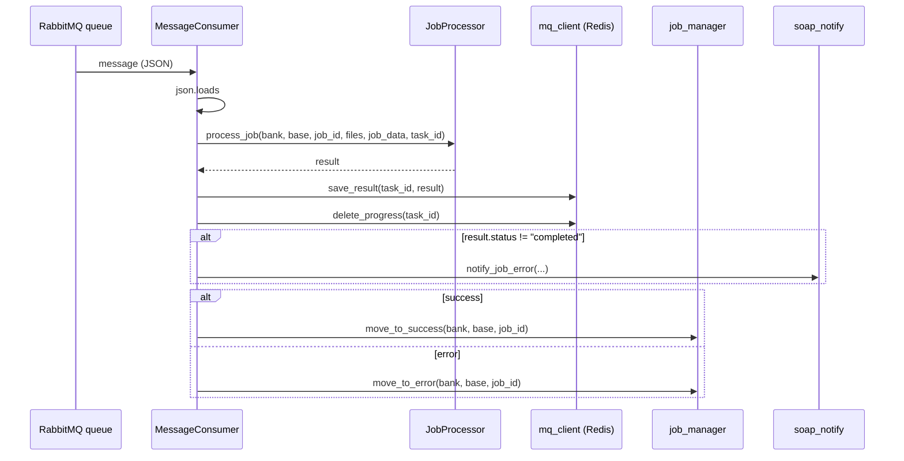
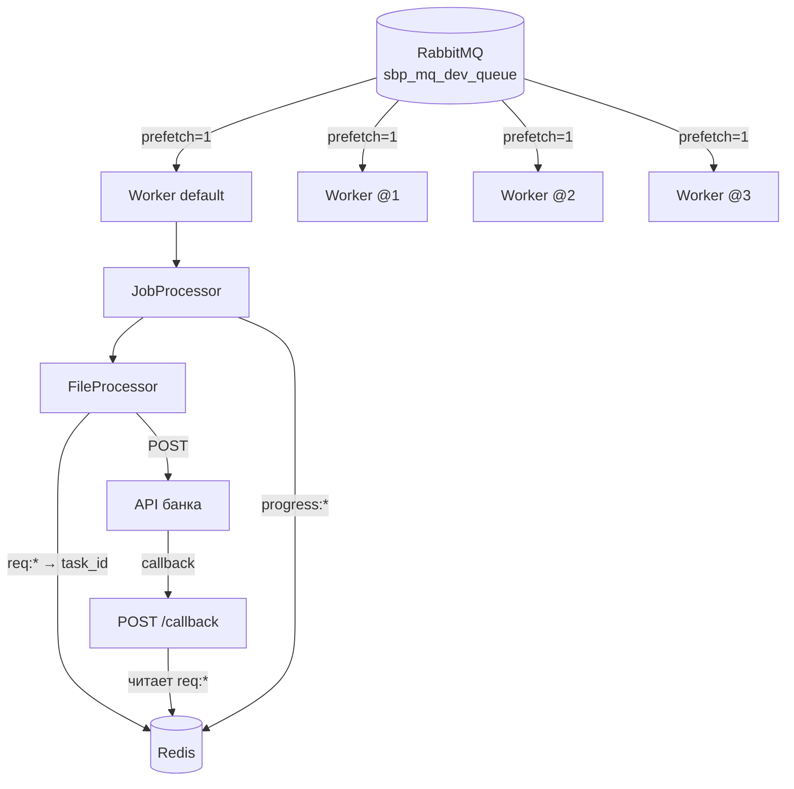

# Модуль `modules/worker/`

Обработка задач из очереди RabbitMQ. Один Worker = один systemd-сервис.

> 📖 **Как воркеры встроены в систему** — см. [architecture.md](../architecture.md)
> и [deployment.md](../deployment.md#-systemd).

---

## 📁 Структура

```
modules/worker/
├── __init__.py          27 строк   ← публичный API
├── base.py             252 строки  ← класс Worker (главный)
├── consumer.py         171 строка  ← MessageConsumer
├── job_processor.py    251 строка  ← обработка Job (последовательность файлов)
├── file_processor.py   190 строк   ← обработка одного файла
└── result_saver.py     115 строк   ← сохранение в Redis (legacy, см. ниже)
```

**Итого:** 1006 строк, 6 файлов.
**Точка входа:** `run_worker.py` (в корне проекта).

---

## 🗂 `__init__.py` — публичный API

```python
from .base import Worker
from .consumer import MessageConsumer
from .job_processor import JobProcessor
from .file_processor import FileProcessor
from .result_saver import ResultSaver

worker = Worker()       # глобальный экземпляр для обратной совместимости
```

`run_worker.py` использует **только** `worker`:

```python
from modules.worker.base import worker
await worker.start()
```

---

## ⚙️ `base.py` — класс `Worker`

### Что делает

- Подключается к **RabbitMQ** и **Redis**
- Объявляет очередь (`durable=True`)
- Устанавливает `prefetch_count=1` (по одной задаче за раз)
- Запускает `consume_loop` (в фоне)
- Держит дочерние подмодули (`consumer`, `job_processor`, `file_processor`, `result_saver`)

### Инициализация

```python
self.worker_id = os.getenv('WORKER_ID') or uuid.uuid4().hex[:6]
self._log_name = os.getenv('LOG_NAME', f"worker-{self.worker_id}")

# Все настройки — из config.py
self.rabbitmq_host = config.RABBITMQ_HOST
self.rabbitmq_queue = config.RABBITMQ_QUEUE
self.redis_db = config.REDIS_DB
```

- **`WORKER_ID`** задаётся в systemd-юните:
  - `sbp_mq-worker.service` → `WORKER_ID=default`
  - `sbp_mq-worker@1.service` → `WORKER_ID=mq-worker-1` (через `%i`)
- **`LOG_NAME`** — для ссылки в aggregated-логе

### Методы

| Метод | Что делает |
|-------|------------|
| `connect()` | `aio_pika.connect_robust` + `channel` + `set_qos(1)` + `redis.Redis` + `ping()` + создание подмодулей |
| `start()` | `connect()` → `declare_queue` → `consume_loop` → `await task` |
| `stop()` | `is_running=False`, `task.cancel()`, `cleanup()` |
| `cleanup()` | Закрытие RabbitMQ-соединения и Redis-клиента |

### Особенность: **двойной лог**

Каждое ключевое событие пишется в **два логгера**:

- `logger` — детальный лог, файл `logs/{LOG_NAME}.log` (у каждого воркера свой)
- `aggregated_logger` — общий лог `logs/all.log`, короткие события + **ссылка**
  на детали `logs/{LOG_NAME}.log`

Пример:

```
# logs/mq-worker-1.log
📥 [Worker mq-worker-1] ВЗЯЛ Job ci@zkh_ursv@123 (Печать квитанций) | файлов: 2, запросов: 8 | task_id: job_20260906_abc

# logs/all.log
📥 [Worker mq-worker-1] ВЗЯЛ Job ci@zkh_ursv@123 | файлов: 2, запросов: 8 | детали: logs/mq-worker-1.log
```

**Зачем:** 4 воркера пишут в один `all.log` коротко, а детали — каждый в свой файл.
`log_show.sh` в `sh_common/` умеет их показывать.

### Прокси-методы (для обратной совместимости)

```python
async def _process_message(self, message)         # → self._consumer.process_message
async def _process_job(...)                        # → self._job_processor.process_job
async def _process_file_for_bank(...)              # → self._file_processor.process_file
async def _save_result(...), _save_error(...)      # → self._result_saver
```

⚠️ **Сейчас не используются** — воркер вызывает `self.parent.job_processor.process_job()`
напрямую. Эти методы — рудимент, но не удалены.

---

## 🔄 `consumer.py` — `MessageConsumer`

### Что делает

- Читает сообщения из очереди (`queue.iterator()`)
- Проверяет `is_running` — при `False` **выходит из цикла**
- `message.process()` — контекст-менеджер (`ack` при успехе, `nack` при исключении)
- Парсит JSON сообщения: `task_id`, `bank`, `base`, `job_id`, `job_name`, `files`, `total_requests`
- Пишет **двойной лог** (детальный + агрегированный)
- Вызывает `self.parent.job_processor.process_job(...)`
- Сохраняет результат через `mq_client.save_result(task_id, result)`
- Удаляет прогресс через `mq_client.delete_progress(task_id)`
- **При ошибке** — вызывает `notify_job_error(bank, base, job_id, result)` (SOAP)
- Перемещает Job-файл: `job_manager.move_to_success` / `move_to_error`

### Схема обработки



### Двойной лог (в `process_message`)

- **`📥 ВЗЯЛ Job`** — детально + агрегированно
- **`📄 Файл: X (N запросов)`** — только детально (debug)
- **`✅ ГОТОВ Job`** / **`⚠️ ОШИБКА Job`** — детально + агрегированно
- **`❌ Ошибка парсинга JSON`** / **`❌ Ошибка обработки`** — детально + агрегированно,
  с `exc_info=True` в детальном

### ⚠️ Known issues (TODO)

1. **`errors = result.get('errors', 0)`** — такого ключа нет в `result` (там `summary.error_files`).
   Значит **всегда 0** в логе `⚠️ Job ... ЗАВЕРШЁН С ОШИБКАМИ | ошибок: 0`.

2. **`if result.get("status") != "completed"`** — SOAP вызовется также при
   `status="processing"` (если что-то оставило его таким). Сейчас это маловероятно
   (в `job_processor` финальный `status` — либо `completed`, либо `error`),
   но лучше явно: `if result.get("status") == "error"`.

3. **Пустой `except:`** в блоке обработки критических ошибок (после `except Exception`)
   — глотает **все** исключения, включая `KeyboardInterrupt` и `SystemExit`.
   Лучше `except Exception:` + лог.

Эти три места — **кандидаты на исправление** в следующей итерации.

---

## 📦 `job_processor.py` — `JobProcessor`

### Что делает

Обрабатывает **Job целиком** — последовательно файл за файлом. **Ошибка в любом
файле → прерывание Job**.

### Метод `process_job(bank, base, job_id, files, job_data, task_id)`

**Алгоритм:**

1. Формирует `result` в формате, **симметричном заданию** + summary + status
2. **Сохраняет начальный прогресс** в Redis через `_save_progress(task_id, ...)`
3. Получает пути для банка/базы:
   ```python
   base_path = config.SBP_ROOT.pathlib(bank, base)
   paths = {
       'base': base_path,
       'processing': base_path / 'processing',
       'sended': base_path / 'sended',
       'get': base_path / 'get',
       'geted': base_path / 'geted',
       'stop': base_path / 'stop',
       'stoped': base_path / 'stoped',
   }
   ```
4. Создаёт все подпапки (`mkdir(parents=True, exist_ok=True)`)
5. **Цикл по файлам:**
   - Формирует `file_result` (симметрично заданию + результат)
   - Вызывает `self.parent.file_processor.process_file(file_path, bank, base, paths, request_ids, task_id)`
   - Обогащает `file_result` (`status`, `status_code`, `saved_count`, `processed_at`, `error`, `response`)
   - Обновляет `result['summary']`
   - **При ошибке** (`file_result['status'] not in ['completed', 'success']`) — `has_error = True`, **break**
   - **Сохраняет прогресс** через `_save_progress(...)` после каждого файла
6. **Финал:** `result['status'] = 'error' if has_error else 'completed'`, `finished_at`

### Структура `result`

```json
{
  "bank": "ci",
  "base": "zkh_ursv",
  "job_id": 123,
  "job_name": "Печать квитанций",
  "created_at": "...",
  "started_at": "...",
  "finished_at": "...",
  "files": [
    {
      "filename": "7845.json",
      "count": 4,
      "request_ids": ["req-1", "req-2", "req-3", "req-4"],
      "status": "completed",
      "status_code": 202,
      "saved_count": 4,
      "processed_at": "...",
      "error": null,
      "response": [...]
    }
  ],
  "total_requests": 4,
  "status": "completed",
  "summary": {
    "total_files": 1,
    "processed_files": 1,
    "success_files": 1,
    "error_files": 0,
    "total_requests": 4,
    "success_requests": 4,
    "error_requests": 0
  }
}
```

**Ключевое:** `result` **симметричен** исходному заданию + добавлена информация
об обработке (`summary`, `status`, `files[].*`).

### `_save_progress(task_id, result, all_files, started_at, current_file)`

Сохраняет **краткий** прогресс в Redis (`progress:{task_id}`):

```json
{
  "task_id": "...",
  "status": "processing",
  "bank": "ci", "base": "zkh_ursv", "job_id": 123,
  "job_name": "Печать квитанций",
  "total_files": 5,
  "processed_files": 3,
  "success_files": 3,
  "error_files": 0,
  "current_file": "7847.json",
  "progress_percent": 60,
  "started_at": "..."
}
```

- **Обновляется после каждого файла** — мониторинг видит прогресс в реальном времени
- **`current_file=None`** при ошибке — чтобы в карточке не было «Сейчас: файл», который уже не обрабатывается
- **Удаляется** `consumer`-ом после завершения (`delete_progress`)

### Особенность: `mq_client` импортируется внутри методов

```python
async def process_job(...):
    from modules.mq_client import mq_client
```

Причина — **избежать циклического импорта**: `mq_client` может импортировать
`config`, а `config` → `sbp_root` → … Ленивый импорт разрывает цикл.

---

## 📄 `file_processor.py` — `FileProcessor`

### Что делает

Обрабатывает **один JSON-файл** с массивом запросов.

### Метод `process_file(file_path, bank, base, paths, request_ids, task_id)`

**Алгоритм:**

1. **Проверка существования** файла
2. **Перемещение в `processing/`** (через `shutil.move`)
3. **Чтение JSON** (`json.load`)
4. **Сохранение в SQLite** — `db.save_all_requests_from_json(json_packet, base, filename)`
   — используется как **fallback** для `resolve_bases_for_requests` в callback
5. **🔥 Сохранение `req:{id} → task_id` в Redis** — `request_storage.save_requests(request_ids, task_id)`
   — **критично**, чтобы callback нашёл `base`
   - Ошибка **не прерывает** обработку (fallback — SQLite в шаге 4)
6. **Отправка в банк** — `api_bank.post(data=json_packet, context=filename)`
7. **Успех (`202 Accepted`)** → перемещение в `sended/` → `return {'status': 'completed', ...}`
8. **Не-202** → `return {'status': 'error', 'status_code': ..., 'error': ...}`
9. **Любое исключение** → `return {'status': 'error', 'error': str(e)}`

### Порядок операций (важно!)

```
[1] проверка файла
[2] → processing/
[3] читаем JSON
[4] → SQLite (db.save_all_requests_from_json)   ← fallback для callback
[5] → Redis: req:{id} = task_id                  ← основной путь для callback
[6] → API банка (api_bank.post)
[7] → sended/ (при 202)
```

**Почему `[4]` до `[5]`:** если Redis упадёт, callback найдёт `base` в SQLite.
**Почему `[5]` до `[6]`:** если банк ответит **очень быстро** (callback до того,
как мы записали `req:*`), callback не найдёт `task_id` → потеряется связка.
Поэтому **сначала пишем в Redis, потом в банк**.

### Что возвращает

| Поле | Когда есть |
|------|-----------|
| `status` | всегда (`completed` / `error`) |
| `filename` | всегда |
| `status_code` | если был HTTP-ответ |
| `saved_count` | если файл сохранён в SQLite |
| `response` | если `DEBUG_VERBOSE` и HTTP 202 |
| `error` | если ошибка |

---

## 💾 `result_saver.py` — `ResultSaver`

### Что делает

Сохраняет результаты в Redis через **свой** `redis_client` воркера.

### ⚠️ Статус: **legacy, дублирует `mq_client`**

В текущем пайплайне `ResultSaver` **не используется** — `consumer.py` вызывает
`mq_client.save_result(task_id, result)` (глобальный MQ-клиент), а не
`self.parent.result_saver.save_result(...)`.

`ResultSaver` остался с более ранней архитектуры. Методы:

- `save_result(task_id, result)` — добавляет `result` в `task:{task_id}.files`,
  пересчитывает статус (`processing` / `completed` / `error`)
- `save_error(task_id, error)` — устанавливает `task:{task_id}.status = 'error'`,
  пишет `error`
- `_get_timestamp()` — ISO-время

**Логика статуса:**

```python
if error_files > 0:
    results['status'] = 'error'
elif total_files > 0 and total_files == completed_files:
    results['status'] = 'completed'
else:
    results['status'] = 'processing'
```

**TTL:** `config.REDIS_TTL` (по умолчанию 3600 сек).

### Рекомендация

- **Не использовать в новом коде** — брать `mq_client`
- **Удалить** `result_saver.py` и `_result_saver` из `base.py` — **TODO**
- **`_save_result` / `_save_error`** в `base.py` — тоже рудимент

---

## 🚀 `run_worker.py` — точка входа

```python
import asyncio, os, sys
from pathlib import Path

PROJECT_DIR = Path(__file__).parent.resolve()
sys.path.insert(0, str(PROJECT_DIR))

from modules.logger_config import logger, aggregated_logger
from modules.mq_client import mq_client
import config

async def main():
    worker_id = os.getenv('WORKER_ID', 'default')
    log_name = os.getenv('LOG_NAME', f"worker-{worker_id}")

    logger.info(f"🚀 Запуск Worker'а из {PROJECT_DIR}")
    logger.info(f"   LOG_NAME: {log_name}, WORKER_ID: {worker_id}")
    logger.info(f"   LOG_DIR: {config.LOG_DIR}")

    aggregated_logger.info(
        f"🚀 [Worker {worker_id}] СТАРТ | LOG_NAME: {log_name} | "
        f"детали: logs/{log_name}.log"
    )

    await mq_client.connect()

    from modules.worker.base import worker
    await worker.start()

if __name__ == "__main__":
    worker_id = os.getenv('WORKER_ID', 'default')
    log_name = os.getenv('LOG_NAME', f"worker-{worker_id}")

    try:
        asyncio.run(main())
    except KeyboardInterrupt:
        logger.info("👋 Worker остановлен пользователем")
        aggregated_logger.info(f"👋 [Worker {worker_id}] СТОП (пользователь)")
    except Exception as e:
        logger.error(f"❌ Критическая ошибка: {e}", exc_info=True)
        aggregated_logger.error(
            f"❌ [Worker {worker_id}] КРИТИЧЕСКАЯ ОШИБКА | "
            f"детали: logs/{log_name}_errors.log"
        )
        sys.exit(1)
```

### Что происходит при старте

1. **`sys.path.insert(0, PROJECT_DIR)`** — чтобы `import modules.*` работал при
   запуске из любой директории
2. **Инициализация логгеров** — `logger` + `aggregated_logger`
3. **`mq_client.connect()`** — глобальный Redis/RabbitMQ-клиент (для `progress:*`,
   `task:*`, `req:*`)
4. **`worker.start()`** — блокирующий вызов до `KeyboardInterrupt` / `SIGTERM`
   (systemd при `stop` шлёт `SIGTERM` — воркер получит `KeyboardInterrupt` через
   `asyncio.run`)

### Обработка сигналов

- **`Ctrl+C`** → `KeyboardInterrupt` → лог `👋 Worker остановлен пользователем`, `exit 0`
- **`systemctl stop`** → `SIGTERM` → Python по умолчанию `KeyboardInterrupt`? **Нет**,
  `SIGTERM` не транслируется в `KeyboardInterrupt` автоматически. systemd **force-stop**
  через `SIGKILL` (по умолчанию через 90 сек). Для graceful shutdown нужен
  `signal.signal(signal.SIGTERM, ...)` — **TODO**.
- **Критическая ошибка** → лог + `sys.exit(1)` → systemd перезапустит
  (`Restart=always`, `RestartSec=5` или `10`)

### Как systemd вызывает

`/etc/systemd/system/sbp_mq-dev-worker@.service`:

```ini
ExecStart=/var/www/html/sbp_mq_dev/.venv/bin/python -B /var/www/html/sbp_mq_dev/run_worker.py
Environment="WORKER_ID=dev-worker-%i"
Environment="LOG_NAME=dev-worker-%i"
```

То есть:
- `sbp_mq-dev-worker.service` → `WORKER_ID=dev-worker-default`
- `sbp_mq-dev-worker@1.service` → `WORKER_ID=dev-worker-1`
- `sbp_mq-dev-worker@2.service` → `WORKER_ID=dev-worker-2`

---

## 🔌 Как воркеры встроены в систему



**Итого (DEV):** 3 воркера (`default` + `@1` + `@2`).
**PROD:** 4 воркера.

Каждый:
- Своя `LOG_NAME` (свой лог-файл)
- Свой `WORKER_ID` (видно в логах, какой воркер взял Job)
- **Общая** очередь (`sbp_mq_dev_queue` / `sbp_mq_queue`)
- **Общий** Redis (`REDIS_DB=1` / `0`) — через `mq_client`

**Балансировка:** `prefetch=1` + `durable=True` — RabbitMQ раздаёт по одному
сообщению свободному воркеру. **Job не пересекаются** — один Job = один воркер.

---

## 🛠 Как расширять

### Добавить воркер

**DEV:**

```bash
sudo systemctl enable --now sbp_mq-dev-worker@3.service
```

**PROD:**

```bash
sudo systemctl enable --now sbp_mq-worker@3.service
```

`@3` автоматически → `WORKER_ID=*-3`, `LOG_NAME=*-3`.

### Добавить поле в `progress:*`

1. **`job_processor._save_progress`** — добавить в `progress`-словарь
2. **`modules/monitor/data.py`** — подхватит автоматически
3. **`modules/monitor/render.py`** — добавить в карточку `render_progress_card`

### Добавить тип ошибки (для SOAP)

1. **`job_processor`** — при ошибке записать в `file_result['error']` или
   `result['error']`
2. **`modules/soap_notify._collect_errors`** — подхватит (порядок: общая → файлы
   → fallback)

### Изменить поведение при ошибке файла

**Сейчас:** ошибка в любом файле → **прерывание Job** (`break`), все
оставшиеся файлы **не обрабатываются**.

**Чтобы продолжить:** в `job_processor.process_job` убрать `if has_error: break`
и в финале считать `result['status'] = 'partial'` если `error_files > 0 and success_files > 0`.

Но **согласовать с 1С** — какой статус ожидается.

---

## 🧪 Отладка

### Запустить воркер вручную

```bash
# Остановить systemd-версию, чтобы не было двух
sudo systemctl stop sbp_mq-dev-worker.service

# Активировать venv + .env
cd /var/www/html/sbp_mq_dev
source .venv/bin/activate
export WORKER_ID=manual
export LOG_NAME=manual-worker

python run_worker.py
# Ctrl+C для выхода
```

### Логи воркеров

```bash
# все воркеры DEV
sudo journalctl -u 'sbp_mq-dev-worker*' -f

# конкретный
sudo journalctl -u sbp_mq-dev-worker@1.service -f

# в файлах
tail -f logs/mq-worker-1.log
tail -f logs/all.log

# ошибки
cat logs/mq-worker-1_errors.log
```

### Проверить, кто взял Job

```bash
# в детальном логе воркера
grep "ВЗЯЛ Job" logs/mq-worker-*.log

# в агрегированном
grep "ВЗЯЛ Job" logs/all.log
```

### Очередь RabbitMQ

```bash
# через management (если включён)
curl -s -u guest:guest http://localhost:15672/api/queues/%2F/sbp_mq_dev_queue | jq '{messages, consumers}'

# через CLI
sudo rabbitmqctl list_queues name messages consumers
```

### Что лежит в Redis

```bash
# DEV
redis-cli -n 1 keys 'progress:*'    # активные
redis-cli -n 1 keys 'task:*'        # завершённые
redis-cli -n 1 keys 'req:*'         # requestID → task_id
redis-cli -n 1 get 'progress:job_...'
```

---

## 📋 Known issues (TODO)

| # | Файл | Проблема | Приоритет |
|---|------|----------|-----------|
| 1 | `consumer.py` | `result.get('errors', 0)` — ключа нет, всегда 0 в логе | низкий |
| 2 | `consumer.py` | `if result.status != "completed"` вместо `== "error"` — сработает на `processing` | средний |
| 3 | `consumer.py` | Пустой `except:` глотает `KeyboardInterrupt` | средний |
| 4 | `run_worker.py` | Нет graceful shutdown по `SIGTERM` — systemd через 90 сек делает `SIGKILL` | низкий |
| 5 | `result_saver.py` | Legacy, дублирует `mq_client`, не используется | низкий (удалить) |
| 6 | `base.py` | Прокси-методы `_process_job` и др. — рудимент | низкий (удалить) |

---

## 🔗 Связанные документы

- [architecture.md](../architecture.md) — где воркеры в общей схеме
- [deployment.md](../deployment.md) — systemd-юниты, рестарт
- [monitoring.md](../monitoring.md) — `progress:*` и `task:*` в Redis
- [soap_integration.md](../soap_integration.md) — SOAP при ошибке Job
- [modules/monitor.md](monitor.md) — как отображаются `progress:*` и `task:*`
- [modules/mq_client.md](mq_client.md) — `mq_client.save_result`, `save_progress` (TODO)
- [modules/job_manager.md](job_manager.md) — `move_to_success`, `move_to_error` (TODO)
