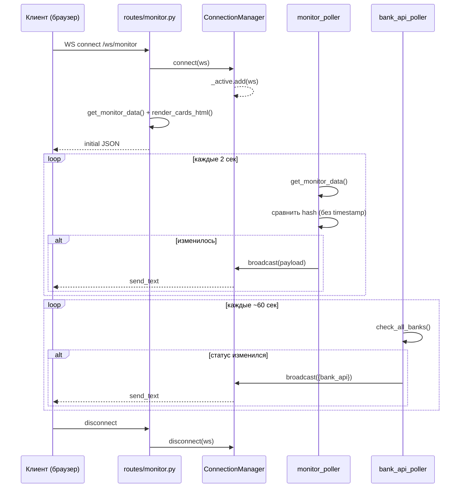

# Мониторинг SBP MQ

## 🎯 Что мониторится

| Слой | Что отслеживается | Где смотреть |
|------|-------------------|--------------|
| **Job-файлы** | Активные (`processing:*`) и завершённые (`task:*`) задачи в Redis | `/monitor`, `/monitor/data` |
| **Доступность банков** | TCP-connect к `host:port` каждого банка | дашборд, `/health/detailed` |
| **WebSocket-клиенты** | Число активных соединений `/ws/monitor` | `/health/detailed` → `monitor_ws.clients` |
| **RabbitMQ** | Размер очереди, число consumers | `/health/detailed` → `rabbitmq` |
| **Redis** | Кол-во ключей по типам (`req:*`, `task:*`, `progress:*`, `lock:*`, `processed:*`) | `/health/detailed` → `redis` |
| **Воркеры** | systemd-сервисы по паттерну `config.WORKER_PATTERN` | `/health/detailed` → `workers` |

---

## 🌐 Веб-дашборд `/monitor`

### Структура

```
┌────────────────────────────────────────────────────────────┐
│  SBP MQ — Мониторинг                    [фильтры] [WS: ●]  │
├────────────────────────────────────────────────────────────┤
│  🔥 В обработке (2)                                        │
│  ┌──────────────┐  ┌──────────────┐                        │
│  │ ci@zkh@123   │  │ ci@zkh@124   │  ← карточки            │
│  │ ▓▓▓▓░░░ 45%  │  │ ▓▓▓▓▓▓▓ 100% │    active/progress    │
│  └──────────────┘  └──────────────┘                        │
├────────────────────────────────────────────────────────────┤
│  ✅ Завершённые (5)  (за 5 мин)                            │
│  ┌──────────────┐  ┌──────────────┐  ┌──────────────┐      │
│  │ ci@zkh@120   │  │ ci@zkh@121   │  │ ci@zkh@122   │      │
│  │ SUCCESS      │  │ ERROR        │  │ SUCCESS      │      │
│  └──────────────┘  └──────────────┘  └──────────────┘      │
├────────────────────────────────────────────────────────────┤
│  🏦 Банки: ci ✅  sb ⏭  vtb ⏭    ⏱ последняя проверка …   │
└────────────────────────────────────────────────────────────┘
```

- **URL:** `http://localhost:8512/monitor` (DEV) / `http://localhost:8510/monitor` (PROD)
- **Обновление:** realtime через `WS /ws/monitor`, **без перезагрузки страницы**
- **Индикатор WS:** точка в правом верхнем углу (`●` зелёная / красная при disconnect)

### Что показывает

- **`processing:*`** — активные задачи из Redis: прогресс, файлы, callback-статистика
- **`task:*`** — завершённые за последние 5 мин: успех/ошибка, summary, текст ошибки
- **Callback-информация** — число callback'ов и последняя ошибка (если была)
- **Фильтры** по `bank` / `base` / `status`
- **Кнопка копирования** `task_id` в каждой карточке

---

## 📡 WebSocket `/ws/monitor`

### Логика подключения



### Формат `initial` (при подключении)

```json
{
  "timestamp": "2026-09-20T17:46:51",
  "processing_count": 2,
  "completed_count": 5,
  "banks": ["ci"],
  "bases": ["zkh_ursv"],
  "cards_html": "<div class='section'>…</div>",
  "bank_api": {"ci": {"available": true, "latency_ms": 12.4}}
}
```

### Формат обновлений

**От `monitor_poller`** (каждые 2 сек при изменениях):

```json
{
  "timestamp": "…",
  "processing_count": 1,
  "completed_count": 6,
  "banks": ["ci"],
  "bases": ["zkh_ursv"],
  "cards_html": "<div class='section'>…</div>"
}
```

**От `bank_api_poller`** (при изменении статуса банка):

```json
{
  "timestamp": "2026-09-20T17:47:00",
  "bank_api": {
    "ci":  {"bank": "ci",  "available": true,  "latency_ms": 12.4, "error_type": null},
    "sb":  {"bank": "sb",  "available": true,  "latency_ms": 15.1, "error_type": null},
    "vtb": {"bank": "vtb", "available": false, "error": null, "error_type": "timeout"}
  }
}
```

### Пример клиента (JS)

```javascript
const ws = new WebSocket(`ws://${location.host}/ws/monitor`);

ws.onopen = () => console.log('[ws] connected');

ws.onmessage = (e) => {
  const data = JSON.parse(e.data);

  if (data.cards_html !== undefined) {
    document.querySelector('#cards').innerHTML = data.cards_html;
    document.querySelector('#processing-count').textContent = data.processing_count;
  }
  if (data.bank_api) {
    updateBankStatus(data.bank_api);
  }
};

ws.onclose = () => setTimeout(() => location.reload(), 3000);
```

### Авто-очистка «мёртвых» соединений

`ConnectionManager.broadcast()` при отправке отлавливает ошибки и удаляет
такие WebSocket'ы из `_active`. Клиент, который «завис», уйдёт из счётчика
при первом же broadcast.

---

## 🔄 Два poller'а в `sbp.py` (lifespan)

Запускаются при старте приложения, останавливаются при shutdown через
общий `asyncio.Event`.

```python
# sbp.py (фрагмент lifespan)
stop_event = asyncio.Event()

monitor_task = asyncio.create_task(monitor_poller(stop_event))
bank_api_task = asyncio.create_task(bank_api_poller(stop_event))

yield  # ← приложение работает

stop_event.set()
await asyncio.gather(monitor_task, bank_api_task, return_exceptions=True)
```

### `monitor_poller` (каждые 2 сек)

`modules/monitor/ws.py`:

1. `get_monitor_data()` — собрать снимок из Redis (см. [data.py](#сбор-данных))
2. **Отфильтровать `timestamp`** перед подсчётом hash
3. Если хэш **изменился** с прошлой итерации — `broadcast(payload)` всем WS-клиентам
4. Если нет клиентов — данные всё равно читаются (для `/monitor/data`)
5. `asyncio.wait_for(stop_event.wait(), timeout=2.0)` — ждать 2 сек или событие остановки

**Экономия:** broadcast только при **реальных изменениях** — не долбит клиентов каждые 2 сек.

### `bank_api_poller` (60 сек, jitter, backoff)

`modules/monitor/ws.py`:

1. **Стартовый jitter** — `random.uniform(5, 30)` сек, чтобы DEV и PROD не совпали
2. `check_all_banks()` — параллельная TCP-проверка всех банков
3. `bank_api_state.record(result)` — обновить состояние (consecutive_errors)
4. Если **статус изменился** — `broadcast({bank_api})`
5. `interval = bank_api_state.get_next_interval()` — базовый + jitter
6. `asyncio.wait_for(stop_event.wait(), timeout=interval)`

---

## 🏦 `bank_api.py` — TCP-проверка банков

### Почему TCP, а не HTTP

- **Не нагружает nginx** — нет записей в access log
- **Не требует авторизации** — только TCP-connect
- **Быстро** — миллисекунды вместо десятков мс на HTTP/TLS
- **Незаметно** — только SYN-пакеты

### Параметры

| Параметр | Значение | Смысл |
|----------|----------|-------|
| `HEALTHCHECK_INTERVAL` | 60 | базовый интервал (сек) |
| `HEALTHCHECK_JITTER` | ±15 | разброс интервала |
| `HEALTHCHECK_TIMEOUT` | 5.0 | таймаут TCP-connect (сек) |

### Backoff при ошибках

```python
BACKOFF_MAP = {
    0: 60,      # 0 ошибок → каждые 60 сек
    3: 600,     # ≥3 ошибок → каждые 10 мин
    5: 1800,    # ≥5 ошибок → каждые 30 мин
}
```

Счётчик `consecutive_errors` **сбрасывается в 0**, как только **все** банки
стали доступны.

### Что возвращает `check_bank_tcp()`

```python
@dataclass
class BankApiStatus:
    bank: str
    host: str
    port: int
    available: bool = False
    latency_ms: Optional[float] = None
    error: Optional[str] = None
    checked_at: str = ""
    error_type: Optional[str] = None
```

`error_type`:
- `"dns"` — не разрешается hostname
- `"timeout"` — TCP timeout (5 сек)
- `"refused"` — connection refused
- `"other"` — прочее

### Пропуск URL-заглушек

Банки с `"..."` в `BANK_CONFIG[bank]["url"]` — **пропускаются**:

```python
if "..." in url:
    logger.debug(f"[BankAPI] Пропуск {bank}: URL-заглушка")
    continue
```

В DEV обычно так: `ci` — рабочий URL, `sb`/`vtb` — заглушки.
В логах это видно как `Пропуск sb: URL-заглушка`.

---

## 📊 Сбор данных (`data.py`)

### Источники

- **`progress:*`** в Redis → активные задачи (`processing`)
- **`task:*`** в Redis → завершённые (`completed`)
- **`callback_stats`** → callback-статистика (обогащение)

### Активные задачи (`_load_processing`)

```python
keys = await redis_client.keys("progress:*")
for key in keys:
    progress = json.loads(await redis_client.get(key))
    progress['task_id'] = key.replace("progress:", "")
    progress['_type'] = 'processing'
    # собираем set banks/bases
```

Поля `progress:*` (от worker'а):
- `bank`, `base`, `job_id`, `job_name`
- `processed_files`, `total_files`, `progress_percent`
- `current_file`, `success_files`, `error_files`
- `started_at`

### Завершённые задачи (`_load_completed`)

```python
COMPLETED_TTL_MINUTES = 5  # показываем только за последние 5 мин

keys = await redis_client.keys("task:*")
for key in keys:
    task = json.loads(await redis_client.get(key))
    if task['finished_at'] < cutoff:  # старше 5 мин — пропуск
        continue
    # нормализация в единую структуру
```

### Обогащение callback-статистикой (`_enrich_with_callbacks`)

Для каждой задачи (и активной, и завершённой):

```python
job['callback_count']       = await callback_stats.get_count(bank, base, job_id)
job['callback_last_error']  = await callback_stats.get_last_error(bank, base, job_id)
```

Это даёт в карточке:
- `📞 Callback'ов: N`
- `❌ <текст последней ошибки> 🕐 <время>` (если есть)

### Сортировка

- `processing` — по `started_at` (убыв.)
- `completed` — по `finished_at` (убыв.)

---

## 🎨 Рендер карточек (`render.py`)

### Карточка активной задачи `render_progress_card()`

```
┌────────────────────────────────────────────────┐
│ ci@zkh_ursv@123                      [В РАБОТЕ]│
│ Обработка файлов за сентябрь                   │
│ ▓▓▓▓▓▓░░░░░░░░░░░░░░ 45%                       │
│ 📁 5/10   ✅ 4   ❌ 1                          │
│ 📄 Сейчас: file_006.json                       │
│ 📞 Callback'ов: 12                             │
│ ❌ timeout на запросе ABC 🕐 17:30:00          │
│ 🔑 job_20260906_abc123        📋  🕐 17:25:00  │
└────────────────────────────────────────────────┘
```

### Карточка завершённой задачи `render_completed_card()`

- Тот же формат, но вместо прогресс-бара — `summary`:
  `📁 10/10   ✅ 9   ❌ 1`
- **Текст ошибки** собирается `_collect_job_error()`:
  1. `job["error"]` (общая)
  2. `files[].error` (по файлам): `filename: error`
  3. Обрезается до 300 символов

### Бейдж статуса `render_status_badge()`

| Status | Цвет | Текст |
|--------|------|-------|
| `processing` | `#1976d2` (синий) | В РАБОТЕ |
| `completed` | `#388e3c` (зелёный) | ЗАВЕРШЕНО |
| `error` | `#c62828` (красный) | ОШИБКА |
| `pending` | `#f57c00` (оранжевый) | ОЖИДАНИЕ |
| (default) | `#757575` (серый) | (сам статус) |

### Callback-блок `render_callback_html()`

Если `callback_count > 0`:
```html
📞 Callback'ов: 12
```
Если есть `callback_last_error`:
```html
❌ <error_short> 🕐 <time>
```
`error_short` — обрезается до 100 символов, полный текст в `title=` (tooltip).

---

## 🔗 Связка с `/health/detailed`

Смотри [api.md → /health/detailed](api.md#get-healthdetailed).

| Компонент | Что внутри |
|-----------|-----------|
| `monitor_ws` | `{"status": "ok", "clients": N}` — из `manager.count` |
| `bank_api` | `{"status": "ok", "last_check": "…", "banks": {...}}` — из `bank_api_state.get_status()` |
| `redis` | `keys: {"req": N, "task": N, "progress": N, "lock": N, "processed": N}` |

---

## 🧪 Отладка

### Посмотреть данные из Redis напрямую

```bash
# DEV (DB 1)
redis-cli -n 1 keys 'progress:*'
redis-cli -n 1 get 'progress:job_20260906_abc'
redis-cli -n 1 keys 'task:*'

# PROD (DB 0)
redis-cli -n 0 keys 'task:*'
```

### Посмотреть данные мониторинга

```bash
curl -s http://localhost:8512/monitor/data | jq .

# только счётчики
curl -s http://localhost:8512/monitor/data | jq '{processing: (.processing|length), completed: (.completed|length)}'

# активные (для деплоя — проверка processing_count=0)
curl -s http://localhost:8512/monitor/data | jq '.processing_count'
```

### Проверить WS вручную

```bash
# websocat или wscat
wscat -c ws://localhost:8512/ws/monitor
# сразу придёт initial JSON
```

### Логи poller'ов

```bash
# monitor_poller
sudo journalctl -u sbp_mq-dev.service | grep "\[WS\]"

# bank_api_poller
sudo journalctl -u sbp_mq-dev.service | grep "\[BankAPI\]"

# в реальном времени
sudo journalctl -u sbp_mq-dev.service -f | grep -E "\[WS\]|\[BankAPI\]"
```

Что искать:
- `[WS] Poller запущен` / `остановлен`
- `[WS] Клиент подключён (всего: N)`
- `[BankAPI] Broadcast: ['ci']`
- `[BankAPI] TCP errors=0, next_interval=60s`
- `[BankAPI] Пропуск sb: URL-заглушка`

---

## ⚙️ Что можно подкрутить

| Параметр | Файл | По умолчанию | Смысл |
|----------|------|--------------|-------|
| `COMPLETED_TTL_MINUTES` | `data.py` | 5 | сколько минут показывать завершённые |
| `HEALTHCHECK_INTERVAL` | `bank_api.py` | 60 | базовый интервал TCP-проверки |
| `HEALTHCHECK_JITTER` | `bank_api.py` | ±15 | разброс интервала |
| `HEALTHCHECK_TIMEOUT` | `bank_api.py` | 5.0 | таймаут TCP-connect |
| `BACKOFF_MAP` | `bank_api.py` | `{0:60, 3:600, 5:1800}` | backoff при ошибках |
| Интервал monitor_poller | `ws.py` | 2 сек | период проверки изменений |
| Стартовый jitter bank_api | `ws.py` | 5–30 сек | разброс старта poller'а |

---

## 🔗 Связанные документы

- [api.md](api.md) — `/monitor`, `/monitor/data`, `/monitor/cards`, `/ws/monitor`
- [architecture.md](architecture.md) — общая схема и потоки данных
- [modules/monitor.md](modules/monitor.md) — детально по файлам модуля (TODO)
- [workflows/callback_flow.md](workflows/callback_flow.md) — как callback попадает в мониторинг (TODO)