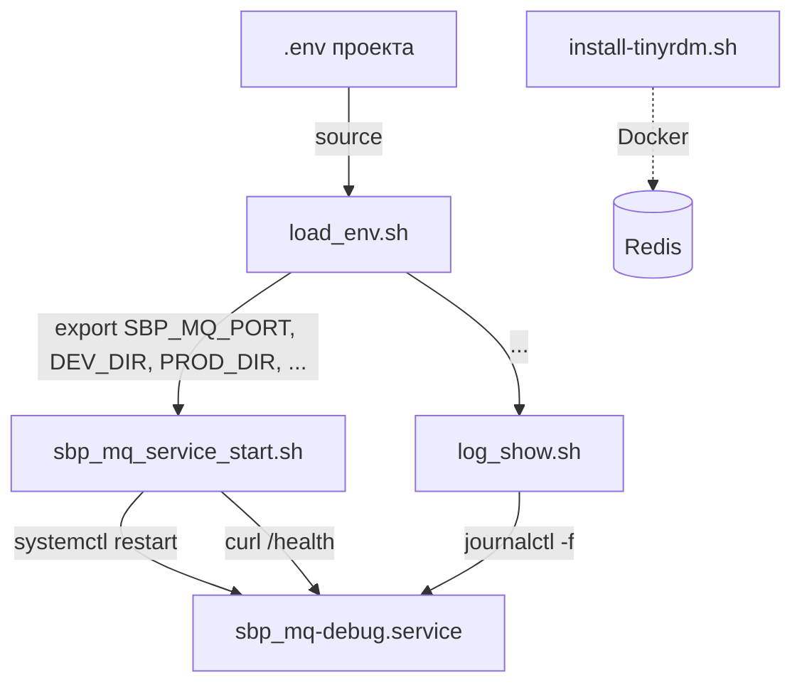

# Скрипты `sh_common/`

Общие скрипты. **Работают и в DEV, и в PROD.** Используются как утилиты
другими скриптами (`sh_dev/*`, `sh_prod/*`).

> 📖 **Общая картина** — [deployment.md](../deployment.md).

---

## 📁 Структура

```
sh_common/
├── load_env.sh               ← загрузка .env в shell
├── sbp_mq_service_start.sh   ← рестарт PROD с ожиданием
├── log_show.sh               ← live-логи PROD
├── install-tinyrdm.sh        ← установка Tiny RDM (Docker)
└── README.md
```

---

## 🗂 `load_env.sh` — **ключевой скрипт**

**Назначение:** загружает `.env` проекта в переменные окружения shell.
Используется **всеми** остальными скриптами.

### Контракт

```bash
source sh_common/load_env.sh "$PROJECT_DIR"
```

После вызова доступны:

| Переменная | Что |
|------------|-----|
| `SBP_MQ_PORT` | порт HTTP |
| `SBP_MQ_DEBUG_PORT` | порт debugpy |
| `REDIS_DB` | номер БД Redis |
| `RABBITMQ_QUEUE` | имя очереди |
| `TEST_MODE` | `true` / `false` |
| `DEV_DIR` | `/var/www/html/sbp_mq_dev` |
| `PROD_DIR` | `/var/www/html/sbp_mq` |
| `PROJECT_DIR` | переданная директория |

### Логика

1. Проверка, что `project_dir` передан
2. Проверка, что `project_dir/.env` существует
3. `set -a; source .env; set +a` — все переменные из `.env` экспортируются
4. **Проверка обязательных:** `SBP_MQ_PORT`, `DEV_DIR`, `PROD_DIR`
5. Установка defaults для необязательных:
   - `SBP_MQ_DEBUG_PORT=5679`
   - `REDIS_DB=0`
   - `RABBITMQ_QUEUE=sbp_mq_queue`
   - `TEST_MODE=false`
6. `export` всех ключевых

### Возврат

- `0` — успех
- `1` — `.env` не найден / не задан `project_dir` / пропущена обязательная переменная

При ошибке печатает `❌ load_env: <причина>` в **stderr**.

### Использование в скриптах

```bash
SCRIPT_DIR="$(cd "$(dirname "$0")" && pwd)"
PROJECT_DIR="$(dirname "$SCRIPT_DIR")"

source "$PROJECT_DIR/sh_common/load_env.sh" "$PROJECT_DIR" || exit 1
```

### Особенность: `.env` из DEV и PROD читаются оба

`sh_prod/*` часто делает **двойной** вызов:

```bash
source load_env.sh "$DEV_DIR"      # чтобы узнать $PROD_DIR
source load_env.sh "$PROD_DIR"     # чтобы узнать $SBP_MQ_PORT (8511)
```

Потому что `DEV_DIR` / `PROD_DIR` заданы **в обоих** `.env`, а `SBP_MQ_PORT`
**разный**.

---

## 🚀 `sbp_mq_service_start.sh`

**Назначение:** рестарт `sbp_mq-debug.service` (PROD) с полным ожиданием
старта + healthcheck.

### Что ждёт

1. `systemctl is-active sbp_mq-debug.service` → `active`
2. HTTP на `http://localhost:8511/health` → `200`

### Параметры (в шапке)

| Параметр | Значение | Что |
|----------|----------|-----|
| `PROJECT_DIR` | `/var/www/html/sbp_mq` | **захардкожено** |
| `SERVICE_NAME` | `sbp_mq-debug.service` | сервис |
| `START_TIMEOUT` | 60 сек | ожидание `active` |
| `HTTP_TIMEOUT` | 30 сек | ожидание HTTP-ответа |
| `CHECK_INTERVAL` | 1 сек | частота проверок |

### Логика

1. `systemctl restart sbp_mq-debug.service`
2. Цикл: проверка `active (running)` каждую 1 сек до `START_TIMEOUT`
3. Если не поднялся — печатает ошибку и `journalctl -n 30`
4. Цикл: `curl /health` каждую 1 сек до `HTTP_TIMEOUT`
5. Если не ответил — печатает ошибку и `journalctl -n 30`
6. Успех — печатает финальный `/health` JSON

### Когда использовать

- **Вручную** — когда нужно аккуратно перезапустить PROD без деплоя
- **Альтернатива** для `deploy_to_prod.sh` шагов 8–9, но **без git-операций**

### Особенность

⚠️ **`PROJECT_DIR=/var/www/html/sbp_mq`** — **захардкожено**. Если PROD
переедет — надо править в 3 местах (`PROJECT_DIR`, `SERVICE_NAME`, а по-хорошему —
брать из `.env`).

---

## 📜 `log_show.sh`

**Назначение:** live-логи PROD (`tail -f` через `journalctl`).

```bash
#!/bin/bash
cd /var/www/html/sbp_mq
source .venv/bin/activate
sudo journalctl -u sbp_mq-debug.service -f
```

- Заходит в **PROD-директорию**
- Активирует venv (для `jq`? нет — для `journalctl` не нужно, но оставлено)
- `journalctl -u sbp_mq-debug.service -f` — **live tail**
- **Выход:** `Ctrl+C`

⚠️ **Захардкожен путь** `/var/www/html/sbp_mq`. Для DEV не подходит (там свой
`sh_dev/logs_dev.sh`).

⚠️ **`cd` + `source .venv/bin/activate` не нужны** для `journalctl` —
рудимент.

---

## 🐳 `install-tinyrdm.sh`

**Назначение:** установка **Tiny RDM** (Redis GUI) через Docker.

```bash
DATA_DIR="/home/user/tinyrdm_data"
```

### Что делает

1. Проверка, что `docker` установлен
2. Создание папки данных `/home/user/tinyrdm_data`
3. Запуск Docker-контейнера Tiny RDM с монтированием папки
4. Tiny RDM — веб-GUI для Redis (открывается в браузере)

### Данные

- **В домашней папке пользователя** (`/home/user/tinyrdm_data`) — не в проекте
- Хранит **сохранённые коннекты** к Redis

### Когда использовать

- **Первая настройка** на новой машине
- Для ручной отладки Redis (посмотреть `progress:*`, `task:*`, `req:*`)

### Аналог в CLI

```bash
redis-cli -n 1 keys 'progress:*'
```

Tiny RDM удобнее для визуального просмотра.

---

## 🔗 Связки



---

## 🧪 Отладка

### Проверить, что `.env` читается

```bash
cd /var/www/html/sbp_mq_dev
source sh_common/load_env.sh "$PWD"
echo "PORT=$SBP_MQ_PORT"
echo "DEV_DIR=$DEV_DIR"
echo "PROD_DIR=$PROD_DIR"
```

**Ожидаемо:** `PORT=8512`, `DEV_DIR=/var/www/html/sbp_mq_dev`, `PROD_DIR=/var/www/html/sbp_mq`.

### Проверить `sbp_mq_service_start.sh`

**Осторожно** — перезапустит PROD.

```bash
cd /var/www/html/sbp_mq_dev
./sh_common/sbp_mq_service_start.sh
```

Ожидаемо: рестарт + ожидание + финальный `/health` JSON.

### Проверить `install-tinyrdm.sh`

```bash
docker ps | grep tinyrdm
docker logs tinyrdm 2>&1 | tail -20
```

Ожидаемо: контейнер `Up`, лог без ошибок.

---

## 🛠 Как расширять

### Добавить утилиту для обоих окружений

1. Скрипт в `sh_common/*.sh`
2. **Обязательно** использует `load_env.sh` — никакого хардкода портов/путей
3. **Обновить `README.md`** (в `sh_common/`)

### Убрать хардкод `PROJECT_DIR` в `sbp_mq_service_start.sh`

Заменить:

```bash
PROJECT_DIR="/var/www/html/sbp_mq"
```

на:

```bash
SCRIPT_DIR="$(cd "$(dirname "$0")" && pwd)"
PROJECT_DIR="$(dirname "$SCRIPT_DIR")/sbp_mq"       # ← или взять из .env
```

Или взять `PROD_DIR` из `load_env.sh`. **TODO.**

### Аналогично `log_show.sh`

Сейчас хардкод `/var/www/html/sbp_mq`. Можно сделать параметризованным
или переехать в `sh_prod/logs_prod.sh` (уже есть).

---

## 📋 Known issues (TODO)

| # | Файл | Проблема | Приоритет |
|---|------|----------|-----------|
| 1 | `sbp_mq_service_start.sh` | Хардкод `PROJECT_DIR` | средний |
| 2 | `log_show.sh` | Хардкод `/var/www/html/sbp_mq`; `cd` + `activate` не нужны | низкий |
| 3 | `install-tinyrdm.sh` | Хардкод `/home/user/tinyrdm_data` (не `$HOME`) | низкий |
| 4 | `load_env.sh` | Нет валидации `SBP_MQ_DEBUG_PORT`, `RABBITMQ_QUEUE` — только defaults | низкий |

---

## 🔗 Связанные документы

- [deployment.md](../deployment.md) — как запускать, systemd
- [configuration.md](../configuration.md) — переменные `.env`
- [scripts/sh_dev.md](sh_dev.md) — dev-скрипты
- [scripts/sh_prod.md](sh_prod.md) — prod-скрипты
