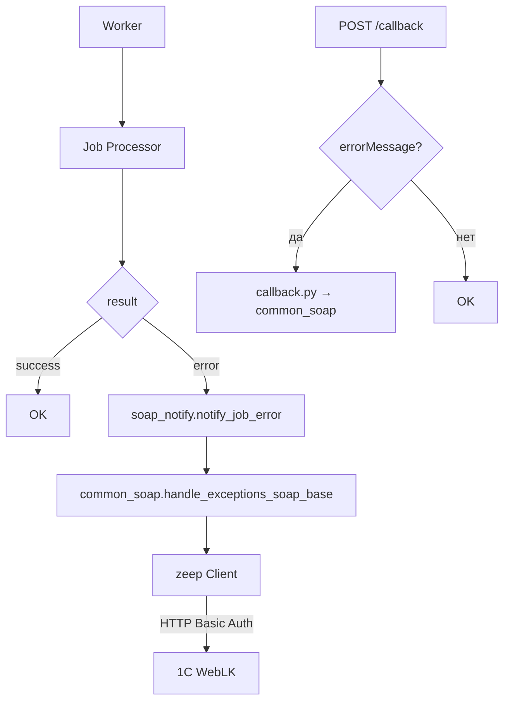
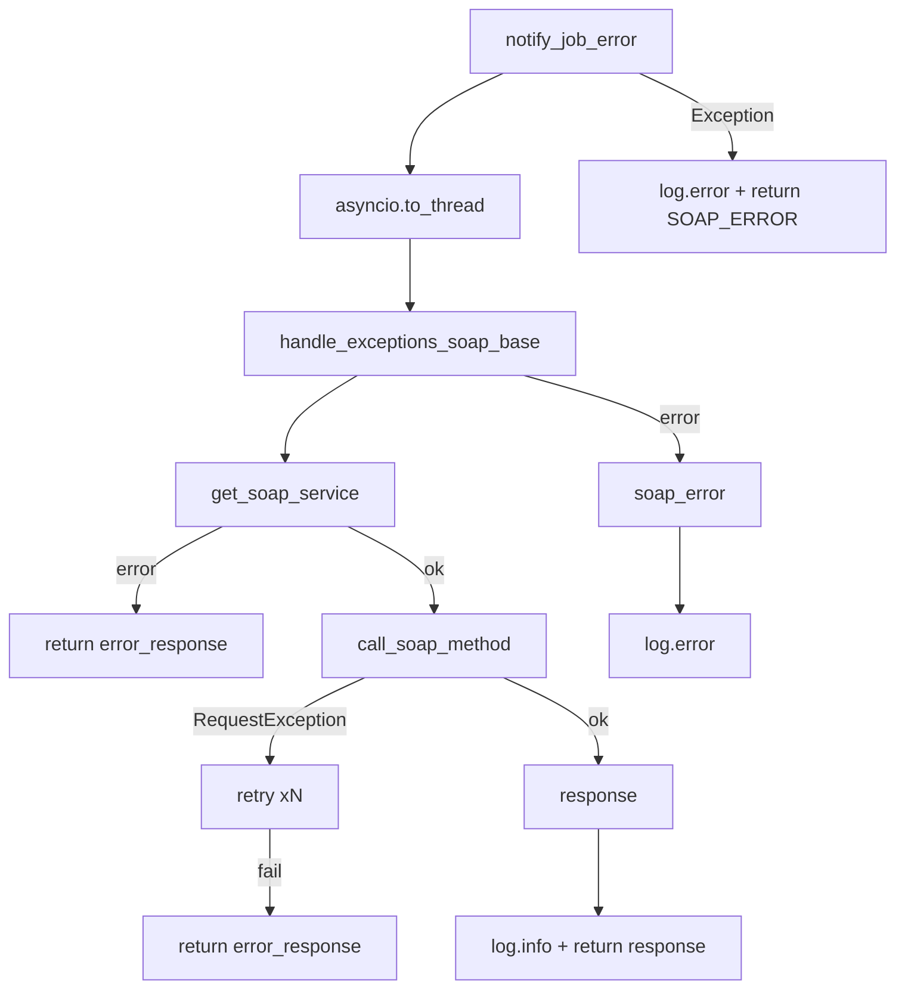

# SOAP-интеграция с 1С

## 🎯 Назначение

SBP MQ отправляет **SOAP-уведомления в 1С** через метод `ProcessPayload`
в двух случаях:

1. **Job Error** — воркер не смог обработать Job (VPN timeout, API 500 и т.п.)
2. **Callback** — банк вернул `errorMessage` в `/callback`

1С различает тип уведомления **по ключу в payload**:
- `jobId` → Job Error (обработка Job упала)
- `requestId` → Callback (ответ банка по конкретному запросу)

Подробнее про callback — [workflows/callback_flow.md](workflows/callback_flow.md) (TODO).

---

## 🔌 Когда вызывается



**Точки вызова в коде:**

| Файл | Строка | Что вызывает |
|------|--------|--------------|
| `modules/worker/consumer.py` | 100–101 | `from modules.soap_notify import notify_job_error` → `await notify_job_error(bank, base, job_id, result)` |
| `routes/callback.py` | (через `common_soap`) | `handle_exceptions_soap_base` напрямую |

`notify_job_error` вызывается **только при ошибке Job**, из воркера. Callback-путь
зовёт `common_soap` напрямую, минуя `soap_notify` (это тонкая обёртка
для Job-ошибок с автоподстановкой `jobId`).

---

## 📨 Формат сообщения

### Job Error

**Payload — JSON-строка**, передаётся в аргумент `Payload` SOAP-метода
`ProcessPayload`.

```json
[
  {
    "jobId": "123",
    "bank": "ci",
    "base": "zkh_ursv",
    "errorMessage": "VPN timeout | 7845.json: API 500",
    "jobName": "Печать квитанций"
  }
]
```

**Поля:**

| Поле | Обяз. | Описание |
|------|-------|----------|
| `jobId` | ✅ | ID Job (строка, из `job_id`) |
| `bank` | ✅ | Имя банка (`ci` / `sb` / `vtb`) |
| `base` | ✅ | Имя базы (`zkh_ursv`) |
| `errorMessage` | ✅ | Текст ошибки (см. «Сбор ошибок» ниже) |
| `jobName` | — | Человекочитаемое имя Job (если есть в `result`) |

### Callback

Формат — на стороне `routes/callback.py`, отличается **наличием `requestId`**
вместо `jobId`. См. [api.md → POST /callback](api.md#post-callback).

---

## 📝 Сбор ошибок (`_collect_errors`)

Приоритет и формат — **вариант C**:

1. **Общая ошибка Job** — `result["error"]` (если есть)
2. **Ошибки по файлам** — `files[].error` с именем файла:
   `{filename}: {error}`
3. **Фоллбэк** — `"Job failed"` (если ничего нет)

**Разделитель:** `" | "`.
**Максимальная длина:** 500 символов (обрезается с `...`).

### Примеры

| Источник | Результат |
|----------|-----------|
| `result["error"] = "VPN timeout"` | `VPN timeout` |
| Один файл упал | `7845.json: API 500` |
| Общая + 2 файла | `VPN timeout \| 7845.json: API 500 \| 7846.json: timeout` |
| Ничего нет | `Job failed` |
| >500 символов | `...обрезается до 500...` |

**Настройки** (`modules/soap_notify.py`):
```python
MAX_ERROR_LENGTH = 500
ERROR_SEPARATOR = " | "
FALLBACK_ERROR = "Job failed"
```

---

## ⚙️ Конфигурация (`config.py`)

### SOAP_CONFIG

```python
SOAP_CONFIG = {
    "default": {
        "url": "http://192.168.10.128/zkh_lk1/ws/WebLK?wsdl",
        "username": "Администратор",
        "password": ""                       # ← маскировано
    },
    "base": {
        "url_template": "http://192.168.10.238/{base}/ws/WebLK?wsdl",
        "username": "Администратор",
        "password": "***"                    # ← маскировано
    }
}
```

- **`default`** — используется, когда база не указана
- **`base`** — **основной шаблон** для `notify_job_error`:
  `url_template.format(base=base)` → `http://192.168.10.238/zkh_ursv/ws/WebLK?wsdl`

> ⚠️ **Пароль сейчас захардкожен в `config.py`.** Рекомендуется вынести
> `SOAP_CONFIG["base"]["password"]` в `.env` (`SOAP_PASSWORD`) и читать через
> `parse_str_env`. В документации секреты маскируются.

### Таймауты и ретраи

| Параметр | Default | Источник | Смысл |
|----------|---------|----------|-------|
| `SOAP_TIMEOUT` | 60 сек | `.env` | общий timeout zeep-транспорта |
| `SOAP_OPERATION_TIMEOUT` | 30 сек | `.env` | timeout одной операции |
| `SOAP_MAX_RETRIES` | 3 | `.env` | кол-во попыток при `RequestException` |
| `SOAP_RETRY_DELAY` | 1 сек | `.env` | пауза между попытками |

Все четыре читаются через `parse_*_env()` — можно переопределить в `.env`.

---

## 🔧 Механика вызова

### Стек

- **zeep** — SOAP-клиент
- **requests** — HTTP-транспорт
- **lxml** — XML-парсинг

### `get_soap_service(url, username, password)`

Создаёт `zeep.Client`:
- `Settings(strict=True)` — строгий режим
- `InMemoryCache(timeout=60)` — кэш WSDL
- `Transport(session, timeout=60, operation_timeout=30, cache)`
- `UTF8BasicAuth` — Basic Auth с **UTF-8** в credentials (важно для русских логинов,
  стандартный `HTTPBasicAuth` в requests использует latin-1 и падает)

### `call_soap_method(service, method_name, max_retries=3, retry_delay=1)`

Цикл до `max_retries` попыток:

1. `method = getattr(service, method_name)` → `method(**kwargs)`
2. Успех → `return response, None`
3. `requests.exceptions.RequestException` → retry с `time.sleep(1)`
4. **Другие исключения** (например, `zeep.exceptions.Fault`) — **не ретраятся**,
   сразу `break`
5. После всех попыток — `return None, "SOAP {method} не выполнен после N попыток: ..."`

### `handle_exceptions_soap_base(base, method_name, context, **kwargs)`

**Публичная точка входа** для всех SOAP-вызовов:

1. Формирует URL: `url_template.format(base=base)`
2. `get_soap_service(url, username, password)`
3. `call_soap_method(service, method_name, **kwargs)`
4. Логирует **elapsed** для обоих шагов (в секундах)
5. При ошибке возвращает `create_response(status=API_SOAP_ERROR, ...)`

**Возвращает:** `Tuple[response, error_dict | None]`
- `(response, None)` — успех
- `(None, error_response)` — ошибка (структурированный ответ)

### `notify_job_error(bank, base, job_id, result)`

Обёртка для **Job Error**:

```python
payload_item = {
    "jobId": str(job_id),
    "bank": bank,
    "base": base,
    "errorMessage": _collect_errors(result),
}
if result.get("job_name"):
    payload_item["jobName"] = result["job_name"]

payload_json = json.dumps([payload_item], ensure_ascii=False)
context = f"job_error_{bank}@{base}@{job_id}"

response, soap_error = await asyncio.to_thread(
    common_soap.handle_exceptions_soap_base,
    base, "ProcessPayload", context,
    Payload=payload_json,
)
```

⚠️ **Важно:** `handle_exceptions_soap_base` — **синхронный** (zeep + requests).
Поэтому оборачивается в `asyncio.to_thread()` — не блокирует event loop.

---

## 🛡️ Обработка ошибок

### Уровни



### Что логируется

| Событие | Уровень | Сообщение |
|---------|---------|-----------|
| Начало отправки | `INFO` | `[SOAP Notify] Отправка уведомления: ci@zkh_ursv@123 — VPN timeout...` |
| Ошибка zeep/requests | `ERROR` | `[SOAP Notify] ❌ Ошибка уведомления job_error_ci@...: <текст>` |
| Успех | `INFO` | `[SOAP Notify] ✅ Уведомление job_error_ci@... отправлено` |
| Ответ 1С | `INFO` | `[SOAP Notify] Ответ 1С: <response>` (обрезан до 500 символов) |
| Критическая ошибка | `ERROR` | `[SOAP Notify] ❌ Критическая ошибка ...: <текст>` + `exc_info=True` |

### Что если SOAP тоже упал

`notify_job_error` **не бросает исключение** — всегда возвращает `response`
или `error_response`. Воркер **продолжает работу**. При этом:

- Job-файл **уже** в `error/` (worker сохранил до вызова SOAP)
- Запись в `task:*` (Redis) **есть** — мониторинг покажет карточку
- В логах — `❌` с текстом ошибки SOAP

**1С не получит уведомление**, но данные не потеряются — можно дослать вручную
или починить и повторить.

### Retry-логика

Retry **только** на `requests.exceptions.RequestException`:
- `ConnectionError`
- `Timeout`
- `HTTPError` (5xx, 4xx — тоже)
- DNS-ошибки

**Не** retry на:
- `zeep.exceptions.Fault` — 1С вернула SOAP fault (ошибка в данных)
- `zeep.exceptions.ValidationError` — неверный XML
- `TypeError` / `AttributeError` — баги в коде

---

## 🧪 Отладка

### Вручную отправить SOAP

```python
# python -i
import asyncio
from modules.soap_notify import notify_job_error

result = {
    "error": "Test error",
    "files": [
        {"filename": "test.json", "error": "API 500"},
    ],
    "job_name": "Test Job",
}

resp = asyncio.run(notify_job_error("ci", "zkh_ursv", 999, result))
print(resp)
```

### Проверить WSDL вручную

```bash
curl -s "http://192.168.10.238/zkh_ursv/ws/WebLK?wsdl" | head -50
```

### Логи SOAP

```bash
# DEV
sudo journalctl -u sbp_mq-dev.service | grep "SOAP"

# PROD
sudo journalctl -u sbp_mq-debug.service | grep "SOAP"

# в реальном времени
sudo journalctl -u sbp_mq-dev.service -f | grep "SOAP"
```

Что искать:
- `SOAP get_soap_service выполнен за 0.34 сек для базы zkh_ursv`
- `SOAP ProcessPayload выполнен за 0.12 сек для базы zkh_ursv`
- `[SOAP Notify] ✅ Уведомление job_error_ci@zkh_ursv@123 отправлено`

### Типовые проблемы

| Симптом | Причина | Что делать |
|---------|---------|-----------|
| `DNS: [Errno -2]` | не разрешается host из URL | проверить `url_template` в `config.SOAP_CONFIG` |
| `TCP timeout` | 1С недоступна (VPN, firewall) | проверить `telnet 192.168.10.238 80` |
| `401 Unauthorized` | неверный логин/пароль | проверить `SOAP_CONFIG["base"]` |
| `SOAP Fault: ...` | 1С вернула ошибку (валидация данных) | смотреть текст fault в логе |
| `zeep.exceptions.TransportError` | сетевые проблемы | retry'и исчерпаны, лог с ошибкой |
| `UnicodeEncodeError` | latin-1 в Basic Auth | должен быть `UTF8BasicAuth` — проверить, что не заменён |

---

## 🔐 Безопасность

⚠️ **Текущее состояние:**

- Пароль SOAP в `config.py` **захардкожен**: `"password": "***"`
- `config.py` **в git** — секрет виден всем, у кого доступ к репозиторию

**Рекомендуется:**

1. Вынести в `.env`:
   ```bash
   SOAP_USERNAME=Администратор
   SOAP_PASSWORD=***
   ```
2. В `config.py`:
   ```python
   SOAP_CONFIG = {
       "base": {
           "url_template": "http://192.168.10.238/{base}/ws/WebLK?wsdl",
           "username": parse_str_env("SOAP_USERNAME", "Администратор"),
           "password": parse_str_env("SOAP_PASSWORD", ""),
       }
   }
   ```
3. `.env` **не в git** — уже так (`.gitignore`)
4. Ротация пароля через тикет в 1С-отдел

До этого — при передаче `config.py` третьим лицам **маскировать** пароль.

---

## 🔗 Связанные документы

- [api.md](api.md) — `POST /callback`
- [architecture.md](architecture.md) — общая схема, поток Job Error
- [workflows/callback_flow.md](workflows/callback_flow.md) — callback от банка (TODO)
- [workflows/error_handling.md](workflows/error_handling.md) — общая обработка ошибок (TODO)
- [configuration.md](configuration.md) — `config.py` + `.env` (TODO)