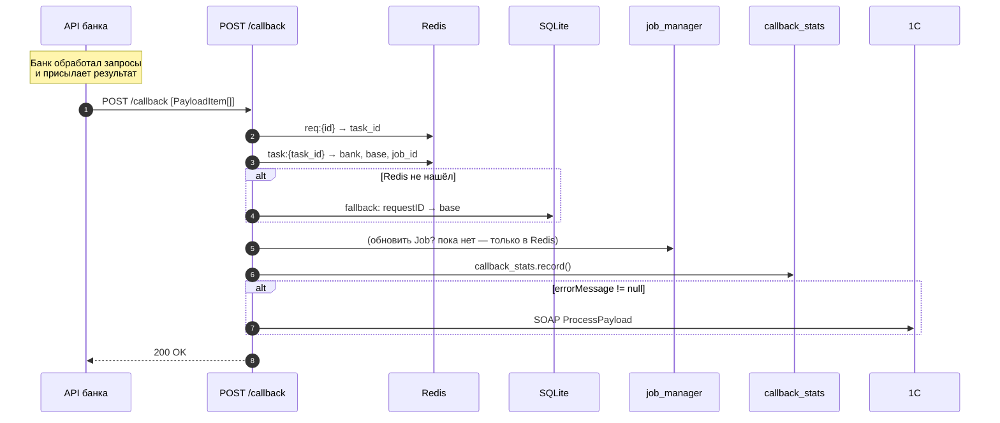

# Workflow: callback от банка

Как банк уведомляет о результате обработки запроса и что происходит в SBP MQ.

> 📖 Связанные: [api.md](../api.md#post-callback),
> [soap_integration.md](../soap_integration.md),
> [modules/mq_client.md](../modules/mq_client.md),
> [modules/worker.md](../modules/worker.md).

---

## 🗺 Общая схема



---

## 📨 Что присылает банк

**Тело запроса** — массив `PayloadItem` (≤ 10 000 элементов):

```json
[
  {
    "requestId": "754316",
    "qrPayload": "QR:abc...",
    "errorMessage": null
  },
  {
    "requestId": "754317",
    "qrPayload": null,
    "errorMessage": "payment rejected"
  }
]
```

**Модель `PayloadItem`** (см. `models/schemas.py`):

| Поле | Тип | Обяз. | Описание |
|------|-----|-------|----------|
| `requestId` | str | ✅ | ID запроса, который отправляли в банк |
| `qrPayload` | str | — | QR-код (при успехе) |
| `errorMessage` | str | — | Ошибка (если есть) |

**Endpoint:** `POST /callback` (без авторизации, внутренний).

**HTTP-код ответа:** всегда `200` (даже если часть запросов не разрешилась —
это ответственность банка решать, повторять или нет).

---

## 🧭 Шаг 1. Разрешение `requestId` → `base`

**Проблема:** банк присылает `requestId`, но в Job-статусе нужен `base`.

**`routes/callback.py::resolve_bases_for_requests`:**

1. **Redis (основной путь):**
   - `request_storage.get_task_ids_for_requests(request_ids)` — пачка `req:{id}` → `task_id`
   - Для каждого `task_id` — `mq_client.get_result(task_id)` (читает `task:*` из Redis)
   - Из `task:*` берётся `base`

2. **SQLite (fallback):**
   - Для `requestID`, которые не нашлись в Redis — `db.get_bases_for_requests(...)`
   - SQLite наполняется в `worker/file_processor.py` шаг 4 (см. [create_job.md](create_job.md#-шаг-5-обработка-одного-файла))

**Что возвращает:**

```python
(
  {requestID: base | None},                     # основной результат
  {task_id: {bank, base, job_id}},              # task_info
  {requestID: task_id | None},                  # связка
)
```

**Пример:**

```python
request_ids = ["754316", "754317"]
→ rid_to_base       = {"754316": "zkh_ursv", "754317": "zkh_ursv"}
→ task_info         = {"job_20260920193000_abc": {"bank": "ci", "base": "zkh_ursv", "job_id": 123}}
→ rid_to_task_id    = {"754316": "job_...abc", "754317": "job_...abc"}
```

---

## 🧮 Шаг 2. CallbackStats

**`modules/callback_stats.py`** — Redis-счётчики по каждому Job:

- `callback:{bank}:{base}:{job_id}:count` — сколько callback'ов пришло
- `callback:{bank}:{base}:{job_id}:last_error` — последняя ошибка (JSON: `{error, timestamp}`)

**Зачем:**
- **Мониторинг** показывает в карточке: `📞 Callback'ов: N` и `❌ <ошибка>`
- **Отладка** — видно, приходили ли callback'и для конкретного Job

**TTL:** `REDIS_TTL`.

---

## 🔔 Шаг 3. SOAP при `errorMessage`

**Если хоть один `PayloadItem` имеет `errorMessage != null`:**

→ вызывается `common_soap.handle_exceptions_soap_base(base, "ProcessPayload", ...)`.

**Формат payload в 1С:**

```json
[
  {
    "requestId": "754317",
    "bank": "ci",
    "base": "zkh_ursv",
    "errorMessage": "payment rejected"
  }
]
```

⚠️ **`requestId` вместо `jobId`** — так 1С отличает callback-ошибку от
Job-ошибки. Подробнее — [soap_integration.md](../soap_integration.md#-когда-вызывается).

**Если ошибок нет** — SOAP **не вызывается**, только пишется в CallbackStats
и в SQLite.

---

## 💾 Шаг 4. Что сохраняется

| Что | Где | Кто |
|-----|-----|-----|
| Callback пришёл (счётчик +1) | Redis `callback:*:count` | `callback_stats.record()` |
| Последняя ошибка | Redis `callback:*:last_error` | `callback_stats.record()` |
| Связка `req:*` | Redis | уже есть (не трогаем) |
| Полный результат Job | Redis `task:*` | уже есть (не трогаем) |
| История callback'ов | SQLite | **не пишется сейчас** — TODO |
| Job-файл в `success/`/`error/` | — | уже перемещён worker'ом |

⚠️ **Callback НЕ перемещает Job-файл.** Это делает worker (см. `create_job.md`
шаг 7). Callback может прийти **после** перемещения Job — это нормально.

⚠️ **Callback НЕ удаляет `req:*`.** Ключи живут до `REQUEST_TTL` (1 час).

---

## 🔀 Возможные сценарии

### 1. Успех (`errorMessage = null`)

- `callback_stats` +1
- SOAP **не** вызывается
- Банк получает `200 OK`

### 2. Ошибка (`errorMessage != null`)

- `callback_stats` +1 + `last_error`
- SOAP `ProcessPayload` → 1С
- Банк получает `200 OK`

### 3. `requestId` не найден ни в Redis, ни в SQLite

- `base = None`
- Callback **не сможет** вызвать SOAP (не знает базу)
- Логируется `logger.warning` (см. `callback.py`)
- Банк получает `200 OK` (незачем ему повторять)

**Что делать:**
- Проверить, что `req:*` в Redis есть: `redis-cli -n 1 keys 'req:{id}'`
- Если Redis пуст — fallback на SQLite: `SELECT base FROM requests WHERE request_id=?`
- Если и там нет — **значит callback пришёл раньше, чем worker записал `req:*`**.
  См. «Гонка» ниже.

### 4. Redis упал

- Fallback на SQLite: `db.get_bases_for_requests(...)`
- Если и SQLite упал — `base = None` для всех
- Логируется ошибка

---

## ⚡ Гонка: callback приходит раньше worker'а

**Проблема:** worker делает POST в банк (шаг 6 в [create_job.md](create_job.md)),
но **до этого** записал `req:*` в Redis (шаг 5). **Между шагами 5 и 6** банк
теоретически может прислать callback.

**Порядок гарантирует:** `req:*` записан **до** HTTP. Значит:
- Callback найдёт `task_id` в Redis ✅
- `task:{task_id}` **ещё не существует** (worker запишет только в конце)
- `task_info` будет пустой → `base = None`

**На практике:**
- Callback через реальный API банка — задержка **секунды**. Worker успевает.
- **В TEST_MODE (mockapi)** — ответ мгновенный. Возможен **реальный race**.
- Fallback на SQLite (шаг 4 в `create_job.md`) — на этот случай.

**Правильная последовательность:** worker пишет `req:*` **и** SQLite до POST.
Что и сделано. ✅

---

## 🧪 Отладка

### Посмотреть CallbackStats

```bash
# DEV (DB 1)
redis-cli -n 1 keys 'callback:*'
redis-cli -n 1 get 'callback:ci:zkh_ursv:123:count'        # 5
redis-cli -n 1 get 'callback:ci:zkh_ursv:123:last_error'   # {"error":"...","timestamp":"..."}
```

### Посмотреть связку `req:*`

```bash
redis-cli -n 1 keys 'req:*' | head
redis-cli -n 1 get 'req:754316'    # → task_id
```

### Тестовый callback вручную

```bash
curl -X POST http://localhost:8512/callback \
  -H "Content-Type: application/json" \
  -d '[{"requestId":"754316","qrPayload":"QR:test","errorMessage":null}]'
```

**Ожидаемо:** `200 OK`. В логах — обработка, в Redis — `callback:*` +1.

### Callback с ошибкой

```bash
curl -X POST http://localhost:8512/callback \
  -H "Content-Type: application/json" \
  -d '[{"requestId":"754317","qrPayload":null,"errorMessage":"test error"}]'
```

**Ожидаемо:** `200 OK`. В логах — SOAP-вызов `ProcessPayload`. В логах 1С —
приход сообщения.

### Логи

```bash
sudo journalctl -u sbp_mq-dev.service | grep -E "callback|Callback"
sudo journalctl -u sbp_mq-dev.service | grep "SOAP"
```

Что искать:
- `Получен callback с N запросами`
- `resolve_bases_for_requests: Найдено base: N/M`
- `Callback SOAP: ...`
- `[SOAP Notify] Ответ 1С: ...`

---

## 📋 Что бывает не так

| Симптом | Причина | Что делать |
|---------|---------|-----------|
| `base = None` для всех | Redis пуст + SQLite пуст | проверить `req:*`, проверить `requests.db` |
| SOAP не вызывается при ошибке | `base = None` | см. выше |
| Callback приходит повторно | банк не получил `200` | проверить логи, доступность `POST /callback` |
| `requestId` в callback — не тот | 1С/банк по-разному формируют ID | сверить формат, см. `models/schemas.py` |
| Callback вообще не приходит | банк не настроен на наш `/callback` | проверить конфиг банка, доступность хоста снаружи |

**Больше сценариев:** [workflows/error_handling.md](error_handling.md).

---

## 🛠 Как расширять

### Добавить сохранение истории callback'ов

Сейчас **не сохраняется**. Можно:

1. Новая таблица в SQLite (`callbacks`): `request_id`, `bank`, `base`, `job_id`, `error`, `received_at`
2. В `routes/callback.py` — после успешного resolve — `db.save_callback(...)`
3. Эндпоинт `/stats/callbacks` для просмотра

### Добавить `/callback_sb` и `/callback_vtb`

Сейчас есть **только `/callback`** (для `ci`). Клиенты `BankSB` / `BankVTB`
ссылаются на `/callback_sb` / `/callback_vtb`, но их **нет**.

1. Скопировать `routes/callback.py` → `routes/callback_sb.py`
2. Зарегистрировать в `routes/__init__.py`
3. Или — сделать **общий** эндпоинт с параметром `?bank=ci`

### Изменить формат SOAP при callback

Сейчас — `[{requestId, bank, base, errorMessage}]`.
Если 1С ждёт другое — правка в `routes/callback.py` в блоке вызова
`common_soap.handle_exceptions_soap_base(...)`.

---

## 🔗 Связанные документы

- [api.md](../api.md#post-callback) — формат `POST /callback`
- [soap_integration.md](../soap_integration.md) — SOAP `ProcessPayload`
- [modules/mq_client.md](../modules/mq_client.md) — `ResultStorage`, `request_storage`
- [modules/worker.md](../modules/worker.md) — как worker пишет `req:*`
- [workflows/create_job.md](create_job.md) — что было **до** callback
- [workflows/error_handling.md](error_handling.md) — обработка ошибок
- [monitoring.md](../monitoring.md) — `callback_count` и `last_error` в карточках
