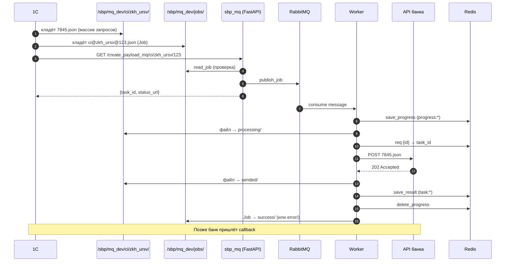

# Workflow: создание и обработка Job

Пошаговый сценарий: **от нажатия кнопки в 1С до callback от банка**.

> 📖 Связанные: [api.md](../api.md), [modules/worker.md](../modules/worker.md),
> [modules/job_manager.md](../modules/job_manager.md), [modules/mq_client.md](../modules/mq_client.md).

---

## 🗺 Общая схема



**Два «мира»:**
- **Файлы** — Job-файл (Job) + файлы с запросами (n×JSON)
- **Очередь/состояние** — RabbitMQ (Job в очередь), Redis (progress, req, task)

---

## 📋 Предусловия

| Что | Где | Кто |
|-----|-----|-----|
| Сервер запущен | `sbp_mq-dev.service` | systemd |
| Воркеры запущены | `sbp_mq-dev-worker*` (3 в DEV) | systemd |
| RabbitMQ доступен | `localhost:5672` | — |
| Redis доступен | `localhost:6379` DB 1 | — |
| Папки готовы | `SBP_ROOT4MQ = /sbp/mq_dev` | `JobManager.__init__` создаёт `jobs/` |
| Файлы с запросами | `/sbp/mq_dev/{bank}/{base}/*.json` | **1С** кладёт заранее |
| Job-файл | `/sbp/mq_dev/jobs/{bank}@{base}@{job_id}.json` | **1С** кладёт перед вызовом API |

---

## 📄 Шаг 0. 1С готовит данные (внешне)

1. Кладёт **файлы с запросами** в `/sbp/mq_dev/{bank}/{base}/`
   ```
   /sbp/mq_dev/ci/zkh_ursv/
   ├── 7845.json    ← [{"requestId":"754316","amount":100}, ...]
   ├── 7846.json
   └── 7847.json
   ```

2. Формирует **Job-файл** — `ci@zkh_ursv@123.json`:
   ```json
   {
     "bank": "ci",
     "base": "zkh_ursv",
     "job_id": 123,
     "job_name": "Печать квитанций",
     "created_at": "2026-09-20T19:00:00",
     "files": [
       {"filename": "7845.json", "count": 4, "request_ids": ["754316", "754317", "754318", "754319"]},
       {"filename": "7846.json", "count": 3, "request_ids": ["754320", "754321", "754322"]}
     ],
     "total_requests": 7,
     "status": "pending"
   }
   ```

3. Кладёт его в `/sbp/mq_dev/jobs/ci@zkh_ursv@123.json`

⚠️ **Имя файла критично:** `{bank}@{base}@{job_id}.json`. `JobSearch.get_job_info`
парсит имя и, если не 3 части, вернёт `None`.

⚠️ **`job_id` — глобально уникален в пределах базы.** Если 1С переиспользует ID
(например, при повторной печати), Job **перезапишется** — старый потеряется.
Об этом — в [workflows/error_handling.md](error_handling.md).

---

## 🚀 Шаг 1. Вызов API

**1С дёргает:**

```
GET http://localhost:8512/create_payload_mq/ci/zkh_ursv/123
```

**Что делает `routes/create_payload_mq.py`:**

1. **Валидация банка** — `bank in config.SBP_ROOT` (иначе `CONFIG_ERROR`)
2. **Проверка Job-файла** — `job_manager.job_exists(bank, base, job_id)`
   - нет → `JOB_NOT_FOUND`
3. **Чтение** — `job_manager.read_job(bank, base, job_id)`
   - ошибка JSON → `JSON_ERROR`
4. **Публикация** — `mq_client.publisher.publish_job(job_data)`
   - генерируется `task_id` = `job_{timestamp}_{uuid6}`
   - message → `RABBITMQ_QUEUE` (`sbp_mq_dev_queue`)
5. **Ответ 200:**
   ```json
   {
     "status": "SUCCESS",
     "data": {
       "task_id": "job_20260920193000_abc123",
       "bank": "ci", "base": "zkh_ursv", "job_id": 123,
       "files_count": 2, "total_requests": 7,
       "status_url": "/create_payload_mq/ci/zkh_ursv/123/status"
     }
   }
   ```

**1С сохраняет `task_id`** — по нему отслеживать статус.

---

## 📨 Шаг 2. Сообщение в RabbitMQ

```json
{
  "task_id": "job_20260920193000_abc123",
  "bank": "ci",
  "base": "zkh_ursv",
  "job_id": 123,
  "job_name": "Печать квитанций",
  "created_at": "2026-09-20T19:00:00",
  "files": [ ... как в Job-файле ... ],
  "total_requests": 7,
  "published_at": "2026-09-20T19:30:00"
}
```

**Свойства:**
- `delivery_mode=PERSISTENT` — не теряется при рестарте RabbitMQ
- `content_type=application/json`
- `routing_key=sbp_mq_dev_queue`

**Очередь `durable=True`** — объявлена в `MQClient.connect()`.

---

## 🏃 Шаг 3. Worker забирает сообщение

**Один из 3 воркеров** (DEV) получает message. `prefetch_count=1` — за раз
только один.

**`worker/consumer.py::process_message`:**

1. **Логирует** `📥 ВЗЯЛ Job {bank}@{base}@{job_id}` в `logs/mq-worker-N.log`
   + короткое в `logs/all.log`
2. **Парсит** JSON
3. **Вызывает** `job_processor.process_job(bank, base, job_id, files, job_data, task_id)`

**Как узнать, какой воркер взял:**

```bash
grep "ВЗЯЛ Job" logs/mq-worker-*.log | tail
# или
sudo journalctl -u 'sbp_mq-dev-worker*' | grep "ВЗЯЛ Job" | tail
```

---

## 📦 Шаг 4. Обработка Job

**`worker/job_processor.py::process_job`:**

1. **Формирует** `result` (симметричный Job-файлу + summary + status)
2. **Сохраняет начальный прогресс** — `progress:{task_id}` в Redis:

   ```json
   {
     "task_id": "...", "status": "processing",
     "bank": "ci", "base": "zkh_ursv", "job_id": 123,
     "total_files": 2, "processed_files": 0,
     "current_file": null, "progress_percent": 0,
     "started_at": "..."
   }
   ```

   С этого момента **карточка появляется в `/monitor`**.

3. **Получает пути** для банка/базы:
   - `base`: `/sbp/mq_dev/ci/zkh_ursv/`
   - `processing`: `/sbp/mq_dev/ci/zkh_ursv/processing/`
   - `sended`, `get`, `geted`, `stop`, `stoped` — по аналогии
4. **Создаёт** подпапки (`mkdir(parents=True, exist_ok=True)`)
5. **Цикл по файлам** — для каждого файла вызывает `file_processor.process_file(...)`
6. **После каждого файла** — `_save_progress(task_id, ...)` (обновляет `progress:*`)
7. **При ошибке в файле** — `has_error = True`, `break` (Job прерывается)
8. **Финал:** `result['status'] = 'error' if has_error else 'completed'`

---

## 📄 Шаг 5. Обработка одного файла

**`worker/file_processor.py::process_file`:**

**Порядок операций (важен!):**

1. **Проверка** существования файла (`base/7845.json`)
2. **→ `processing/`** — `shutil.move`
3. **Читает JSON** (`json.load`)
4. **SQLite** — `db.save_all_requests_from_json(json, base, filename)` ← **fallback для callback**
5. **🔥 Redis** — `request_storage.save_requests(request_ids, task_id)`
   - `SET req:{id} = task_id` для каждого `request_id`
   - **сразу после** — до HTTP в банк
6. **HTTP в банк** — `api_bank.post(data, context=filename)`
7. **Если `202`** → `sended/`
8. **Если ошибка** → возвращает `{'status': 'error', ...}`

**Почему шаг 5 (Redis) до шага 6 (банк):** если банк ответит **очень быстро**,
callback может прийти раньше, чем мы запишем `req:*`. Тогда `callback.py`
**не найдёт `task_id`** → потеряет связку.

---

## 🇨🇮 Шаг 6. Запрос в банк

**Если `TEST_MODE=true`** (DEV):
```
POST http://localhost:8512/mockapi/qr-code
```
Отвечает **202** + фиктивные `qrPayload` (мок).

**Если `TEST_MODE=false`** (PROD):
```
POST https://10.0.245.20:443/ivolga-api/qr-code
```

Подробнее — [modules/api_bank_client.md](../modules/api_bank_client.md).

**Что отправляется:** содержимое `7845.json` — массив запросов. Пример:

```json
[
  {"requestId": "754316", "amount": 100},
  {"requestId": "754317", "amount": 200},
  ...
]
```

**Что возвращается (202):**
```json
[
  {"requestId": "754316", "qrPayload": "QR:abc...", "errorMessage": null},
  {"requestId": "754317", "qrPayload": null, "errorMessage": "accepted"}
]
```

---

## ✅ Шаг 7. Завершение

**`worker/consumer.py` после `job_processor.process_job`:**

1. **`mq_client.save_result(task_id, result)`** — `task:{task_id}` в Redis
   с полным JSON (симметричный заданию + summary)
2. **`mq_client.delete_progress(task_id)`** — удаляет `progress:{task_id}`
   (карточка «В обработке» пропадёт через ≤2 сек — следующий tick poller'а)
3. **Если `result['status'] != 'completed'`:**
   - `notify_job_error(bank, base, job_id, result)` — SOAP в 1С
4. **Перемещает Job-файл:**
   - success → `jobs/success/ci@zkh_ursv@123.json`
   - error → `jobs/error/ci@zkh_ursv@123.json`

**`task:*` живёт `REDIS_TTL` (по умолчанию 3600 сек = 1 час).**

---

## 📊 Что видно в мониторинге

**Во время обработки** (карточка «🔥 В обработке»):

```
┌────────────────────────────────────────┐
│ ci@zkh_ursv@123              [В РАБОТЕ]│
│ Печать квитанций                        │
│ ▓▓▓▓▓░░░░░ 50%                          │
│ 📁 1/2  ✅ 4  ❌ 0                      │
│ 📄 Сейчас: 7846.json                    │
│ 🔑 job_20260920193000_abc123      📋    │
└────────────────────────────────────────┘
```

**После завершения** (карточка «✅ Завершённые», 5 мин):

```
┌────────────────────────────────────────┐
│ ci@zkh_ursv@123           [ЗАВЕРШЕНО]  │
│ Печать квитанций                        │
│ 📁 2/2  ✅ 7  ❌ 0                      │
│ 🔑 job_20260920193000_abc123      📋    │
└────────────────────────────────────────┘
```

**Как смотреть:** `http://localhost:8512/monitor`

---

## 🔄 Что дальше — callback от банка

После шага 6 (или **параллельно** с шагами 6–7, если банк быстрый) приходит
**callback** — отдельный workflow:

→ [workflows/callback_flow.md](callback_flow.md)

**Связь:** `requestId` из callback → `req:{requestId}` в Redis → `task_id` →
Job-файл. Подробнее — в callback_flow.

---

## 🧪 Проверка (вручную)

### Быстрый smoke-тест

```bash
./sh_dev/quick_test.sh
```

### Проверка конкретного Job

```bash
# 1. Создать Job вручную
cat > /sbp/mq_dev/jobs/ci@zkh_ursv@999.json << 'EOF'
{
  "bank": "ci", "base": "zkh_ursv", "job_id": 999,
  "job_name": "Test", "created_at": "2026-09-20T19:00:00",
  "files": [{"filename": "7845.json", "count": 2, "request_ids": ["1", "2"]}],
  "total_requests": 2, "status": "pending"
}
EOF

# 2. Вызвать API
curl "http://localhost:8512/create_payload_mq/ci/zkh_ursv/999" | jq .
# → task_id

# 3. Смотреть прогресс
curl "http://localhost:8512/create_payload_mq/ci/zkh_ursv/999/status" | jq .

# 4. В Redis
redis-cli -n 1 keys 'progress:*'
redis-cli -n 1 get 'progress:job_...'

# 5. Логи
./sh_dev/logs_dev_all.sh    # live
```

---

## 🆘 Если что-то не так

| Симптом | Куда смотреть |
|---------|---------------|
| `JOB_NOT_FOUND` | `ls /sbp/mq_dev/jobs/*.json` |
| Задача в `/monitor` не появилась | `redis-cli -n 1 keys 'progress:*'` |
| Job висит в «В обработке» долго | `./sh_dev/logs_dev_all.sh` + `redis-cli -n 1 keys 'lock:*'` |
| Job в `error/` | `cat /sbp/mq_dev/jobs/error/*.json \| jq .status, .error` |
| Воркер не берёт Job | `sudo systemctl status 'sbp_mq-dev-worker*'` |

**Больше сценариев ошибок:** [workflows/error_handling.md](error_handling.md).

---

## 🔗 Связанные документы

- [api.md](../api.md) — `/create_payload_mq/*`
- [modules/worker.md](../modules/worker.md) — детали обработки
- [modules/job_manager.md](../modules/job_manager.md) — работа с Job-файлами
- [modules/mq_client.md](../modules/mq_client.md) — publish/result/progress
- [modules/api_bank_client.md](../modules/api_bank_client.md) — HTTP в банк
- [monitoring.md](../monitoring.md) — что видно в `/monitor`
- [workflows/callback_flow.md](callback_flow.md) — что происходит после `202`
- [workflows/error_handling.md](error_handling.md) — обработка ошибок
