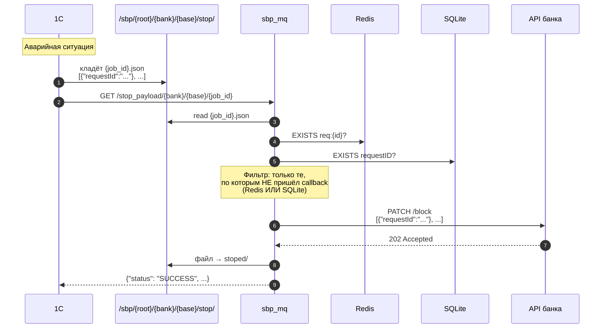

# Workflow: stop_payload (блокировка QR)

Остановка обработки запросов СБП при аварийном завершении.

> 📖 Связанные: [api.md → stop_payload](../api.md#get-stop_payloadbankbasejob_id-мультибанк-mq),
> [modules/api_bank_client.md](../modules/api_bank_client.md),
> [workflows/create_job.md](create_job.md).

---

## 🎯 Назначение

При аварии 1С нужно **заблокировать QR-коды**, которые уже отправлены
в банк, но по которым **ещё не пришёл callback**. Чтобы клиенты не смогли
оплатить «висящие» QR.

**Два пути** — для старой и новой технологии 1С:

| Технология | URL | Bank | Источник файлов |
|-----------|-----|------|-----------------|
| **Старая** | `/stop_payload/{base}` | `ci` (жёстко) | все `stop/*.json` |
| **Новая (`mq`)** | `/stop_payload/{bank}/{base}/{job_id}` | из URL | один `stop/{job_id}.json` |

---

## 🗺 Общая схема



---

## 📋 Предусловия

1. **1С сформировала** файл `stop/{job_id}.json`:
   ```json
   [
     {"requestId": "754316"},
     {"requestId": "754317"}
   ]
   ```
   **Имя файла** = `{job_id}` (в 1С = `ПакетИД`).

2. **Job был отправлен ранее** (через `create_payload_mq`) — есть `req:*` в Redis
   для активных `request_id`.

3. **Банк доступен** — если нет, PATCH вернёт ошибку, файл останется в `stop/`
   для повтора.

---

## 🚦 Логика обработки (оба эндпоинта)

### Шаг 1. Чтение файла

Из `stop/{job_id}.json` извлекается массив `requestId`.

### Шаг 2. Фильтр «unresolved» (не получили callback)

Для каждого `requestId`:

- **`req:{id}` в Redis** → callback **ещё не пришёл** → **блокировать**
- **`req:{id}` нет в Redis, но есть в `requests.db`** → callback **не пришёл** (TTL истёк) → **блокировать**
- **Нигде нет** → callback **пришёл** (удалён из обоих мест) → **пропустить**

**Итог:**
- `unresolved` — блокируем
- `resolved` — пропускаем

### Шаг 3. PATCH /block

- **Legacy** (`/stop_payload/{base}`) — через `api_bank.patch()` (legacy, `ci`)
- **New** (`/stop_payload/{bank}/{base}/{job_id}`) — через
  `create_bank_client(bank).send_request_patch()` (factory, мультибанк)

**Тело запроса:**
```json
[
  {"requestId": "754316"},
  {"requestId": "754317"}
]
```
⚠️ **Только `unresolved`!** `resolved` в банк не отправляются.

### Шаг 4. Обработка ответа

| HTTP | Действие |
|------|----------|
| **202 Accepted** | Файл → `stoped/`, `status=SUCCESS` |
| **4xx / 5xx** | Файл **остаётся** в `stop/`, `status=API_ERROR` — повтор при следующем вызове |
| **Ошибка сети** | То же — файл остаётся |

### Шаг 5. Особый случай — все уже resolved

Если **все** `request_id` уже получили callback (никого блокировать не нужно):
- Файл **всё равно** перемещается в `stoped/`
- Возвращается `SUCCESS` с `blocked: 0, skipped_callback: N`

---

## 📁 Структура директорий

```
/sbp/mq_dev/ci/zkh_ursv/
├── 99001.json            ← исходные файлы с запросами
├── 99002.json
├── stop/                 ← 1С кладёт сюда (новые задачи на stop)
│   └── 123.json          ← {job_id}.json
├── stoped/               ← обработанные
│   └── 122.json
├── sended/
├── processing/
├── get/
└── geted/
```

---

## 🌐 Legacy: `GET /stop_payload/{base}`

**Обратная совместимость** — старая технология 1С.

**Логика:**
1. Сканирует **все** `stop/*.json` в `/sbp/mq_dev/ci/{base}/stop/`
2. Для каждого файла:
   - `job_id` = имя файла
   - `request_ids` = из JSON
   - Фильтр `unresolved` (Redis + SQLite)
   - PATCH через **legacy** `api_bank.patch` (`ci`)
   - Файл → `stoped/`

**Ответ:**
```json
{
  "status": "SUCCESS",
  "base": "zkh_ursv",
  "data": {
    "bank": "ci",
    "total": 1,
    "success": 1,
    "errors": 0,
    "results": [ { ... } ]
  }
}
```

**Пример:**
```bash
curl "http://localhost:8512/stop_payload/zkh_ursv"
```

---

## 🆕 New: `GET /stop_payload/{bank}/{base}/{job_id}`

**Новая технология** (в 1С — `mq`). Мультибанк.

**Логика:**
1. **Валидация** `bank in config.SBP_ROOT` → иначе `CONFIG_ERROR`
2. Файл `stop/{job_id}.json` в `/sbp/{root}/{bank}/{base}/`
3. Если нет — проверка `stoped/{job_id}.json` → `FILE_NOT_FOUND`
4. `process_stop_for_job(bank, base, job_id, stop_file, stoped_dir)`
5. PATCH через **factory** `create_bank_client(bank).send_request_patch()`

**Ответ:**
```json
{
  "status": "SUCCESS",
  "data": {
    "bank": "ci",
    "base": "zkh_ursv",
    "job_id": 123,
    "filename": "123.json",
    "total": 2,
    "blocked": 2,
    "skipped_callback": 0,
    "status_code": 202
  }
}
```

**Пример:**
```bash
curl "http://localhost:8512/stop_payload/ci/zkh_ursv/123"
```

**Коды ошибок:**
| Code | Причина |
|------|---------|
| `CONFIG_ERROR` | `bank` не в `config.SBP_ROOT` |
| `FILE_NOT_FOUND` | Файл `{job_id}.json` нет ни в `stop/`, ни в `stoped/` |
| `JSON_READ_ERROR` | Файл не парсится |
| `JSON_EMPTY` | Нет `requestId` в файле |
| `API_ERROR` | Банк вернул не 202 (файл остаётся в `stop/`) |
| `UNKNOWN_ERROR` | Внутренняя ошибка |

---

## 🧪 Тесты

**Скрипт:** `./sh_dev/test_stop_payload.sh` — проверяет:

| # | Сценарий |
|---|----------|
| 1 | Legacy `NO_FILES` (нет файлов) |
| 2 | Legacy с файлом → SUCCESS, `blocked=2` |
| 3 | New `CONFIG_ERROR` (неизвестный bank) |
| 4 | New `FILE_NOT_FOUND` (файла нет) |
| 5 | New с файлом → SUCCESS, `blocked=2`, `202` |
| 6 | New повторный вызов → `FILE_NOT_FOUND` (уже в `stoped/`) |

**Запуск:**
```bash
./sh_dev/test_stop_payload.sh
```

---

## 🆘 Troubleshooting

### Файл не перемещается в `stoped/`

**Причины:**
- Банк вернул не 202 (PATCH не выполнен)
- Ошибка сети при PATCH

**Что делать:**
```bash
# посмотреть логи
grep "stop_processor\|API банка PATCH" /var/www/html/sbp_mq_dev/logs/sbp-dev.log | tail
```

Файл **остаётся** в `stop/` → повторить вызов → попытка PATCH снова.

### `blocked=0`, `skipped_callback=N`

**Это нормально** — все `request_id` уже получили callback. Файл обработан.

### `CONFIG_ERROR` для известного банка

**Причина:** банк не в `config.SBP_ROOT.keys()`.

**Проверка:**
```bash
python -c "import config; print(list(config.SBP_ROOT.keys()))"
# ожидаемо: ['ci', 'sb', 'vtb']
```

### Новый эндпоинт не работает для `sb` / `vtb`

**Причина:** банки в разработке — URL-заглушки (`"https://sb.api.sberbank.ru/..."`).

**Что делать:** дождаться ТЗ от банка.

---

## 🔗 Связанные документы

- [api.md](../api.md) — оба эндпоинта `/stop_payload/*`
- [modules/api_bank_client.md](../modules/api_bank_client.md) — `send_request_patch`
- [modules/stop_processor.md](../modules/stop_processor.md) — helper (TODO)
- [workflows/create_job.md](create_job.md) — что было **до** stop
- [workflows/callback_flow.md](callback_flow.md) — callback как «отмена» блокировки
- [workflows/error_handling.md](error_handling.md) — обработка ошибок
